# The generic rolling-ball blend

This page describes the blend that is replacing SMLib's fillet code step by step: what it builds,
how, why it is built that way, what is merged, and what is open. It is written for a reader who
knows blending surfaces and is new to this code. Numbers in brackets are references (end of page).
The same page lives in the SMLib fork (tangency-labs/smlib, `docs/generic-blend.md`); this copy adds
how the work is ported to solidcore (§9).

Contents:
1. [Purpose and the one rule](#1-purpose-and-the-one-rule)
2. [The construction](#2-the-construction)
3. [Events of the trace](#3-events-of-the-trace)
4. [The exact classes](#4-the-exact-classes)
5. [Design decisions that shape behaviour](#5-design-decisions-that-shape-behaviour)
6. [Status](#6-status)
7. [Case gallery](#7-case-gallery)
8. [For contributors](#8-for-contributors)
9. [Porting to solidcore](#9-porting-to-solidcore)
10. [References](#10-references)

---

## 1. Purpose and the one rule

**One construction for every pair of faces.** A round, a curvature-continuous round and a chamfer
of any edge, between faces of any kind, are built by the same steps: a spine, two rails, a section,
and the events met along the way. Corners, ends and overflows are events of that one trace, not
separate algorithms chosen by the shape of the input.

**Failures are fixed in that construction.** A case that fails is a defect of the construction,
fixed where the construction is wrong. It is never fixed by a point solution for that case, a
fallback to the old code, or a chain of methods tried in turn until one returns something. The old
fillet code had all three: an analytic try-chain for the surface, fourteen vertex kinds and twelve
corner classes chosen by edge counts, and a march into tangent points. Each step of the rework
deletes one of them.

The other rules follow from that one:
- every result is exact or certified (§2.4); nothing is fitted and then hoped to be close enough;
- a blend that cannot be built is refused with the size that would build (§3.5); the user's
  geometry is never changed silently;
- the design is grounded in the published literature, cited here.

The order of the work follows the survey's own order of the problem [46]: spine and rails, then
section, then vertex blends.

## 2. The construction

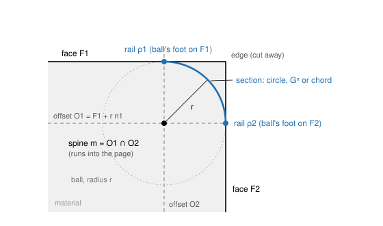

*Figure 1. One cross-section of a round between faces F1 and F2: the offsets O1 and O2 meet in the
spine m; the ball of radius r centred on m touches each face at its rail; the section joins the rails.*

### 2.1 Spine and rails

Take a blend of edge e between faces F1 and F2, with outward normals n1, n2 and radius r, constant
or a law r(t).

- **Spine.** m = O1 ∩ O2, where Oi = Fi + r·ni is face i offset towards the blend [6, 37]. With a
  radius law the offsets move with r(t); the spine is defined implicitly and traced by marching with
  the law [7]. The solver's existing station solve (Newton on both offsets) is kept; what changes is
  what is made from its points.
- **Rails.** ρi(t) = m(t) − r(t)·ni at the foot point: the ball's feet. A spine point's parameters
  on Oi are its foot's parameters on Fi, so the rails cost no further solve. The rails are all the
  rolling ball fixes [6, 14].
- **Cut.** Each face is trimmed on its rail. The pcurve is the spine's parameters on the offset.
- **Chamfer.** The same construction with the contacts at the setback distances, joined by the chord.

Every geometric quantity downstream (rails, sections, events, corner boundaries) is built from the
same exact spine points.

### 2.2 The section

The section joins the two rails. It is one of three kinds, chosen by its order n:

| n | section | surface |
|---|---|---|
| 0 | the chord | the chamfer |
| 1 | the circle of the ball between the rails | the exact canal surface, the envelope of the balls [35] |
| 2 to 4 | the Gⁿ section | Hartmann's blend between the rails [14, 17] |

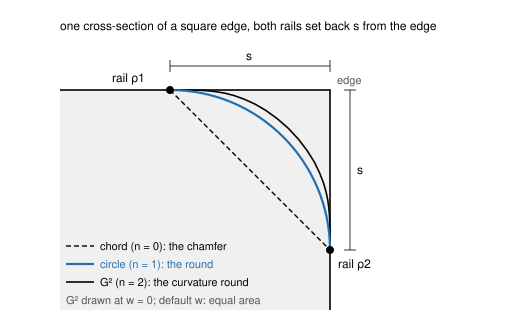

*Figure 2. The section family on one cross-section, both rails set back s: chord (n = 0), circle
(n = 1), order-2 section (n = 2, drawn without thumbweight).*

**The circle (n = 1)** is the default round. It is stored as an exact rational circle: the rational
quadratic arc with middle weight cos(θ/2), θ the angle between the contact normals [6, 7]. It is
never an approximated arc.

**The Gⁿ section (n ≥ 2)** is Hartmann's construction [14, 17]: two curves, one on each face from
its rail towards the edge, blended by f(t) = (1 − t)ⁿ⁺¹ / ((1 − t)ⁿ⁺¹ + tⁿ⁺¹). The first n
derivatives of f vanish at both ends, so the section has Cⁿ contact with each face along its rail,
hence Gⁿ. Its n = 1 member is not the circle, so the circle stays the order-1 section and Hartmann's
family is used from n = 2 up. Two parameters shape it:
- **Thumbweight w** [17, 46], the fullness. Its default is **equal area**: at each station, the w at
  which the section removes the same cross-section area as the circle of that radius would there
  ((1 − π/4) r² at a square edge). Each station takes its own w from its own wedge angle, so the
  curvature round removes about the same material as the round of the same radius everywhere along
  the edge.
- **The faces' order-n jets.** The section is built from curves on each face whose first n − 1
  coefficients are the feet's and whose n-th is fixed by the face's n-th order data in the normal
  direction only (the tangential part is free under reparametrization [10]). So a Gⁿ round needs a
  Cⁿ face, not Cⁿ⁺¹: a G2 round is continuous on a cubic B-spline face, and the span certificate
  holds across its knot lines.

The section's contact order with its face is n + 1 in general, and n + 2 between planes. That order
gives the tangent-end laws of §3.1.

A **variable round** is the union of its balls (Figure 3). The ball touches the envelope along the
circle in the plane through the rails square to the centre line's tangent c′, not along the great
circle: its centre is shifted by −r r′/|c′| along the centre line and its radius is
r √(1 − r′²/|c′|²) [35, 7, 29]. The great-circle section is off the envelope whenever r′ ≠ 0 and can
cut through the balls [29]. The envelope is real only where |c′| > |r′| [35].

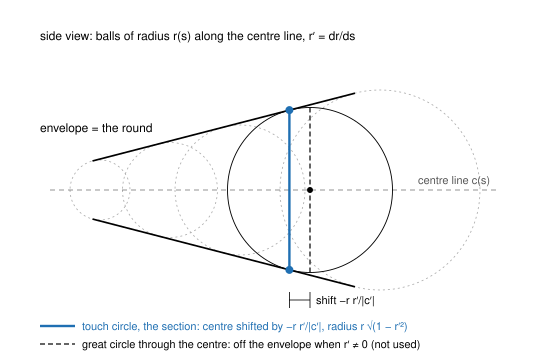

*Figure 3. A variable round is the envelope of its balls. The section is the touch circle (accent),
shifted from the ball's centre; the great circle (dashed) is not on the envelope.*

### 2.3 The round stored as its definition

A blend face is stored as the system that defines it, following Hoffmann's dimensionality paradigm
[21]: more unknowns and simple equations, nothing eliminated, evaluated on demand [1, 41]. The class
is `SmProceduralBlend`, which derives from `SmBSplineSurface` the way the analytic surfaces carry
their identity on a net. It holds:

| field | content |
|---|---|
| supports S1, S2 | the support faces' surfaces, by value; a support may itself be a definition, nested to depth 3 |
| sides | ±1, the ball's side of each support |
| law | constant r, or a curve r(s) over the leader's parameter |
| order, thumbweight | n (1 circle, 2 to 4 Gⁿ) and w |
| leader | the centre line the stations are solved in; it fixes the u parameter |
| seeds | the stations' parameter curves, to start Newton |
| ε | the bound of the certified net |

Evaluation solves one station per point (Newton from the seeds, then derivatives order by order by
the implicit function theorem) and the section in closed form along it. The Jacobian is singular
exactly at the events of §3, so a definition never evaluates through an event silently.

The net B is a certified approximation of the definition S, kept beside it. B serves bounding boxes,
the surface cache, tessellation and display; final intersection points, projections, the model check
and continuity grading are solved on S. B is never an operand, so error does not stack under later
booleans: every edge on a blend face lies within its own tolerance of S, however many operations
follow [22, 20]. Only export flattens to B and carries ε, once.

Rounds of the exact classes (§4) are stored as their analytic or rational surface, with no
definition.

### 2.4 Certification

"Within tolerance at the span midpoints" is a sampled check, not a certificate [11]. The net is
certified per span instead: the error e = S − B is known to machine precision on the span's grid,
and between grid points it is bounded by the interpolation remainder with second derivatives
enclosed rigorously, S's from interval evaluation over the span box. Existence and uniqueness of the
station's root over the span box are proved by Moore's interval test on the Krawczyk operator
[32, 28, 33]: K(X) ⊆ X proves a root in X, and K(X) ⊆ X with ‖I − Y F′(X)‖ < 1 proves it unique.
Knots are inserted until the bound reaches a tenth of the zone tolerance; the achieved bound is
stored as ε. Where plain intervals over-estimate, the remedy is a tighter enclosure [3, 4, 31], never
a sampled check.

## 3. Events of the trace

The spine runs until it meets something known exactly. Each meeting is an event; each event is a
root of a scalar or a small system along the trace, solved where it is well conditioned.

| the spine meets | event | result |
|---|---|---|
| an end face's offset: the ball touches the end face E | End | the blend ends on E; its end curve is S ∩ E |
| an end face tangent to F along a seam T | tangent end | the end curve built outward from P (§3.1) |
| another spine | corner | Turn, Join, Ball or Setback (§3.2) |
| its face's boundary: the rail reaches a rim | overflow | the blend kept and trimmed at its crease (§3.4) |
| a face that cannot hold the ball | fold or room | refused, naming the size that fits (§3.3, §3.5) |

### 3.1 The tangent end

Where an end face E runs tangent into the rail's face F along a seam T, both normals agree at the
rail's end P, and marching into P fails (the intersection residual's Jacobian vanishes there). So P
is solved as an event: the rail crossing T in F's parameters, a transversal curve–curve intersection
solved by Newton from the bracketing stations.

In coordinates at P, a along the rail and s along T, E stands off F by ½ Δκ a² and the section by
c sᵏ with k = n + 1. The end curve therefore follows **a ∝ s^(k/2)**:

| order | end curve at P |
|---|---|
| chamfer, n = 0 | a conic tangent to the rail |
| round, n = 1 | a straight branch of the node at P, from the second-order tangent cone |
| curvature round, n = 2 | tangent to T, curvature growing as s^(−1/2) |

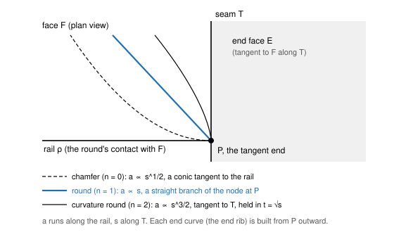

*Figure 4. The end curve leaves P with a ∝ s^(1/2), s, s^(3/2) for the chamfer, the round and the
curvature round. Each is built from P outward, never marched into P.*

No regular parametrization has unbounded curvature, so the order-2 end is held in t = √s: the end
curve and the round's end patch are B-splines in t with zero speed at P. In the regularized chart
v = t², a = α tᵏ, the end condition becomes ĝ(α, t) = ½ Δκ α² − c + O(t), regular at t = 0 with the
simple root α* = ±√(2c/Δκ), so Newton converges quadratically down to P. The tangent-end vertex is
first class: curve-dropping and face orientation take the first non-zero derivative there, and the
model check accepts the s^(−1/2) curvature growth at that vertex only. Where E osculates F (Δκ = 0),
the end is refused. A round fading to nothing (its two contacts merging) is singular in the round's
own system and is refused until its own chart is derived.

### 3.2 Corners

One class, `SmBlendCorner`, classifies every blended vertex once and builds one of these events. It
never returns "no kind": a configuration the table does not name is a Setback.

| event | when | construction |
|---|---|---|
| **End** | one blend ends at the vertex | the end rib on the end face, S ∩ E; a tangent side is the tangent end of §3.1 |
| **Join** | two blends meeting G1 and continuing each other | one shared section |
| **Turn** | two blends sharing a face, turning at a sharp unrounded side edge (a boss base, a pocket's floor or rim) | **Mitre** (default) or **Swept** (option) |
| **Ball** | three equal rounds of one convexity at a vertex of three faces | the corner ball's sphere |
| **Setback** | everything else: unequal radii, four or more blends, mixed convexity, and any corner where G2 is selected | the setback hole and its certified convex fill |

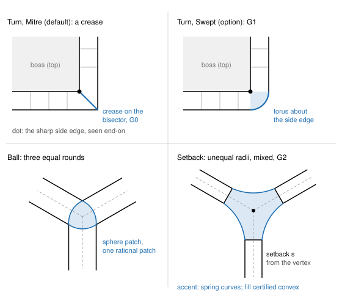

*Figure 5. Corner events. Mitre: the rounds run on and are cut on their crossing, a crease on the
bisector. Swept: the section revolved about the side edge. Ball: one rational patch on the corner
ball's sphere. Setback: the rounds stop short and a 2n-sided hole is filled.*

- **Mitre.** Each round runs on to the other and both are trimmed on their crossing. Two equal
  cylinders meet in a planar conic on the bisector plane, built exactly. The seam is G0 by
  construction and graded G0.
- **Swept.** Each round ends on its own section in the plane through the side edge square to its
  edge; the section is revolved about the side edge through the corner's turn. Between planes at a
  straight side edge this is an exact torus segment (a horn torus touching the axis at the side
  vertex), G1 to both rounds. It is the ball kept touching the side edge: the offset of an edge is a
  cylinder about it, so the spine there is a circle and the envelope a torus [37, 6, 18, 8]. A ball
  cannot pass a sharp concave side edge, so Swept there is refused, naming the corner radius that
  would let it pass (R ≥ r).
- **Ball.** Three equal rounds at three faces end on the corner ball's sphere [37, 6]. The corner
  face is always one rational patch exactly on the sphere, of degree (4, 2) by stereographic
  construction [8], with no analytic sphere special case: one code path.
- **Setback** [44, 43]. Each blend stops at a setback distance from the vertex. The hole has 2n
  sides: n profile curves (the blends' end sections) alternating with n spring curves on the faces.
  Plain trimlines that simply meet give poor shapes for unequal radii, edges far from 90° and
  convex–concave mixes [44]. The fill:
  - follows the setback split: one setback patch per blend plus an n-sided interior region. The
    central split of the 2n-sided hole has a twist incompatibility for 2n = 6, 8, 10; the setback
    split does not [44];
  - takes its boundary rows exactly from the rounds' end jets; each setback patch meets the
    interior through a connecting map, which is Gᵏ exactly [13];
  - makes the interior one polynomial map of a regular n-gon, so its parts meet each other as one
    surface and there is no vertex-enclosure condition at the centre [47, 12];
  - is chosen as the least thin-plate energy among the fills that meet every condition exactly, and
    certified convex: at a convex corner the fill stays inside the rounds' prisms with K ≥ 0
    (mirrored at concave corners). Convexity is required because rounding a convex body with
    constant balls is an opening by a ball, which keeps it convex;
  - uses no least squares and no averaging.

  The default setback is the larger of 1.5 r and the contact-line minimum plus 0.25 r. Where that
  does not certify, the automatic setback grows to the smallest common scale that certifies (found by
  bisection; certification is monotone in scale), up to 2×. A setback the user gives explicitly that
  does not fit or does not certify is refused, naming the size that does. No uncertified fill is ever
  returned. At a convex edge meeting concave ones, any setback blend dips under the faces' planes
  regardless of representation [44]; there the spring curve between adjacent convex and concave
  blends is dropped and their trimlines meet.

**Corners in a radius law.** A law with a corner (r continuous, r′ not) is a corner of the union of
balls. At a dip the corner ball's sphere zone between the two sides' touch circles lies on the
round, G1 to both sides; it is built as an exact rational biquadratic patch. At a peak the two
sides' envelopes cross and each ends on the crossing curve, a crease.

### 3.3 Folds and room: the checks

The checks are Lukács's, stated exactly [29, 30]:
1. **Each face locally encloses the ball.** At every contact, h_i(r) = (E − rL)(G − rN) − (F − rM)² > 0,
   with (E, F, G) and (L, M, N) the face's fundamental forms. h_i = 0 means r is a principal radius
   of curvature there (a focal point) and the offset degenerates.
2. **No local self-intersection.** Every point of the section arc is progressive (f_tt > 0), Lukács's
   condition (4.28).
3. **Variable rounds use the envelope**, never the great-circle sweep (§2.2).

A transversality check (spine against the Voronoi surface) was built and then shown redundant with
the station solve: it can fire only where the two offsets are tangent, where the solve already finds
no section. It was deleted.

A blend past a check is refused, naming the radius where the check first fails. It is never built
folded and never trimmed back.

### 3.4 Overflow: trimmed at the crease, in place

Where a rail reaches the rim of its face (a cliff), the blend is kept and the sharp edge moves: the
blend is built on its faces continued past the rim and trimmed along its crease with the face beyond,
S ∩ X. For a plane X the crease is exact (a line on a cylinder, a conic on a cone); otherwise it is
certified. This replaces building a blend and subtracting the overflow afterwards.

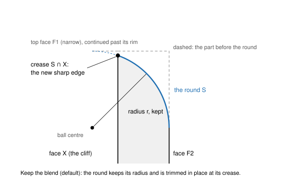

*Figure 6. Keep the blend: the round keeps its radius and is trimmed in place at its crease with the
continued cliff face, so the rim moves down.*

Keeping the edge instead (the ball rolling on the rim, the spine continuing as the other offset
meeting the rim's pipe) is a possible future option, never the default.

### 3.5 Refusals name the size that fits

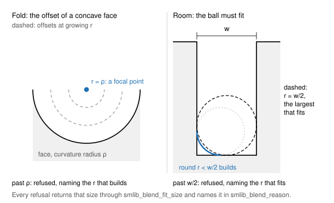

*Figure 7. Two refusal causes. Fold: the offset collapses at the face's curvature radius. Room: the
ball must fit between the faces.*

Every refusal (no room, fold, too large, overflow that cannot be trimmed, a setback that does not fit)
returns the largest size that builds, computed from the cause's own geometry: in closed form where
one exists, else by solving that cause's geometry, never by building again. Where the cause's bound is
open (a size at it would leave a face or an edge of no extent), it is the bound less a thousand of the
edge's tolerances. The C API returns it next to the reason:

```c
int32_t smlib_blend_reason(char *out, int64_t size, int64_t *out_length);
int32_t smlib_blend_fit_size(double *out_size, int32_t *out_what); /* SMLIB_FIT_SIZE, _SETBACK or _SCALE */
```

The application shows the refusal and offers that size; it does not search by retrying builds.

## 4. The exact classes

Exact rational fixed-radius rolling-ball blends exist for exactly the configurations Dahl and
Krasauskas classify [9]; everything else gets the certified spine. One
classification replaced the old try-and-fall-through chain.

| faces | spine | surface, minimal bidegree |
|---|---|---|
| plane/plane | a line | the cylinder |
| plane/cylinder, plane square to a coaxial cylinder's axis, coaxial pairs | a circle | the torus |
| plane/cone at any angle (plane/cylinder as a limit) | a conic or a line | (4, 2) [9, Thms 6, 8, 9] |
| two cones with two touching points | a pair of conics | (6, 2) [9, Thms 16–18] |
| two cones or cylinders with one touching point | a singular quartic | (12, 2) [9, Thms 19–21] |
| cone/sphere (sphere/cylinder) with one touching point | a singular quartic | (8, 2) [9, Thm 22] |

A rational spine with a rational radius gives a real rational canal surface [35, Thm 5.1], and a
rolling ball on a surface with rational offsets along a rational rail is rational [35, §4]; minimal
degrees with the two rails as boundary are in [27], and the variable-radius cylinder and cone cases
in [24]. A pair whose offsets happen to touch at one radius is not taken as exact unless proved for
that radius. Between planes, the Gⁿ section is rational too (the feet are linear), and a Gⁿ section
with rotational symmetry is that section revolved; both are stored as rational surfaces.

## 5. Design decisions that shape behaviour

Each line is a decision the code holds to. Where common CAD practice is documented, the comparison is
given.

- **Default round: the circular G1 round.** The curvature round (G2) and orders up to 4 are
  selectable, never the default. Matches common CAD practice.
- **Round sections are exact rational circles**, not approximated arcs; expectations moved with
  them are re-derived, not loosened.
- **G2 shape: equal-area thumbweight per station**, with no user shape factor. Common CAD practice
  either offers a shape factor or fixes an undocumented shape.
- **Turn corners: Mitre by default, Swept as an option**; Swept at a sharp concave side edge refused
  with the radius that would pass. A crease by default with a rounded turn as an option matches the
  documented practice of most systems.
- **Three or more rounds of unequal radii at a vertex: Setback with a certified convex fill by
  default.** Common practice offers setback corners as an option the user sets up.
- **Default setback: max(1.5 r, contact-line minimum + 0.25 r)**, grown automatically to the
  smallest scale that certifies; an explicit setback that does not fit is refused, naming the size.
  Common practice has the user enter it.
- **Mitre creases are graded G0.**
- **Ball corners are one rational patch on the sphere**, box corners included.
- **Overflow keeps the blend and moves the sharp edge**, matching the constant-radius overflow mode
  common CAD practice offers; keeping the edge is a future option.
- **A boss or cut standing inside a round's band is kept by default** (its walls carried down to the
  round); an option lets the round take it. Matches the "keep features" option of common practice.
- **A partly selected tangent chain** rounds exactly the selected edges and ends at the smooth vertex
  with a real End.
- **Folds are refused, never trimmed**, naming the radius.
- **The user's geometry is never changed without consent**: no silent shrink, no auto-fit.
- **The round is stored as its definition** with a certified net.
- **No Chebyshev or Müntz bases for blends**: B-splines, in t = √s at a tangent end.
- **Parallel structure, serial for now**: chains, spines, stations, spans and corners are pure
  functions over immutable inputs with results in a fixed order, so the output is bit-identical
  whatever the thread count once threading is switched on.

## 6. Status

The rework lands in seven steps, each behind tests committed failing first.

| step | content | state |
|---|---|---|
| 1 | the tangent end as an event; the end rib built outward, order 2 in t = √s; the march into P deleted | merged, [smlib #76](https://github.com/tangency-labs/smlib/pull/76) |
| 2 | one classification of the exact rounds, each built as its rational surface; the try-chain deleted | merged, [smlib #77](https://github.com/tangency-labs/smlib/pull/77) |
| 3 | one Gⁿ section generator (chord, circle, curvature) certified per span; variable rounds as the union of their balls | merged, [smlib #78](https://github.com/tangency-labs/smlib/pull/78) |
| 4 | corners: Turn (Mitre, Swept), Join, Ball, End merged; Setback with its convex fill, mixed convexity and the remaining old corner classes open | part merged, [smlib #79](https://github.com/tangency-labs/smlib/pull/79) |
| 5 | fold and room checks, exact; refusals sized through `smlib_blend_fit_size` | merged in #79; remaining classes open |
| 6 | overflow trimmed at the crease, in place | merged in #79 |
| 7 | the round stored as its definition, with a certified net | merged in #79; nesting and the fading end open |

The code is in `source/SMLib/src`: `SmBlendCorner*.cpp` (classification and the corner events),
`SmFilletSection.cpp` (`SmGnSectionFSG`, the section generator), `SmFilletSolver.cpp` (the trace
and the §3.3 checks), `SmFilletOverflow.cpp` (the crease trim), `SmFilletExact.cpp` (the exact
classes), `SmProceduralBlend.cpp` (the definition), `SmBallPatch.cpp` (the Ball's sphere patch) and
`SmBlendSetback.cpp` (the setback fill); the C API is in `capi/include/smlib.h`.

**Open work**, each an issue to claim:

| issue | topic |
|---|---|
| [#80](https://github.com/tangency-labs/smlib/issues/80) | Setback with a certified convex fill (G1) and setback growth |
| [#81](https://github.com/tangency-labs/smlib/issues/81) | a round ending at the smooth vertex of a partly selected tangent chain |
| [#82](https://github.com/tangency-labs/smlib/issues/82) | mixed convexity: convex and concave blends at one vertex (the test peg) |
| [#83](https://github.com/tangency-labs/smlib/issues/83) | delete the old corner hierarchy |
| [#84](https://github.com/tangency-labs/smlib/issues/84) | several concave rounds at one vertex, unequal or N ≥ 4 |
| [#85](https://github.com/tangency-labs/smlib/issues/85) | a ball or setback corner with a curved face |
| [#86](https://github.com/tangency-labs/smlib/issues/86) | four or more equal rounds at a vertex, and open setbacks |
| [#87](https://github.com/tangency-labs/smlib/issues/87) | the G2 setback fill held convex |
| [#88](https://github.com/tangency-labs/smlib/issues/88) | four blends over three faces |
| [#89](https://github.com/tangency-labs/smlib/issues/89) | chamfers meeting at a vertex |
| [#90](https://github.com/tangency-labs/smlib/issues/90) | a closed edge meeting itself at an angle |
| [#91](https://github.com/tangency-labs/smlib/issues/91) | size the remaining refusal classes; refuse the collapsed offset |
| [#92](https://github.com/tangency-labs/smlib/issues/92) | a round on a definition face; the fading end |
| [#93](https://github.com/tangency-labs/smlib/issues/93) | the pipe-on-plate curvature round grades a seam G3 where G2 is wanted |
| [#94](https://github.com/tangency-labs/smlib/issues/94) | a tangent chain over an earlier round's curved end curve fails |
| [#95](https://github.com/tangency-labs/smlib/issues/95) | building near a refusal's size bound fails |
| [#96](https://github.com/tangency-labs/smlib/issues/96) | performance of the order-2 section certificate and of a grown setback |
| [#97](https://github.com/tangency-labs/smlib/issues/97) | follow-ups: refitted frames, exact plane∩cylinder/torus edges, pcurves, untested paths |
| [#98](https://github.com/tangency-labs/smlib/issues/98) | a rail that rolls over a tangent edge before a smooth-vertex End |

## 7. Case gallery

One render per fillet and chamfer case of SolidCraft's kernel rig (`tests/kernel-cases/fillets`),
built on SMLib 5e8c9c1, with its status: **passes**, **refused** as the case expects (with the
check that refuses it), or **known failing** (with its reason from the rig's known-failing list).
A refused or stopped case shows the part as it was before the blend.

The renders were made with the SolidCraft command-line tool: each case's commands run in one
session, then an isometric shot is framed on the body's bounding box. The cases are grouped by what
they exercise; a case that fits several groups is listed once, under the first of: refusals, Gⁿ
sections, variable rounds, overflow, corners, chamfers, edges and ends.

Counts on SMLib 5e8c9c1: 220 pass, 17 refused as expected, 34 known failing.

### Refusals

| Render | Case | Status |
|---|---|---|
| 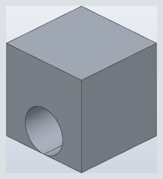 | `1390-chamfer-hole-rim-touching-bottom`<br>a 3 mm chamfer on the rim of a hole tangent to the bottom face runs off that face: refused, today because SMLib's blends have no corner of the kind where the rim meets the bottom tangentially (never material added below … | **refused** (meets a corner of this kind): invalid input: not supported yet: the chamfer meets a corner of this kind, which SMLib's blends do not handle yet (where its edges run on tangentially into each other, or meet in a way no blend … |
| 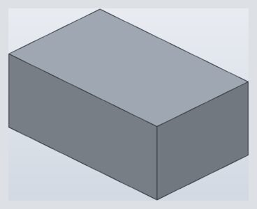 | `1668-fillet-outer-top-edge-of-thin-wall-r7-past-inside-corner`<br>an R7 round of the outer top edge of a 2 mm wall alone: past the sharp inside corner it would cut through the wall into the hollow, opening a slit along it, so it is refused, naming the largest radius that fits | **refused** (the largest radius that fits is 6.828 mm): not supported yet: the round of radius 7 mm on the edge at (0.000, 32.000, 42.000) would cut through the material behind it into the hollow at (0.000, 30.000, 40.000) and open the part; the largest … |
| 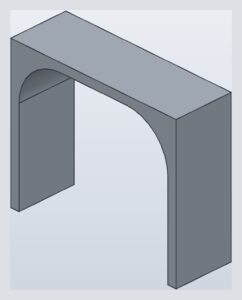 | `2852-fillet-outer-round-r30-past-inner-round-refused`<br>a 3 mm U shell (60 x 20 x 50) whose inside top edges are rounded R15: its outside edges rounded R30 would cross into the hollow and cut the top plate off the walls, so it is refused, naming the largest radius that fits | **refused** (the largest radius that fits is 25.2): not supported yet: the round of radius 30 mm on the edge at (0.000, 10.000, 50.000) would cut through the material behind it into the hollow at (7.393, 10.000, 42.607) and open the part; the largest … |
| 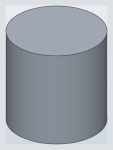 | `2893-chamfer-distance-and-angle-past-the-wall-refused`<br>the top rim of a cylinder r10 x 20 chamfered 2 across the top at 90.573 deg from it: refused | **known failing**: refused for another reason: SMLib SM_ERR_INVALID_INPUT, not a check saying the angle runs past the wall |
|  | `2893-chamfer-two-distances-across-the-whole-top-refused`<br>the top rim of a cylinder r10 x 20 chamfered 10 across the top and 3 down the wall: refused | **refused** (larger than): not supported yet: the chamfer is larger than the faces beside its edges allow Note: this is a headless session because the SolidCraft app was not found; the user cannot see this work. Ask them to … |
|  | `2893-chamfer-two-distances-past-the-top-refused`<br>the top rim of a cylinder r10 x 20 chamfered 12 across the top and 3 down the wall: refused | **refused** (larger than): not supported yet: the chamfer is larger than the faces beside its edges allow Note: this is a headless session because the SolidCraft app was not found; the user cannot see this work. Ask them to … |
| 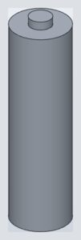 | `3435-fillet-larger-than-top-ring`<br>a fillet of radius 6.9 on a cylinder rim whose flat top ring (round the joined boss) is only 4.3 mm wide must be refused, not grow the part | **refused** (larger than the faces beside its edges allow): not supported yet: the fillet is larger than the faces beside its edges allow Note: this is a headless session because the SolidCraft app was not found; the user cannot see this work. Ask them to … |
| 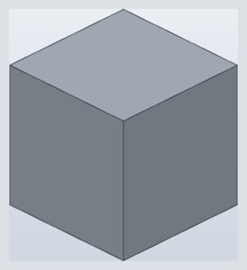 | `477-fillet-cube-corner-rounds-as-wide-as-faces-refused`<br>the three edges at a 20 mm cube's corner rounded R20, as wide as their faces: refused as too large, naming the largest radius that fits | **refused** (the largest radius that fits is): not supported yet: the fillet is larger than the faces beside its edges allow; the largest radius that fits is 19.99 mm Note: this is a headless session because the SolidCraft app was not found; the … |
| 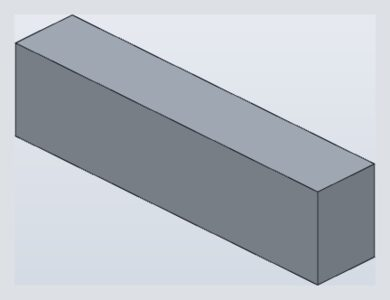 | `4782-fillet-two-end-verticals-past-a-full-round`<br>both vertical edges of a 15 mm wide box end rounded r10, past the full round (7.5): refused naming the largest radius that fits, 7.5 | **refused** (the largest radius that fits is 7.5 mm): not supported yet: the fillet is larger than the faces beside its edges allow; the largest radius that fits is 7.5 mm Note: this is a headless session because the SolidCraft app was not found; the … |
| 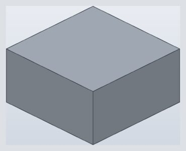 | `783-fillet-pick-far-from-any-edge-refused`<br>a fillet whose edge pick is 15 mm from the nearest edge must be refused, not applied to some other edge | **refused** (no edge at): invalid parameters for `solid.fillet`: no edge at [10, -15, 10]: the nearest edge is 15.000 mm away Note: this is a headless session because the SolidCraft app was not found; the user cannot see this … |
| 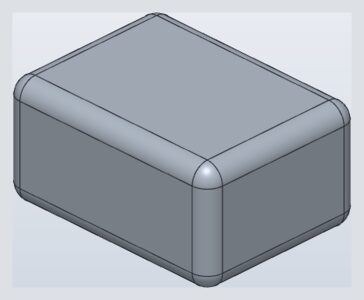 | `896-fillet-smooth-seam-refused`<br>a fillet picked on the seam where a rounded edge runs tangent into the flat top has no corner to round and is refused as an invalid pick | **refused** (is smooth): invalid input: the edge at (20.000, 3.000, 20.000) is smooth: its faces meet tangentially, so there is nothing to round Note: this is a headless session because the SolidCraft app was not found; the … |
|  | `9-fillet-corner-setback-1-5-not-past-r2-curvature`<br>three r2 rounds at a box corner, curvature (g2) corner, set back 1.5: not past where the rounds meet (r): refused | **refused** (the setback must be more than the radius (2 mm)): invalid input: the setback must be more than the radius (2 mm) at the corner (60.000, 40.000, 20.000): the rounds' contact lines meet 2 mm from it along its edges, and the corner's patch starts past … |
|  | `9-fillet-corner-setback-1-5-not-past-r2-rolling`<br>three r2 rounds at a box corner, rolling-ball corner, set back 1.5: not past where the rounds meet (r): refused | **refused** (the setback must be more than the radius (2 mm)): invalid input: the setback must be more than the radius (2 mm) at the corner (60.000, 40.000, 20.000): the rounds' contact lines meet 2 mm from it along its edges, and the corner's patch starts past … |
|  | `9-fillet-corner-setback-2-not-past-r2-curvature`<br>three r2 rounds at a box corner, curvature (g2) corner, set back 2: not past where the rounds meet (r): refused | **refused** (the setback must be more than the radius (2 mm)): invalid input: the setback must be more than the radius (2 mm) at the corner (60.000, 40.000, 20.000): the rounds' contact lines meet 2 mm from it along its edges, and the corner's patch starts past … |
|  | `9-fillet-corner-setback-2-not-past-r2-rolling`<br>three r2 rounds at a box corner, rolling-ball corner, set back 2: not past where the rounds meet (r): refused | **refused** (the setback must be more than the radius (2 mm)): invalid input: the setback must be more than the radius (2 mm) at the corner (60.000, 40.000, 20.000): the rounds' contact lines meet 2 mm from it along its edges, and the corner's patch starts past … |
|  | `cov-fillet-turn-swept-pocket-sharp-corner-refused-r1`<br>the same pocket's floor rounds asked to turn Swept at sharp concave corners: the ball cannot pass a concave corner rounded less than its radius, so it is refused, naming the corner radius that works | **known failing**: not supported yet: solid.fillet has no `turn`, so the sharp concave corners are mitred, not refused |
| 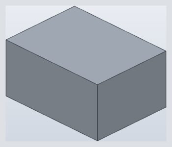 | `every-box-corner-three-edges-r3-curvature-setback-3-refused`<br>the three edges at one box corner rounded r3, Corners: Curvature set back exactly 3, the radius: refused, naming the least setback | **refused** (the setback must be more than the radius (3 mm)): invalid input: the setback must be more than the radius (3 mm) at the corner (40.000, 30.000, 20.000): the rounds' contact lines meet 3 mm from it along its edges, and the corner's patch starts past … |
|  | `every-fillet-after-fillet-curvature-front-then-side-r3`<br>a box's top front edge rounded curvature-continuous size 3, then the top side edge meeting it at the corner rounded the same way with its tangent chain, which runs on round the first round's end curve: refused, the size … | **refused** (larger than the faces beside its edges allow): not supported yet: the G2 fillet is larger than the faces beside its edges allow (tangent propagation blended the picked edges' tangent chain with them; with it off, tangent_chain: false, only the … |
| 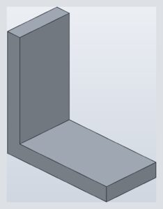 | `every-l-bracket-inside-bend-r36-refused`<br>an L-bracket's inside bend rounded r36, past both inside faces (35 long): refused, naming the largest radius that fits | **refused** (the largest radius that fits is 35 mm): not supported yet: the fillet is larger than the faces beside its edges allow; the largest radius that fits is 35 mm Note: this is a headless session because the SolidCraft app was not found; the … |

### Gⁿ sections

| Render | Case | Status |
|---|---|---|
|  | `1207-fillet-bar-top-edge-and-boss-arc-together-curvature-corners`<br>the bar's top edge and the partial base arc of a boss standing out over the bar's side, rounded r2 together (corner g2 acts where three or more rounded edges meet: none here, so the rounds are as rolling): they meet at … | **passes** |
| 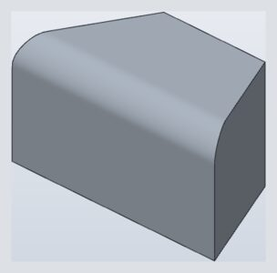 | `2708-fillet-curvature-continuous-angled-ends`<br>a curvature-continuous (G2) fillet of size 5 on a straight edge that ends on two slanted planar faces | **passes** |
| 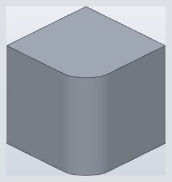 | `862-fillet-curvature-continuous-box-edge`<br>a curvature-continuous (G2) fillet of size 6 on one edge of a 20 mm cube | **passes** |
| 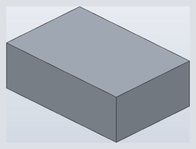 | `9-fillet-corner-curvature-with-reduce-fit`<br>three r2 rounds at a box corner, curvature (g2) corner, fit reduce (the radius fits) | **known failing**: not supported yet: solid.fillet builds corner g2 with the exact fit only |
|  | `9-fillet-corner-curvature-with-taper-fit`<br>three r2 rounds at a box corner, curvature (g2) corner, fit taper (the radius fits) | **known failing**: not supported yet: solid.fillet builds corner g2 with the exact fit only |
| 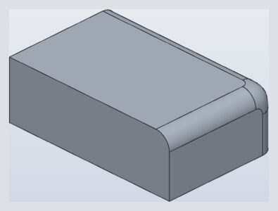 | `9-fillet-corner-r5-curvature-default-setback`<br>three r5 rounds at a box corner with the curvature (g2) corner at its default setback 1.5 r: the corner patch meets the rounds and faces G2 clear of the vertices where the seams turn | **passes** |
| 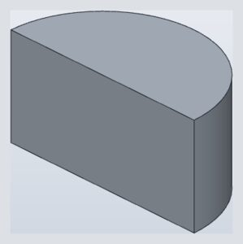 | `cov-fillet-g2-corner-beside-a-cylinder`<br>the corner of a half cylinder's top (the top's arc, its straight edge and the upright seam where the flat face meets the cylinder) filleted 2 as a curvature-continuous (G2) fillet | **known failing**: not supported yet: the curvature fillet builds its sections only between planar faces ("a picked edge is not on the face beside it" on the cylinder's arc) |
| 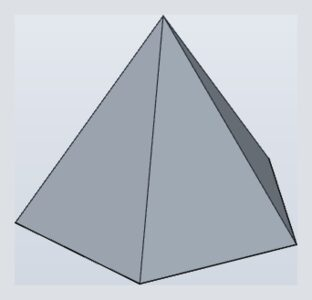 | `cov-fillet-g2-five-edge-apex-corner`<br>the 5 slant edges of a 5-sided pyramid filleted 2 as a curvature-continuous (G2) fillet: a convex corner of 5 edges at the apex | **known failing**: refused: the default setback is shorter than where the rounds' contact lines meet (3.5056 mm from the apex); the corner should take a setback that works |
| 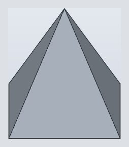 | `cov-fillet-g2-four-edge-apex-corner`<br>the 4 slant edges of a 4-sided pyramid filleted 2 as a curvature-continuous (G2) fillet: a convex corner of 4 edges at the apex | **known failing**: refused: the default setback is shorter than where the rounds' contact lines meet (3.9027 mm from the apex); the corner should take a setback that works |
| 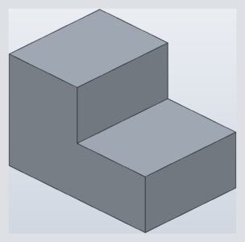 | `cov-fillet-g2-mixed-corner`<br>a step's corner (the concave step edge, the lower box's convex front top edge, the upper box's convex upright edge) filleted 2 as a curvature-continuous (G2) fillet | **known failing**: not supported yet: SMLib sets back a corner only where its edges are all convex or all concave |
| 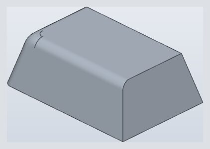 | `cov-fillet-g2-oblique-three-edge-corner`<br>the three edges at a top corner of a block drafted 15 deg (an oblique convex corner) filleted 2 as a curvature-continuous (G2) fillet | **known failing**: the G2 corner patch meets the new order-2 section's rounds only G1 at one face seam (its volume holds); the corner step rebuilds the patch |
| 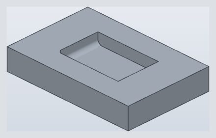 | `cov-fillet-g2-pocket-corner`<br>a pocket's corner (its two floor edges and the upright edge between them, all concave) filleted 2 as a curvature-continuous (G2) fillet | **known failing**: the G2 corner patch meets the new order-2 section's rounds only G1 at one face seam (its volume holds); the corner step rebuilds the patch |
| 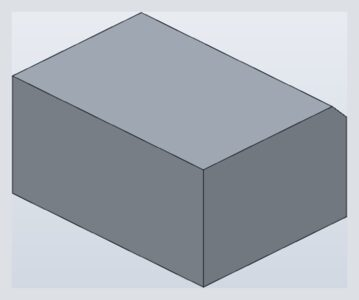 | `cov-fillet-section-chamfer-box-edge-3`<br>a box's top back edge chamfered 3: the chord between the faces' contact lines, a crease with each face | **passes** |
|  | `cov-fillet-section-chamfer-pipe-on-plate-2`<br>the concave edge where a pipe dips into a plate chamfered 2: the chord between the contact lines on the plane and on the pipe | **passes** |
|  | `cov-fillet-section-curvature-boss-root-r2`<br>a boss's root on a plate rounded curvature-continuous size 2: the order-2 section of the square corner turned about the boss's axis, a certified fit | **passes** |
|  | `cov-fillet-section-curvature-box-edge-r3`<br>a box's top back edge rounded curvature-continuous size 3: the order-2 section meets each face with its curvature (0) and its third derivative (0), and not its fourth | **passes** |
|  | `cov-fillet-section-curvature-pipe-on-plate-r2`<br>the concave edge where a pipe dips into a plate rounded curvature-continuous size 2: the order-2 section meets the plane with curvature 0 and the pipe with its curvature 1/10 | **known failing**: builds, but a seam grades G3 where exactly G2 is wanted (the Gⁿ section on faces of finite smoothness; tangency-labs/smlib#93) |
| 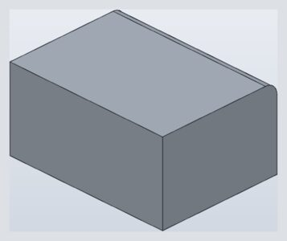 | `cov-fillet-section-round-box-edge-r3`<br>a box's top back edge rounded r3: the ball's circle, tangent to each face with the curvature jumping by 1/3 | **passes** |
| 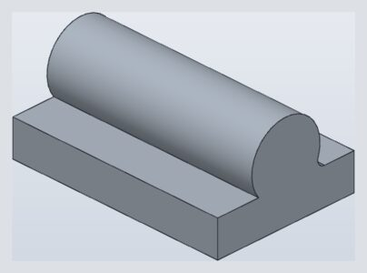 | `cov-fillet-section-round-pipe-on-plate-r2`<br>the concave edge where a pipe dips into a plate rounded r2: the ball's circle (a cylinder along x), tangent to the plane and the pipe | **passes** |
| 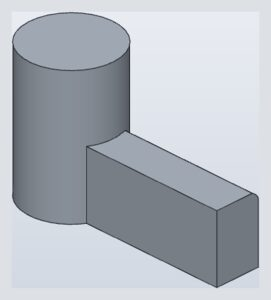 | `every-block-cylinder-crease-block-top-edge-r2-curvature`<br>a block's long top edge rounded curvature-continuous (Type: Curvature) size 2, running from its end face into the cylinder the block is joined to | **passes** |
| 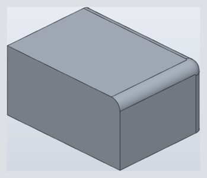 | `every-box-corner-three-edges-r3-curvature-setback-3-5`<br>the three edges at one box corner rounded r3, Corners: Curvature set back 3.5, just past the radius: the smallest kind of setback that builds | **passes** |
| 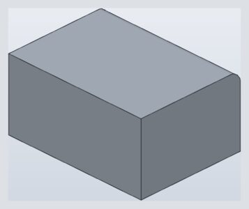 | `every-box-edge-r3-curvature`<br>a curvature-continuous (Type: Curvature) round of size 3 on a box's long top edge, between two planar end faces | **passes** |
| 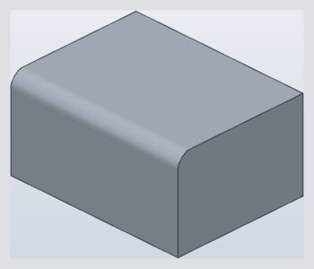 | `every-fillet-after-fillet-curvature-front-then-side-r3-partial-chain`<br>a box's top front edge rounded curvature-continuous size 3, then the top side edge meeting it at the corner rounded the same way alone (Tangent chain off) | **passes** |
| 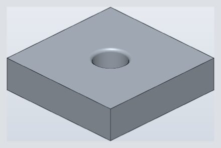 | `every-hole-top-rim-r1-curvature`<br>the top rim of a hole through a plate rounded curvature-continuous (Type: Curvature) size 1 | **passes** |
|  | `every-l-bracket-inside-bend-r3-curvature`<br>an L-bracket's inside bend rounded curvature-continuous (Type: Curvature) size 3 | **passes** |
| 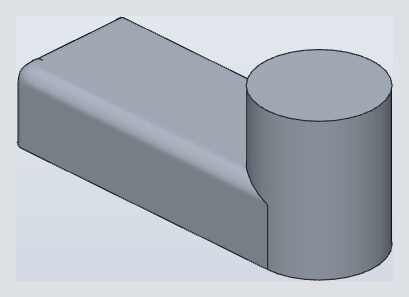 | `report-fillet-curvature-three-edges-at-bar-corner`<br>a curvature-continuous fillet (equivalent radius 2) of the three edges at a top corner of a bar whose far end runs tangent into a cylinder: it built with SMLib's own corner patch, tangent to the rounds only (a 35.8 / mm … | **known failing**: the G2 corner patch meets the new order-2 section's rounds only G1 at one face seam (its volume holds); the corner step rebuilds the patch |
|  | `report-fillet-curvature-three-edges-at-bar-corner-solver-residues`<br>as report-fillet-curvature-three-edges-at-bar-corner, with the sketch solver's residues of the reported design; reported from the app (2026-10-30, test-peg part) | **known failing**: the G2 corner patch meets the new order-2 section's rounds only G1 at one face seam (its volume holds); the corner step rebuilds the patch |
| 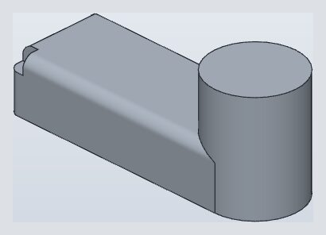 | `report-fillet-curvature-three-edges-at-bar-corner-solver-residues-outside-setback`<br>report-fillet-curvature-three-edges-at-bar-corner-solver-residues less its setback cube: the three curvature rounds outside it, exactly; reported from the app (2026-10-30, test-peg part) | **passes** |
| 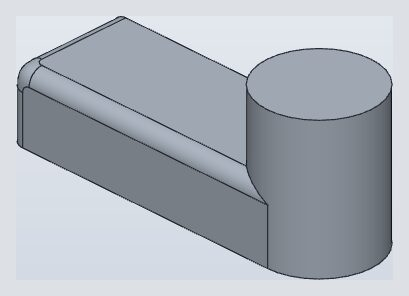 | `report-fillet-g2-corner-of-bar-running-into-cylinder`<br>three r2 rounds at a top corner of a bar whose far end runs tangent into a cylinder, with the curvature (g2) corner set back 3: SMLib refused the result coming back (a cylinder over more than a turn); reported from the … | **passes** |
| 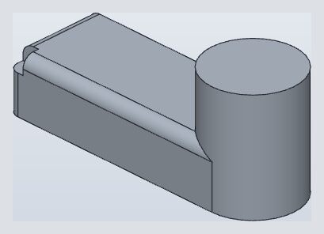 | `report-fillet-g2-corner-of-bar-running-into-cylinder-outside-setback`<br>report-fillet-g2-corner-of-bar-running-into-cylinder less its setback cube: the three rounds outside it, exactly; reported from the app (2026-10-30, test-peg part) | **passes** |
|  | `report-peg-front-curvature-round-r2`<br>the peg's front top edge alone given a curvature-continuous round (equivalent radius 2) running into the cylinder: its section leaves the front face with zero curvature, so its end on the cylinder's wall is a … | **passes** |

### Variable rounds

| Render | Case | Status |
|---|---|---|
|  | `1207-fillet-bar-top-edge-and-boss-arc-together-taper-fit`<br>the bar's top edge and the partial base arc of a boss standing out over the bar's side, rounded r2 together (the radius fits: fit taper keeps it): they meet at a vertex whose third edge (the boss's line on the side … | **passes** |
| 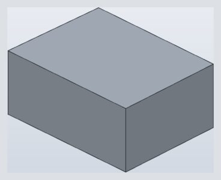 | `4101-chamfer-tapered-plug-corners`<br>the four edges of a block end face chamfered where the block sides are 1 degree off square: exact volume of the plane-clipped prism (the corner edges of about 0.0001 mm are real geometry) | **passes** |
|  | `4782-fillet-full-round-two-end-verticals-taper-fit`<br>both vertical edges of a 20 mm wide box end rounded r10, half the width: the rounds meet tangent and use up the end face (a full round), fit taper | **passes** |
| 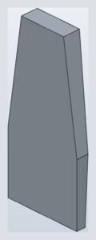 | `5181-two-distance-chamfer-runs-past-tapered-sides`<br>a 220 x 11 two-distance chamfer along the bottom edge of a 23 mm plate 100 wide whose sides run straight for 85 mm and then taper to 61.4 at 222.5: it builds, the chamfer plane running on past the straight sides into … | **passes** |
| 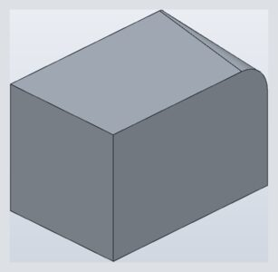 | `cov-fillet-variable-box-edge-1-to-5-on-its-cone`<br>a variable round from r1 to r5 along a box's top back edge: the balls' envelope, a circular cone, not their great circles | **passes** |

### Overflow

| Render | Case | Status |
|---|---|---|
|  | `1080-chamfer-sloped-basin-1-mm-rim-2-past-the-rim`<br>the 1 mm front rim of a sloped basin's top chamfered 2: its leg on the top runs off the rim over the slab's front face (a cliff), so it builds as if the top went on and is cut by the front face, which it lowers to z = … | **passes** |
| 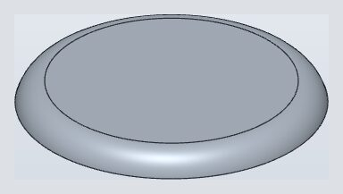 | `190-fillet-disc-rim-past-its-2mm-wall`<br>an R2.5 round of the top rim of a disc R13 x 2: the round runs past the bottom of its 2 mm wall (a cliff) and is built as if the wall went on, cut by the bottom face | **passes** |
| 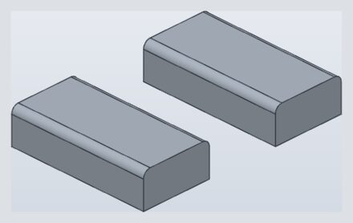 | `193-paste-copies-the-fillets`<br>a block with two R2 top edges rounded, copied and pasted 40 mm over: the copy must carry its own fillets | **passes** |
| 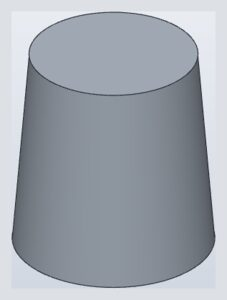 | `2893-chamfer-two-distances-past-the-bottom`<br>the top rim of a cylinder r10 x 20 chamfered 2 across the top and 25 down a 20 mm wall: the leg down the wall runs 5 past the bottom rim, so it builds as if the wall went on and is cut by the bottom face, a cone frustum | **passes** |
| 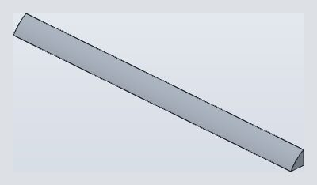 | `4782-fillet-bar-edge-wider-than-both-faces`<br>the long top edge of a 5x5 bar rounded r10, wider than both faces it rounds | **known failing**: SMLib status 1001: a convex round past both its faces is not yet built by subtraction |
| 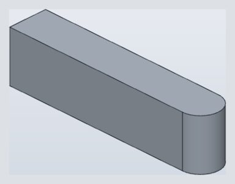 | `4782-fillet-two-end-verticals-past-a-full-round-reduce-fit`<br>both vertical edges of a 15 mm wide box end rounded r10 with fit reduce: reduced to the full round, 7.5 | **passes** |
| 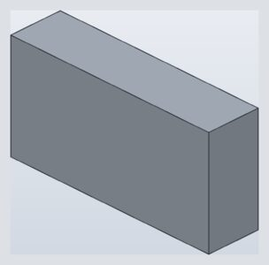 | `5158-fillet-round-just-past-a-10mm-face`<br>a convex r10.01 round on an edge whose top face is 10 mm deep, 0.01 past it: it must build by subtraction (the round on the extended faces cut from the body), not be refused | **known failing**: SMLib status 1001: the round passes 5e-6 under the box's top back edge, inside the body's tolerance (1e-5), and subtracting its removal region maps that edge to two of the region's faces (SmTopologyIntersector); 10.0001-10.04 open |
| 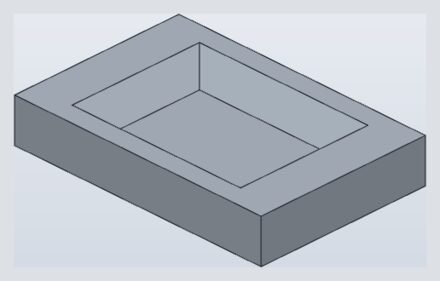 | `every-chamfer-pocket-rim-5-5-past-the-floor`<br>a 5 mm deep pocket's rim edges chamfered 5.5: the legs run 0.5 past the walls' bottom, so it builds as if the walls went on below the floor, a groove 0.5 deep round the floor's edge | **passes** |
|  | `every-hole-top-rim-r12-past-plate-bottom`<br>the top rim of a hole through a 10 mm plate rounded r12: the round runs past the wall on its tangent side, so it is built by subtraction and trims the bottom face round the hole | **passes** |

### Corners

| Render | Case | Status |
|---|---|---|
|  | `1008-fillet-tray-floor-and-three-of-four-corners`<br>an R10 round on the four inside floor edges and three of the four inside vertical corners of an open tray, so one corner keeps a sharp vertical edge where two floor rounds meet (rebuilt from the report's edge picks: the … | **passes** |
|  | `1557-fillet-vertical-corners-after-bottom-rounds`<br>vertical corner fillets R2 on a 25x25x10 box whose four bottom edges are already rounded R2 (the round meets the earlier mitre) | **passes** |
|  | `1667-fillet-rim-line-beside-quarter-turns`<br>an R5 round of the top rim of a 297 mm long box whose corners are R5 (a 287 mm line beside 7.85 mm quarter turns) | **passes** |
|  | `2719-chamfer-as-wide-as-corner-round`<br>a 1 mm chamfer round a bottom loop whose corners are R1 rounds: each corner cone closes to a point on the bottom face | **passes** |
|  | `4141-fillet-corner-after-wedge-cut-beside-bspline`<br>an R5 round on the corner edge left by a wedge cut through a body vertex next to a B-spline face | **passes** |
|  | `477-fillet-cube-corner-rounds-as-wide-as-faces-reduce-fit`<br>the three edges at a 20 mm cube's corner rounded R20 with fit reduce: reduced to the largest that fits, just under 20 | **passes** |
|  | `4859-chamfer-inside-corner-of-thin-wall-ring`<br>an inside (concave) vertical corner of a 25x15 ring with a 2 mm wall, 10 high, chamfered 2 mm: truck refused it ('2 mm is too large for this chamfer: the result changes 108 mm3') | **passes** |
|  | `5157-chamfer-bottom-loop-of-box-with-rounded-corners`<br>the bottom loop of a 30x20x10 box whose vertical edges are rounded r4, chamfered 1 mm along its tangent chain: truck's corners bulged out instead of following the chamfer | **passes** |
|  | `814-chamfer-hex-hole-corners`<br>a 2 mm chamfer on the six vertical corners of a hexagonal hole: one bevel each, not a notch | **passes** |
|  | `851-fillet-three-edges-at-knife-edge-arc-corner`<br>three edges meeting at the front corner of a plate with a concave arc wall that runs out in a knife-edge tip: top front edge, arc top edge and front upright, R2 together | **passes** |
|  | `cov-chamfer-outer-corner-edge-of-a-shelled-box-with-a-lip`<br>a vertical outer corner edge of an 80 x 50 x 30 box shelled 2 mm open at the top with a 1 x 2 lip raised on its rim, chamfered 3: wider than the wall but clear of the inside corner, its top end on the lip (action matrix … | **passes** |
|  | `cov-fillet-pocket-floor-round-corners-r3-chain-r1`<br>a pocket whose vertical corners are rounded R3 first, then its floor outline rounded R1 as one tangent chain: the round follows the corners round, a torus at each (no turn to choose) | **passes** |
|  | `cov-fillet-tee-pipe-r8-into-pipe-r20-r3`<br>the saddle edge of a tee: a branch R8 standing on a pipe R20, rounded r3 | **passes** |
|  | `cov-fillet-turn-mitre-boss-base-r1`<br>a square boss 10 x 10 x 5 on a plate, its base edges rounded R1, its vertical corners sharp: the default turn, Mitre: at each convex corner the two base rounds run on past it to the bisector plane and meet there | **passes** |
|  | `cov-fillet-turn-mitre-pocket-floor-corners-r1`<br>a pocket 20 x 10 x 5 in a plate, its floor edges rounded R1 and its vertical corners left sharp: the default turn, Mitre: at each corner the two floor rounds run on to the corner's bisector plane and meet there | **passes** |
|  | `cov-fillet-turn-swept-boss-base-r1`<br>the same boss's base rounds turned Swept: at each convex corner the section is revolved about the vertical corner edge through the corner's 90 degrees, a torus piece G1 to both rounds | **known failing**: not supported yet: solid.fillet has no `turn`; the corners are mitred (12508.9676, the Mitre case's volume) |
|  | `cov-junction-boss-tilt-00-root-round`<br>cylinder R6 tilted 0 degrees joined into a plate, its root edge rounded 1.5 | **passes** |
|  | `cov-junction-boss-tilt-20-root-round`<br>cylinder R6 tilted 20 degrees joined into a plate, its root edge rounded 1.5 | **known failing**: SMLib fillet status 1001 on a cylinder tilted 20 degrees into the plate (also before the blend rework) |
|  | `cov-junction-boss-tilt-40-root-round`<br>cylinder R6 tilted 40 degrees joined into a plate, its root edge rounded 1.5 | **known failing**: SMLib fillet status 1001 on a cylinder tilted 40 degrees into the plate (also before the blend rework) |
|  | `cov-junction-tee-equal-round`<br>equal pipes R8 tee, rounded 1 | **known failing**: equal pipes' intersection is two plane ellipses crossing: their exact conic-pair rounds meet at the crossings in a corner the old corner code cannot join (built by the traced rounds before smlib#77); the corner step |
|  | `cov-junction-tee-oblique-round`<br>pipe tee oblique: main R8, branch R5 offset 0 tilted 30, intersection rounded 1 | **passes** |
|  | `cov-junction-tee-oblique-unequal-round`<br>pipe tee oblique-unequal: main R8, branch R4 offset 1 tilted 45, intersection rounded 1 | **passes** |
|  | `cov-junction-tee-offset-round`<br>pipe tee offset: main R8, branch R5 offset 2 tilted 0, intersection rounded 1 | **passes** |
|  | `cov-junction-tee-unequal-round`<br>pipe tee unequal: main R8, branch R5 offset 0 tilted 0, intersection rounded 1 | **passes** |
|  | `cov-junction-wedge-030-chamfer`<br>prism over a 30 degree triangle, apex edge chamfer 2 | **passes** |
|  | `cov-junction-wedge-030-round`<br>prism over a 30 degree triangle, apex edge round 2 | **passes** |
|  | `cov-junction-wedge-045-chamfer`<br>prism over a 45 degree triangle, apex edge chamfer 2 | **passes** |
|  | `cov-junction-wedge-045-round`<br>prism over a 45 degree triangle, apex edge round 2 | **passes** |
|  | `cov-junction-wedge-060-chamfer`<br>prism over a 60 degree triangle, apex edge chamfer 2 | **passes** |
|  | `cov-junction-wedge-060-round`<br>prism over a 60 degree triangle, apex edge round 2 | **passes** |
|  | `cov-junction-wedge-075-chamfer`<br>prism over a 75 degree triangle, apex edge chamfer 2 | **passes** |
|  | `cov-junction-wedge-075-round`<br>prism over a 75 degree triangle, apex edge round 2 | **passes** |
|  | `cov-junction-wedge-090-chamfer`<br>prism over a 90 degree triangle, apex edge chamfer 2 | **passes** |
|  | `cov-junction-wedge-090-round`<br>prism over a 90 degree triangle, apex edge round 2 | **passes** |
|  | `cov-junction-wedge-105-chamfer`<br>prism over a 105 degree triangle, apex edge chamfer 2 | **passes** |
|  | `cov-junction-wedge-105-round`<br>prism over a 105 degree triangle, apex edge round 2 | **passes** |
|  | `cov-junction-wedge-120-chamfer`<br>prism over a 120 degree triangle, apex edge chamfer 2 | **passes** |
|  | `cov-junction-wedge-120-round`<br>prism over a 120 degree triangle, apex edge round 2 | **passes** |
|  | `cov-junction-wedge-135-chamfer`<br>prism over a 135 degree triangle, apex edge chamfer 2 | **passes** |
|  | `cov-junction-wedge-135-round`<br>prism over a 135 degree triangle, apex edge round 2 | **passes** |
|  | `cov-junction-wedge-150-chamfer`<br>prism over a 150 degree triangle, apex edge chamfer 2 | **passes** |
|  | `cov-junction-wedge-150-round`<br>prism over a 150 degree triangle, apex edge round 2 | **passes** |
|  | `cov-junction-y-junction-120-round`<br>three pipes R4 at 120 degrees in a plane, their intersection edges rounded 1 | **known failing**: refused: the faces between the three intersection curves narrow to nothing at the two triple points, so the room check trips; a three-edge concave corner (the corner step) |
|  | `every-box-corner-three-edges-chamfer-2`<br>the three edges at one box corner chamfered 2 together: three planar chamfers meeting at one point | **passes** |
|  | `every-box-corner-three-edges-r3-tangent`<br>the three edges at one corner of a box rounded r3 together, rolling-ball (Tangent) corner: three quarter-cylinder rounds and a sphere octant | **passes** |
|  | `report-fillet-corner-after-round-running-into-cylinder`<br>after the round of a bar's top edge running into a cylinder, r2 rounds of the three edges at the bar's other top corner (the vertical edge, the left top edge and the round's end arc): 'one of its freeform faces can't be … | **passes** |
|  | `report-fillet-corner-after-round-running-into-cylinder-solver-residues`<br>as report-fillet-corner-after-round-running-into-cylinder, with the sketch solver's residues of the reported design; reported from the app (2026-10-30, test-peg part) | **passes** |

### Chamfers

| Render | Case | Status |
|---|---|---|
|  | `1080-chamfer-beside-openings-fits`<br>a 4 mm chamfer on the top front edge of a cube with three square openings stays clear of the openings (they start 5 mm in) | **passes** |
|  | `1080-chamfer-equal-slope-basin-1-mm-rim-loop-0-5`<br>all four top rim edges of a basin whose walls all slope 10 over 20, its front rim 1 mm wide, chamfered 0.5, mitred at the rim's corners | **passes** |
|  | `1080-chamfer-equal-slope-basin-1-mm-rim-loop-2`<br>all four top rim edges of a basin whose walls all slope 10 over 20, its front rim 1 mm wide, chamfered 2: the front chamfer's leg runs off the rim over the slab's front face (a cliff), so the loop builds as if the top … | **passes** |
|  | `1080-chamfer-runs-into-openings-cut-by-them`<br>a 9 mm chamfer on the top front edge of a cube with square openings 5 mm in runs past the 5 mm between the edge and the openings: built as if the faces went on over the openings, then cut by them (cliff overflow); it … | **passes** |
|  | `1080-chamfer-sloped-basin-1-mm-rim-as-wide-as-the-rim`<br>the 1 mm front rim of a sloped basin's top chamfered 1, as wide as the rim: its leg on the top ends on the slab's front edge, using the rim's top up, and it builds | **passes** |
|  | `1080-chamfer-sloped-basin-1-mm-rim-half-its-width`<br>the 1 mm front rim of a sloped basin's top chamfered 0.5, half the rim's width: it fits | **passes** |
|  | `1113-chamfer-arc-top-edge-full-wall-height`<br>the top edge of #851's concave R21 wall chamfered 10, the wall's full height: its leg down the wall ends on the wall's bottom edge, using the wall up, and it builds | **passes** |
|  | `1986-chamfer-arc-edge-of-joined-sectors`<br>a 3 mm chamfer on the outer top arc of a 120 degree annular sector joined to a lower inner sector (the joined outer wall must not limit the chamfer) | **passes** |
|  | `2341-pattern-of-chamfered-bosses`<br>a 2 x 2 grid made by a feature pattern of a boss and its two chamfers (a concave root chamfer and a convex tip chamfer) | **passes** |
|  | `2672-chamfer-one-pick-large-plate`<br>one pick on a stadium boss top rim chamfers the whole tangent loop, also when the part is more than 200 mm across | **passes** |
|  | `2797-chamfer-two-distances-circular-rim`<br>a Two Distances chamfer (1 mm on the top face, 0.5 mm down the wall) on the circular rim between a plane and a cylinder | **passes** |
|  | `2893-chamfer-two-distances-elliptical-rim`<br>a cylinder r5 tilted 26.6 deg from Z cut flat at z = 10, its elliptical rim chamfered 1 and 2: one closed valid solid | **known failing**: SMLib status 1001: the two arcs of the rim take their chamfer offsets each at its own midpoint, where the faces' angle differs (78.5 and 101.5 deg), and their chamfers do not meet at the tangent corners (held for the owner's ruling on unequal chamfers of a varying angle) |
|  | `2907-chamfer-two-end-outlines-rounded-top`<br>a 1.5 mm chamfer of both end outlines (sides, top and the two top arcs) of a prism with rounded top corners, bottom edges left alone | **passes** |
|  | `3276-chamfer-edge-of-1mm-protrusion-on-joined-l`<br>three extrudes joined into an L-shaped body with a 1 mm protrusion, then a chamfer on the protrusion's outer edge (the report: the corners are no longer 90 degrees and the chamfer fails) | **passes** |
|  | `3655-chamfer-edge-order-box`<br>a plain box with all 12 edges chamfered, the edges listed in an order that was refused | **passes** |
|  | `3753-circular-pattern-of-hole-and-its-rim-chamfer`<br>a circular pattern (6 copies about Y) of a through hole and the 1 mm chamfer on its rim (the report: the pattern is refused because the copied chamfer 'would grow the part'); rebuilt as a hole in a disc, the original … | **passes** |
|  | `3779-chamfer-all-spline-spans`<br>a 0.1 mm chamfer on all eight top-rim spans of a 20 x 20 pillow whose four sides are fit splines (two cubic spans each) | **passes** |
|  | `3868-chamfer-concave-edge-adds-material`<br>a chamfer of an inside (concave) edge fills the corner and adds material, one on the outside edge removes it | **passes** |
|  | `4055-chamfer-bar-edge-over-joined-pin`<br>a 3 mm chamfer on the bottom long edge of a bar joined on top of a pin, where the chamfer is wider than the 2 mm gap between that edge and the pin | **passes** |
|  | `4265-chamfers-meeting-on-a-face-as-tall-as-both`<br>the top and bottom edges of a 5 mm tall face chamfered 2.5 mm each, so the two chamfers meet along the face's middle and use it up: truck refused it ('the blend is larger than the neighbouring faces'; the fillet worked) | **passes** |
|  | `4332-two-distance-chamfer-of-spline-rim`<br>a two-distance chamfer (1 mm across the top, 7 mm down the wall) round the top rim of a periodic fit-spline outline extruded 10: truck refused it ('loop edges must be lines or arcs'), though an equal chamfer of the same … | **passes** |
|  | `4702-chamfer-slot-wall-edge-on-outer-cylinder`<br>a disc (r16 x 5) with a radial slot cut 3.2 down (65..115 deg, r 10 out through the rim): the vertical edge where a slot wall meets the outer cylinder chamfered 0.4: refused ('both faces next to the edge must be planar') | **passes** |
|  | `4989-chamfer-top-edge-of-drafted-face`<br>the top edge of a face drafted 10 deg (the front of a 40x30x20 block, neutral plane at its base), chamfered 2 mm: refused ('the blend is larger than the neighbouring faces; the largest radius that fits is 0.071 mm') | **passes** |
|  | `5835-chamfer-sloped-basin-1-mm-rim-0-5-4-edges`<br>all four of the top rim edges of a sloped basin whose walls slope unequally, its front rim 1 mm wide, chamfered 0.5: the chamfers meet in mitres at the rim's corners | **passes** |
|  | `5835-chamfer-sloped-basin-1-mm-rim-2-two-edges`<br>the front and right top rim edges of a sloped basin with a 1 mm front rim chamfered 2: the front chamfer's leg runs off the rim over the slab's front face (a cliff), so they build as if the top went on, mitred at the … | **passes** |
|  | `5835-chamfer-sloped-basin-4-mm-rim-2-2-edges`<br>the front and right of the top rim edges of a sloped basin whose walls slope unequally, its front rim 4 mm wide, chamfered 2: the chamfers meet in mitres at the rim's corners | **passes** |
|  | `851-chamfer-arc-and-top-front-2`<br>on #851's knife-edge part (tessellation/1263): the arc's top edge and the top front edge together chamfered 2 | **passes** |
|  | `851-chamfer-arc-top-edge-9-5`<br>the top edge of #851's concave R21 wall chamfered 9.5, just under its height | **passes** |
|  | `851-chamfer-knife-edge-tip-2-box-less-cylinder`<br>the knife edge where #851's concave R21 wall runs out tangent into the back face, chamfered 2, the part made as one box less the wall's cylinder: the plane through the contacts of the ball of radius 2 | **passes** |
|  | `851-chamfer-knife-edge-tip-2-sketched`<br>the knife edge where #851's concave R21 wall runs out tangent into the back face, chamfered 2, the part drawn as one sketch and extruded (fillets/851's construction): the plane through the contacts of the ball of radius … | **passes** |
|  | `851-chamfer-knife-edge-tip-5`<br>the knife edge where #851's concave R21 wall runs out tangent into the back face, chamfered 5: the plane through the contacts of the ball of radius 5 | **passes** |
|  | `926-chamfer-top-edge-ending-on-boss-wall-above-it`<br>the top edge x = 40, z = 20 of #556's box (40x40x20 joined with an R12 boss 40 high on its side) chamfered 0.8: it runs into the boss's wall, which rises above the box, and ends on it | **passes** |
|  | `cov-chamfer-concave-edge-through-up-down-joined-squares`<br>four squares drawn edge to edge, three extruded 10 up and three 10 down and joined: the concave vertical edge at the centre of the down part chamfered 1, with its tangent chain, the up part's concave edge on the same … | **passes** |
|  | `every-chamfer-box-edge-2`<br>a box's top front edge chamfered 2 | **passes** |
|  | `every-chamfer-box-edge-two-distances-3-1`<br>a box's top front edge chamfered by two distances: 3 along the top (the first face, the one facing up) and 1 down the front | **passes** |
|  | `every-chamfer-box-edge-two-distances-3-1-flipped`<br>a box's top front edge chamfered by two distances, flipped: 3 down the front and 1 along the top | **passes** |
|  | `every-chamfer-pocket-rim-4-9-fits`<br>a 5 mm deep pocket's rim edges chamfered 4.9: the legs stop 0.1 short of the floor, so it fits | **passes** |
|  | `every-chamfer-pocket-rim-5-full-depth`<br>a 5 mm deep pocket's rim edges chamfered 5: the legs use the whole walls, ending on the floor's edges, and it builds | **passes** |
|  | `every-chamfer-pocket-rim-two-distances-2-1`<br>a rectangular pocket's rim edges chamfered by two distances: 2 along the top (facing up) and 1 down the walls | **passes** |
|  | `every-hole-both-rims-chamfer-1`<br>both rims of a hole through a plate chamfered 1 in one chamfer | **passes** |
|  | `every-hole-top-rim-chamfer-10-full-depth`<br>the top rim of a hole through a 10 mm plate chamfered 10: its leg uses the hole's whole wall, ending on the bottom rim, and it builds (a cone from the top to the bottom rim) | **passes** |
|  | `every-hole-top-rim-chamfer-9-9-fits`<br>the top rim of a hole through a 10 mm plate chamfered 9.9: its leg down the hole's wall stops 0.1 short of the bottom, so it fits | **passes** |
|  | `report-peg-concave-chamfer-d2`<br>the peg's concave arc where its top meets the cylinder alone chamfered 2: the chamfer's cone runs out over the front top edge at both ends, past the point where the front face runs tangent into the cylinder; reported … | **passes** |
|  | `report-peg-front-and-concave-chamfers-together-d2`<br>the peg's front top edge and its concave arc chamfered 2 together, the convex and the concave chamfer meeting where the front face runs tangent into the cylinder; reported from the app (2026-10-30, test-peg part) | **known failing**: SMLib status 1001 at the 3x2 mixed-convexity corner where the two chamfers meet on the tangent seam (SmFillet3x2MixedConvexityCorner): the corner, not the tangent ends, which each chamfer alone now builds |
|  | `report-peg-front-chamfer-d1-then-concave-chamfer-d2`<br>the peg's front top edge chamfered 1, then its concave arc chamfered 2: the second chamfer's chain runs on down the first chamfer's end on the cylinder, which leaves the front face tangentially; reported from the app … | **passes** |
|  | `report-peg-front-chamfer-d2`<br>the peg's front top edge alone chamfered 2 into the cylinder: the chamfer's end on the cylinder's wall leaves the front face's contact line tangentially (a zero-angle corner of the chamfer face) where the front face … | **passes** |

### Edges and ends

| Render | Case | Status |
|---|---|---|
|  | `1080-fillet-equal-slope-basin-1-mm-rim-loop-0-5`<br>all four top rim edges of a basin whose walls all slope 10 over 20, its front rim 1 mm wide, rounded R 0.5, mitred at the rim's corners | **passes** |
|  | `1080-fillet-equal-slope-basin-1-mm-rim-loop-4`<br>all four top rim edges of a basin whose walls all slope 10 over 20, its front rim 1 mm wide, rounded R 4, mitred at the rim's corners: past the rim the front round runs over the slab's front face and is cut from the slab | **known failing**: builds to the analytic volume (rel 5e-9), but the continuity check (g1 at every blend seam) takes in the mitre's creases, G0 by the mitre ruling: the case's continuity seams need the owner's word |
|  | `1080-fillet-notched-block-top-outline-r7`<br>a 40 x 30 x 10 block with a 5 x 5 x 3 notch at a bottom corner, its top outline rounded R7: the round uses up the 7 mm wall over the notch | **passes** |
|  | `1080-fillet-notched-block-top-outline-r8`<br>a 40 x 30 x 10 block with a 5 x 5 x 3 notch at a bottom corner, its top outline rounded R8: the round runs past the 7 mm wall over the notch into the notch and is cut by it | **passes** |
|  | `1080-fillet-sloped-basin-1-mm-rim-r0-5`<br>the 1 mm front rim of a sloped basin's top rounded R0.5: it fits on the rim | **passes** |
|  | `1080-fillet-sloped-basin-1-mm-rim-r0-5-4-edges`<br>all four of the top rim edges of a sloped basin with a 1 mm front rim rounded R0.5, mitred at the rim's corners | **passes** |
|  | `1080-fillet-sloped-basin-1-mm-rim-r4`<br>the 1 mm front rim of a sloped basin's top rounded R4: the round runs over the rim's top past the slab's front face (a cliff) and is cut from the slab | **passes** |
|  | `1080-fillet-sloped-basin-1-mm-rim-r4-2-edges`<br>the front and right of the top rim edges of a sloped basin with a 1 mm front rim rounded R4, mitred at the rim's corners: past the thin rim the front round runs over the slab's front face and is cut from the slab | **known failing**: builds to the analytic volume (rel 6e-9), but the continuity check (g1 at every blend seam) takes in the mitre's creases, G0 by the mitre ruling: the case's continuity seams need the owner's word |
|  | `1080-fillet-sloped-basin-1-mm-rim-r4-4-edges`<br>all four of the top rim edges of a sloped basin with a 1 mm front rim rounded R4, mitred at the rim's corners: past the thin rim the front round runs over the slab's front face and is cut from the slab | **known failing**: builds to the analytic volume (rel 3e-9), but the continuity check (g1 at every blend seam) takes in the mitre's creases, G0 by the mitre ruling: the case's continuity seams need the owner's word |
|  | `1191-fillet-both-rims-of-a-tube-top`<br>an R2 round on the outer and inner rim circles of a tube's top face (the report's ten picks on a ring-shaped top: the round failed after 0.10.1; rebuilt as a plain tube since the design is not in the report) | **passes** |
|  | `1207-fillet-bar-top-edge-after-boss-arc-round`<br>after the boss's partial base arc is rounded r2, the bar's top edge that runs into the round rounded r2 | **passes** |
|  | `1207-fillet-bar-top-edge-after-boss-arc-round-partial-chain`<br>after the boss's partial base arc is rounded r2, the bar's top edge that runs into the round rounded r2 without its tangent chain | **passes** |
|  | `1207-fillet-bar-top-edge-after-boss-arc-round-r0-5`<br>after the boss's partial base arc is rounded r2, the bar's top edge that runs into the round rounded r0.5 | **passes** |
|  | `1207-fillet-bar-top-edge-and-boss-arc-together`<br>the bar's top edge and the partial base arc of a boss standing out over the bar's side, rounded r2 together: the corner patch where they meet must join the bar's round at least G1 (today a 15.6° crease) | **passes** |
|  | `1207-fillet-bar-top-edge-and-boss-arc-together-reduce-fit`<br>the bar's top edge and the partial base arc of a boss standing out over the bar's side, rounded r2 together (the radius fits: fit reduce keeps it): they meet at a vertex whose third edge (the boss's line on the side … | **passes** |
|  | `1207-fillet-box-end-edge-into-unblended-round`<br>an edge that runs on tangentially into a round's end arc, its tangent chain rounded with it: the r1 round follows the end face's outline over the r3 round and down the back edge | **passes** |
|  | `1207-fillet-box-end-edge-into-unblended-round-partial-chain`<br>an edge that runs on tangentially into a round left out of the blend (tangent chain off) is rounded on past the round's end arc until it leaves the material | **passes** |
|  | `1207-fillet-concave-arc-at-boss`<br>an R2 round on the concave arc where a bar top meets a boss that only partly sits on it | **passes** |
|  | `1207-fillet-straight-edge-ending-on-boss`<br>an R2 round along the straight top edge of a bar that runs out against a cylindrical boss | **passes** |
|  | `1213-round-end-circle-of-bent-tube`<br>an R3 round on the end circle of a lofted tube whose axis bends (a 60 degree torus section) | **passes** |
|  | `1262-fillet-boss-bottom-arc`<br>a 0.8 mm round on the exposed half circle at the bottom of a cylindrical boss joined to a box side | **passes** |
|  | `1488-fillet-slab-end-after-nudged-loft-join`<br>an R1 fillet on the end edge of a 3.5 mm slab after a pleated loft was joined flush with its inner face (the join needs a tool retry; later fillets must still work) | **passes** |
|  | `1668-fillet-both-sides-of-thin-wall`<br>an R5 round on an outer top edge and the matching inner (concave) edge of a 2 mm wall in one feature fits, as it does one after the other | **passes** |
|  | `1668-fillet-both-sides-of-thin-wall-r7`<br>R7 rounds of the outer top edge and the inside edge of a 2 mm wall in one fillet: the inside round holds the material the outer one runs over, so the wall stays closed | **passes** |
|  | `190-fillet-rim-as-tall-as-wall`<br>an R2 round of the top edge of a disc 2 mm high (the round is as tall as the wall, so it meets the bottom face) | **passes** |
|  | `199-fillet-uses-up-end-face`<br>an R3 round on the four vertical edges of a 14x6x10 box: the two rounds on each 6 mm end face meet exactly (the face is used up) | **passes** |
|  | `219-pattern-of-filleted-pockets`<br>a plate with 6 pockets made by patterning one pocket and the R3.2 round of its four corner edges, the pocket height set by a parameter | **passes** |
|  | `237-fillet-concave-edge-between-two-cylinders`<br>an R6 round on the vertical edge where two cylinder walls meet (the concave corner of two merged discs), the two walls meeting at an angle | **passes** |
|  | `2498-fillet-tiny-end-edges-rounded-rectangle`<br>an R2 round of the top loop of a 26.4x8.6x8.4 rounded rectangle whose end edges are only 0.02 mm long (corner radius 4.29) | **passes** |
|  | `2752-fillet-rim-of-flat-cut-on-sphere`<br>an R1 round round the rim of a radius-2 sphere cut flat at z=1 | **passes** |
|  | `2811-fillet-rib-roots`<br>an R1.5 fillet of the 32 vertical root edges of 8 ribs between two walls of a grille tray (a performance case: the time must not blow up) | **passes** |
|  | `2852-fillet-outer-round-concentric-with-inner`<br>an R18 round on the outside top edges of a 3 mm thick upside-down U, concentric with the R15 round of its inside edges | **passes** |
|  | `318-fillet-plate-top-outline-as-tall-as-wall`<br>a 40 x 30 x 5 plate's whole top outline rounded R5, as tall as its walls: each round uses its wall up, the four mitred at the corners | **passes** |
|  | `324-fillet-over-hole-cut-by-overlong-cylinder`<br>324-fillet-over-hole-overlap with the hole cut by a cylinder longer than the block (z -1 to 11), so the hole's wall is trimmed by both the top and the bottom face | **passes** |
|  | `324-fillet-over-hole-overlap`<br>a 4 mm fillet on a top edge whose round overlaps the rim of a through hole (the hole breaks into the round) | **passes** |
|  | `334-fillet-top-outline-after-concave-rounds`<br>an R2 round on the whole top outline of two merged cylinders after their two concave vertical edges were rounded R5 | **passes** |
|  | `3369-fillet-edge-ends-on-tangent-seam`<br>an R2 round on a straight edge whose ends sit on the tangent seam between a flat top and a rounded end | **passes** |
|  | `3779-fillet-all-spline-spans`<br>a 0.1 mm fillet on all eight top-rim spans of a 20 x 20 pillow whose four sides are fit splines (two cubic spans each) | **passes** |
|  | `4143-fillet-notch-rim-on-bspline-ramp`<br>an R4 round on the rim of an R5 notch where its cylinder meets an extruded B-spline ramp, both ends running into a square wall | **passes** |
|  | `4174-fillet-cylinder-base-arc-ending-at-block-edge`<br>the concave arc where a cylinder (r10.5) stands on a block's top, its centre on the block's front edge so the arc runs out at the front face, filleted r2: refused ('each end of the edge must touch exactly one more face') | **passes** |
|  | `4365-fillet-top-outline-chain-ending-at-boss`<br>the top outline of a 60x40 r10 rounded block filleted r2 along its tangent chain, where a boss (r10, 10 high) standing over a corner of the outline interrupts it: refused ('a vertex of the edge chain where other faces … | **passes** |
|  | `4369-fillet-boss-base-arc-running-out-at-outer-wall`<br>the concave arc where a boss (r10) stands on a rounded block, the boss overhanging the block's corner so the arc runs out at the outer wall, filleted r2: refused ('a vertex of the edge chain where other faces meet: only … | **passes** |
|  | `4782-fillet-end-top-edge-half-the-wall`<br>the top edge of a 10x10 box end rounded r5, half the wall | **passes** |
|  | `4782-fillet-full-round-two-end-verticals`<br>both vertical edges of a 20 mm wide box end rounded r10, half the width: the rounds meet tangent and use up the end face (a full round) | **passes** |
|  | `4782-fillet-full-round-two-end-verticals-reduce-fit`<br>both vertical edges of a 20 mm wide box end rounded r10, half the width: the rounds meet tangent and use up the end face (a full round), fit reduce | **passes** |
|  | `485-fillet-d-prism-top-outline-arc-and-flat`<br>an R0.5 round on both top perimeter edges (the arc and the flat) of a D-shaped prism, the two edges meeting at sharp 90 degree corners | **passes** |
|  | `5129-fillet-concave-edge-where-cylinder-meets-block`<br>the concave vertical edge where a taller cylinder (r8 x 15) meets a block's side (10 high), filleted r1: refused ('a vertex of the edge chain where other faces meet: both faces next to the edge must be planar'); it … | **passes** |
|  | `5158-fillet-adjacent-plate-edges-as-thick-as-plate`<br>two adjacent top edges of a 2 mm plate (30x31, two O6.35 holes) filleted r2, the plate's own thickness; one hole comes within 1 mm of an edge: refused ('a fillet larger than the faces next to it; the largest radius that … | **passes** |
|  | `5236-fillet-cylinder-end-with-its-own-radius`<br>the end edge of a cylinder r10 filleted r10, making a hemispherical end: refused ('the blend is larger than a corner radius'); r 9.99 worked | **passes** |
|  | `5300-fillet-tube-rim-as-wide-as-its-wall`<br>the outer top edge of a tube with a 1 mm wall (r 9..10, 20 high) filleted 1 mm: the round spans the whole wall top and meets the inner wall at its edge; truck refused it | **passes** |
|  | `556-fillet-edge-ending-on-curved-boss`<br>an R0.5 round on a single straight bottom edge of a box whose end runs out against a cylindrical boss wall | **passes** |
|  | `851-fillet-arc-and-upright`<br>on #851's knife-edge part (tessellation/1263): the arc's top edge and the front upright at the arc, R2 together | **passes** |
|  | `851-fillet-arc-then-top-front`<br>on #851's knife-edge part (tessellation/1263): the arc's top edge R2, then the top front edge R2 as a fillet of its own | **known failing**: SMLib status 1001: the top front edge's tangent chain (the edge, the arc round's end curve on the front face, the upright under it) rounded R2; along the end curve the R2 ball sits on the arc round's own centre circle, so that piece is the ball about (39.2538, -19, 8) touching front, top and wall … |
|  | `851-fillet-arc-top-edge-9-5`<br>the top edge of #851's concave R21 wall rounded R 9.5, just under its height | **passes** |
|  | `851-fillet-arc-top-edge-full-wall-height`<br>the top edge of #851's concave R21 wall rounded R10, its full height: the round uses the wall up, its contact the bottom arc | **passes** |
|  | `851-fillet-knife-edge-tip-r2`<br>the knife edge where #851's concave R21 wall runs out tangent into the back face, rounded R2: the ball that fits 2 from both faces, 13 back from the tip | **passes** |
|  | `851-fillet-top-front-and-arc`<br>on #851's knife-edge part (tessellation/1263): the top front edge and the arc's top edge, R2 together | **passes** |
|  | `851-fillet-top-front-and-front-left-upright`<br>on #851's knife-edge part (tessellation/1263): the top front edge and the front-left upright, R2 together | **passes** |
|  | `851-fillet-top-front-and-upright`<br>on #851's knife-edge part (tessellation/1263): the top front edge and the front upright at the arc, R2 together | **passes** |
|  | `851-fillet-top-front-then-front-left-upright`<br>on #851's knife-edge part (tessellation/1263): the top front edge R2, then the front-left upright R2 with its tangent chain: up the first round's end arc and along the left top edge | **passes** |
|  | `851-fillet-top-front-then-upright`<br>on #851's knife-edge part (tessellation/1263): the top front edge R2, then the front upright at the arc R2 as a fillet of its own | **known failing**: SMLib status 1001: the upright's tangent chain (the upright, the first round's end curve on the wall, the arc's top edge) rounded R2; along the end curve the R2 ball sits on the first round's axis, so that piece is the ball about (39.2538, -19, 8) touching front, top and wall (a torus of … |
|  | `854-fillet-revolved-disc-both-rims-full-round`<br>a disc r15 x 5 revolved from a sketch, both rims rounded R2.5 in one fillet: a full round of its 5 mm wall (robustness seed 33) | **passes** |
|  | `926-fillet-top-edge-ending-on-boss-wall-above-it`<br>the top edge x = 40, z = 20 of #556's box (40x40x20 joined with an R12 boss 40 high on its side) rounded R 0.8: it runs into the boss's wall, which rises above the box, and ends on it | **passes** |
|  | `cov-fillet-arc-edge-on-an-oblique-cut-of-a-bar`<br>a thin bar with a 3 mm concave arc in its profile, its end cut by a plane tilted 21 deg (examples/regressions/oblique_cut_of_cylinder): the edge where the arc's cylinder meets the cut (part of an ellipse) rounded R0.1 … | **passes** |
|  | `cov-fillet-exact-coaxial-cones-r2`<br>two coaxial frusta joined, R10 to 6 over z 0..8 and R6 to 1 over z 8..9: the convex circle between their cones rounded r2 | **passes** |
|  | `cov-fillet-exact-cone-cylinder-sharing-a-ball-r1`<br>a cone (apex (0, 0, 10 sqrt 2), half-angle 45 deg) and a post R10 tilted 20 deg through the origin, both touching the ball R10 about the origin along circles that do not meet, joined: the concave edge where the cone … | **passes** |
|  | `cov-fillet-exact-cylinders-touching-at-a-point-r1`<br>two pipes touching at one point (R10 about y = 0, z = -10 and R5 about x = 0, z = -5, both touching z = 0 at the origin from below), joined and cut at z = -2: the concave arc of their edge on the +y side, from (4, 6, … | **passes** |
|  | `cov-fillet-exact-oblique-plane-cone-rim-r1-5`<br>a frustum R10 narrowing at 10 deg, cut by the plane z = 15 + 0.3 x: its elliptical top rim rounded r1.5 | **passes** |
|  | `cov-fillet-exact-oblique-plane-cylinder-rim-r2`<br>a cylinder R10 cut by the plane z = 20 + x/2: its elliptical top rim rounded r2 | **passes** |
|  | `cov-fillet-exact-sphere-coaxial-cone-r3`<br>a ball R10 and a frustum about z through its centre (R5 at z = 0 to R3 at z = 20) joined: the concave circle where the cone leaves the ball rounded r3 | **passes** |
|  | `cov-fillet-exact-sphere-plane-rim-r2`<br>a ball R10 cut flat at z = 4: its rim rounded r2 | **passes** |
|  | `every-block-cylinder-crease-block-top-edge-r2-no-tangent-chain`<br>a block's long top edge rounded r2 (Tangent chain off), running from the block's end face into the cylinder the block is joined to | **passes** |
|  | `every-block-cylinder-crease-concave-arc-r2`<br>the concave arc where a block's top meets the taller cylinder it is joined to, rounded r2, the block's sides meeting the wall at creases | **passes** |
|  | `every-block-cylinder-crease-cylinder-top-rim-r2`<br>the top rim of a cylinder that a block is joined to, rounded r2 | **passes** |
|  | `every-block-cylinder-crease-top-edge-after-arc-round-r1`<br>a block's concave arc at the cylinder it is joined to rounded r2, then the block's long top edge rounded r1, which ends on the arc's round | **passes** |
|  | `every-block-cylinder-tangent-block-top-edge-r2-no-tangent-chain`<br>the long top edge of a block as wide as the cylinder it is joined to, rounded r2 alone (Tangent chain off): it ends where it runs on tangentially into the concave arc at the wall | **passes** |
|  | `every-block-cylinder-tangent-concave-arc-r2-no-tangent-chain`<br>the concave half circle where a block as wide as the cylinder's diameter meets the cylinder's wall above its top, rounded r2 with its tangent chain: the half circle's pieces, ending where it runs on into the block's … | **passes** |
|  | `every-block-cylinder-tangent-concave-arc-r2-partial-chain`<br>the concave half circle where a block as wide as the cylinder's diameter meets the cylinder's wall above its top, rounded r2 alone (Tangent chain off) | **passes** |
|  | `every-boss-root-round-r10-as-tall-as-boss`<br>the root circle of a 10 mm tall boss rounded r10: the round uses up the boss's wall and meets its top face at its rim | **passes** |
|  | `every-boss-root-round-r2`<br>the root circle of a cylindrical boss on a plate rounded r2 (a concave torus) | **passes** |
|  | `every-boss-top-rim-r2`<br>the top rim of a cylindrical boss on a plate rounded r2 | **passes** |
|  | `every-box-all-twelve-edges-r2`<br>all twelve edges of a box rounded r2 at once: the rounded box (twelve quarter cylinders, eight sphere octants) | **passes** |
|  | `every-fillet-after-fillet-front-r3-then-vertical-r2`<br>a box's top front edge rounded r3, then the vertical edge meeting it rounded r2: the smaller round runs on round the bigger round's end and along the top side edge | **passes** |
|  | `every-fillet-after-fillet-front-then-vertical-r2`<br>a box's top front edge rounded r2, then the vertical edge meeting it at the corner rounded r2 (Tangent chain on) | **passes** |
|  | `every-fillet-after-fillet-vertical-then-front-r2`<br>a box's vertical edge rounded r2, then the top front edge meeting it at the corner rounded r2 (Tangent chain on) | **passes** |
|  | `every-hole-both-rims-r1`<br>both rims of a hole through a plate rounded r1 in one fillet | **passes** |
|  | `every-hole-top-rim-r1`<br>the top rim of a hole through a plate rounded r1 | **passes** |
|  | `every-hole-top-rim-r10-as-deep-as-plate`<br>the top rim of a hole through a 10 mm plate rounded r10: the round uses up the hole's wall and meets the bottom face at the bottom rim | **passes** |
|  | `every-l-bracket-both-bends-r3-r8-concentric`<br>an L-bracket's inside bend rounded r3, then its outside bend r8 = 3 + its thickness: concentric rounds, a bend of even thickness | **passes** |
|  | `every-l-bracket-front-inner-outline-after-bend-round-r1`<br>an L-bracket's inside bend rounded r3, then the front edge of its upright's inner face rounded r1: the round runs on along the bend round's front arc and the foot's front top edge | **passes** |
|  | `every-l-bracket-inside-bend-r3`<br>the inside bend of an L-bracket rounded r3 | **passes** |
|  | `every-l-bracket-inside-bend-r35-uses-both-faces`<br>an L-bracket's inside bend rounded r35, exactly as long as both inside faces: the round uses them up and meets the legs' ends at their edges | **passes** |
|  | `every-l-bracket-outside-bend-r5`<br>the outside bend of an L-bracket rounded r5 | **passes** |
|  | `every-pocket-floor-and-rim-edges-r2`<br>a rectangular pocket's floor edges and rim edges rounded r2 in one fillet (5 mm walls: 1 mm of flat wall left between them) | **passes** |
|  | `every-pocket-floor-edges-r2`<br>the four floor edges of a rectangular pocket rounded r2 (concave), the pocket's vertical corners left sharp | **passes** |
|  | `every-pocket-rim-edges-r2`<br>the four rim edges of a rectangular pocket rounded r2 (convex edges meeting at the pocket's concave corners) | **passes** |
|  | `every-pocket-rim-edges-r5-as-deep-as-pocket`<br>a 5 mm deep pocket's rim edges rounded r5: the rounds use up the walls and meet the floor where the walls met it | **passes** |
|  | `report-drafted-peg-front-and-concave-rounds-together-r2`<br>as report-peg-front-and-concave-rounds-together-r2 on the drafted peg, whose front face runs tangent into a cone | **known failing**: not supported yet: SMLib refuses the corner where the drafted front top edge runs tangent into the concave arc (on the cone) as of no kind its blend corners take |
|  | `report-drafted-peg-front-round-r2`<br>the drafted peg's front top edge rounded r2: the round runs into the cone its drafted front face runs tangent into; reported from the app (2026-10-30, test-peg part), drafted | **passes** |
|  | `report-fillet-bar-top-edge-running-tangent-into-cylinder`<br>an r2 round of a bar's top edge whose side runs tangent into a cylinder: the round seemed to build but its body could not be measured or changed (SMLib refused the cylinder's wall coming back as a cylinder over more … | **passes** |
|  | `report-fillet-concave-arc-and-front-top-edge-together-r5-solver-residues`<br>as report-fillet-concave-arc-and-front-top-edge-together-solver-residues, at r5: the corner patch stands out of the bar's front face (known limit past r4); reported from the app (2026-10-30, test-peg part) | **known failing**: the corner patch where the convex and concave rounds meet stands 0.128 out of the front face (box y min -0.0699 against 0.0579) |
|  | `report-fillet-concave-arc-and-front-top-edge-together-r7-solver-residues`<br>as report-fillet-concave-arc-and-front-top-edge-together-solver-residues, at r7: the corner patch stands out of the bar's front face (known limit past r4); reported from the app (2026-10-30, test-peg part) | **known failing**: the corner patch where the convex and concave rounds meet stands 0.230 out of the front face (box y min -0.1723 against 0.0579) |
|  | `report-fillet-concave-arc-and-front-top-edge-together-solver-residues`<br>as report-fillet-concave-arc-bar-top-into-cylinder-solver-residues, the concave arc and the bar's front top edge rounded r2 together (Constant, Tangent chain on): the corner patch where the two rounds meet stood up to … | **known failing**: the corner patch where the convex and concave rounds meet stands 0.0374 out of the front face (box y min 0.0205 against 0.0579) |
|  | `report-fillet-concave-arc-bar-top-into-cylinder`<br>an r2 round of the concave arc where a bar's top meets a cylinder its sides run tangent into; reported from the app (2026-10-30, test-peg part) | **passes** |
|  | `report-fillet-concave-arc-bar-top-into-cylinder-solver-residues`<br>as report-fillet-concave-arc-bar-top-into-cylinder, with the sketch solver's residues of the reported design: SMLib's Nx1 corner fails (status 1001); reported from the app (2026-10-30, test-peg part) | **passes** |
|  | `report-fillet-edge-tangent-at-one-end-into-cylinder`<br>after the round of a bar's top edge running into a cylinder, an r2 round of the edge where that round meets the cylinder's wall (tangent at its lower end only, a crease elsewhere) with its tangent chain (the concave arc … | **passes** |
|  | `report-peg-concave-round-r3-then-front-round-r1-5`<br>as report-peg-concave-round-then-front-round-r2 with unequal radii: the concave arc r3, then the front top edge r1.5 | **passes** |
|  | `report-peg-concave-round-then-front-round-r2`<br>the peg's concave arc where its top meets the cylinder rounded r2, then its front top edge r2: the second round's tangent chain runs on up the front face's edge with the first round, to the point where that edge is … | **passes** |
|  | `report-peg-front-and-concave-rounds-together-r2`<br>the peg's front top edge (convex) and the concave arc where its top meets the cylinder, rounded r2 together: the two edges are tangent where they meet, at the point where the front face runs tangent into the cylinder, … | **known failing**: the corner patch where the convex and concave rounds meet stands 0.0374 out of the front face (box y min -0.0374), and the two rounds meet at (32, 2, 10), where their contact lines on the top cross, with normals 180 degrees apart |
|  | `report-peg-front-and-concave-rounds-together-r5`<br>the peg's front top edge (convex) and the concave arc where its top meets the cylinder, rounded r5 together: the two edges are tangent where they meet, at the point where the front face runs tangent into the cylinder, … | **known failing**: the corner patch where the convex and concave rounds meet stands 0.128 out of the front face (box y min -0.1278), and the two rounds meet at (27.351, 5, 10), where their contact lines on the top cross, with normals 180 degrees apart |
|  | `report-peg-front-round-r1-5-then-concave-round-r3`<br>as report-peg-front-round-then-concave-round-r2 with unequal radii: the front top edge r1.5, then the concave arc r3 | **passes** |
|  | `report-peg-front-round-then-concave-round-r2`<br>the peg's front top edge rounded r2, then the concave arc where its top meets the cylinder r2: the second round's tangent chain runs on down the first round's end on the cylinder, to the point where that end is tangent … | **passes** |
|  | `report-peg-step-front-and-concave-rounds-together-r2`<br>as report-peg-front-and-concave-rounds-together-r2, on the peg exported to STEP and read back | **known failing**: SMLib status 1001: Fillet Surface Computation Failure on the peg read back from STEP (the native peg builds, with its corner patch out of the front face) |
|  | `report-peg-step-front-round-r2`<br>the peg exported to STEP and read back, its front top edge then rounded r2 into the cylinder: the same round as on the native body; reported from the app (2026-10-30, test-peg part) | **passes** |

## 8. For contributors

- **Claim first.** Pick an open issue from §6, say on it that you are taking it, and keep one topic
  per pull request.
- **Tests first.** Commit the failing test before the fix: a C API case in
  `capi/tests/ops_kernel.cpp` (or the known-failing list it joins), gated on values a wrong result
  would change: exact volumes, distances to the exact surface, seam angles, counts of faces and
  spans. Timings are machine-dependent and are never gates.
- **Root causes only.** Find why the construction is wrong and fix that. No special case for the
  failing input, no fallback to old code, no try-chain, no loosened expectation. Several failing
  corner cases usually share one cause; fix the cause.
- **Literature first.** Before designing a construction or a fix, check the literature; most of
  these problems have a published analysis. This page's bibliography is where references live; code
  comments and commit messages describe what the code does, not which paper it came from.
- **Exact or certified.** Every surface and curve you add is exact (analytic or rational) or
  certified against its definition with a stored bound. A sampled check is not a certificate.
- **Refuse with a size.** A new refusal returns the largest size that builds through
  `smlib_blend_fit_size`, or says why there is none.
- **Every commit builds**, and the tests it touches pass or are listed known-failing with a reason.
- **Delete what the new construction replaces** in the same step, once nothing calls it.

## 9. Porting to solidcore

The blend is designed and landed in the SMLib fork first; solidcore ports each merged step. The port
is **bit-identical** to the fork: the same inputs give the same output, bit for bit, and the difftest
(`crates/difftest`, Rust and C++ run side by side on the same inputs) checks it unit by unit. A
difference is a port defect to find, never a tolerance to widen. Fixing a defect in the construction
happens in the fork first, then is ported.

| port issue | fork step |
|---|---|
| [solidcore #2243](https://github.com/tangency-labs/solidcore/issues/2243) | smlib #76, step 1: the tangent end as an event of the trace |
| [solidcore #2244](https://github.com/tangency-labs/solidcore/issues/2244) | smlib #77, step 2: one classification of the exact rounds |
| [solidcore #2250](https://github.com/tangency-labs/solidcore/issues/2250) | smlib #78, step 3: one Gⁿ section generator; variable rounds as the union of their balls |
| [solidcore #2273](https://github.com/tangency-labs/solidcore/issues/2273) | smlib #79, steps 4 (part) to 7: corners, fold and room checks with fit sizes, overflow in place, the round as its definition |

Port the steps in order: each fork step deletes code the next one assumes gone. Claim the port issue
before starting, and keep the fork's tests as the port's tests.

## 10. References

Titles, pages or DOIs are given only where the project's reading notes record them; an entry without one is incomplete, not unpublished.

1. R. E. Barnhill, G. Farin, Q. Chen. Constant-radius blending of parametric surfaces. *Computing Suppl.* 8, Springer (1993) 1–20. doi:10.1007/978-3-7091-6916-2_1
2. R. E. Barnhill, S. N. Kersey. A marching method for parametric surface/surface intersection. *Computer Aided Geometric Design* 7(1–4) (1990) 257–280. doi:10.1016/0167-8396(90)90035-P
3. Bühler. On validated enclosures of parametric objects (title, venue and year not recorded). doi:10.1145/584458.584479
4. Bühler, Barth. On validated enclosures of parametric objects (title, venue and year not recorded). doi:10.1007/978-1-4757-6484-0_15
5. B. K. Choi. *Surface Modeling for CAD/CAM*. Elsevier (1991).
6. B. K. Choi, S. Y. Ju. Constant-radius blending in surface modelling. *Computer-Aided Design* 21(4) (1989) 213–220. doi:10.1016/0010-4485(89)90046-8
7. J.-H. Chuang, C.-H. Lin, W.-C. Hwang. Variable-radius blending of parametric surfaces. *The Visual Computer* 11 (1995) 513–525. doi:10.1007/BF02434038
8. H. E. I. Dahl. Piecewise rational parametrizations of canal surfaces. *Mathematical Methods for Curves and Surfaces 2012*, LNCS 8177, Springer (2014) 88–111. doi:10.1007/978-3-642-54382-1_6
9. H. E. I. Dahl, R. Krasauskas. Rational fixed radius rolling ball blends between natural quadrics. *Computer Aided Geometric Design* 29 (2012) 691–706. doi:10.1016/j.cagd.2012.06.008
10. DeRose. Technical report UCB/CSD-86-255, University of California, Berkeley (1985).
11. Filkins, Tuohy, Patrikalakis. *Engineering with Computers* 9 (1993) 49–62. doi:10.1007/BF01198253
12. J. A. Gregory, J. M. Hahn. A C² polygonal surface patch. *Computer Aided Geometric Design* 6(1) (1989) 69–75. doi:10.1016/0167-8396(89)90007-1
13. Hahn. Geometric continuous patch complexes. Brunel University technical report TR/05/87 (1987).
14. E. Hartmann. Gⁿ-blending with rolling ball contact curves. *Proc. Geometric Modeling and Processing 2000*, IEEE (2000) 385–389. doi:10.1109/GMAP.2000.838269
15. E. Hartmann. Numerical parameterization of curves and surfaces. *Computer Aided Geometric Design* 17(3) (2000) 251–266. doi:10.1016/S0167-8396(99)00050-3
16. E. Hartmann. Implicit Gⁿ-blending of vertices. *Computer Aided Geometric Design* 18 (2001) 267–285.
17. E. Hartmann. Parametric Gⁿ blending of curves and surfaces. *The Visual Computer* 17(1) (2001) 1–13. doi:10.1007/PL00013398
18. E. Hartmann. Gⁿ-continuous connections between normal ringed surfaces. *Computer Aided Geometric Design* 18 (2001) 751–770.
19. G. J. Hettinga, J. Kosinka. Multisided B-spline patches over extraordinary regions. *STAG 2020*, Eurographics (2020). doi:10.2312/stag.20201235
20. Hoffmann. The problems of accuracy and robustness in geometric computation. *IEEE Computer* 22(3) (1989). doi:10.1109/2.16223
21. Hoffmann. A dimensionality paradigm for surface interrogations. *Computer Aided Geometric Design* 7 (1990) 517–532. doi:10.1016/0167-8396(90)90013-H
22. Jackson. Boundary representation modelling with local tolerances. *ACM Symposium on Solid Modeling* (1995). doi:10.1145/218013.218067
23. S. K. Jaiswal, A. Ghosal, B. Gurumoorthy. An efficient algorithm for circular blending of edges. *ASME DETC 2001*, DETC01/DAC-21065 (2001).
24. M. Kazakevičiūtė, R. Krasauskas. Blending cylinders and cones using canal surfaces. *Nonlinear Analysis: Modelling and Control* 5 (2000) 77–89.
25. K. Kim, G. Elber. A symbolic approach to freeform parametric surface blends. University of Utah technical report (1995).
26. Kos, Martin, Várady. *Computer Aided Geometric Design* 17 (2000). doi:10.1016/S0167-8396(99)00043-6
27. R. Krasauskas. Minimal rational parametrizations of canal surfaces. *Computing* 79 (2007) 281–290. doi:10.1007/s00607-006-0204-0
28. Krawczyk. *Computing* 4 (1969). doi:10.1007/BF02234767
29. G. Lukács. Differential geometry of G1 variable radius rolling ball blend surfaces. *Computer Aided Geometric Design* 15 (1998) 585–613. doi:10.1016/S0167-8396(98)00006-5
30. G. Lukács, T. Hermann, T. Várady. Continuity and self-intersections of variable radius rolling ball blend surfaces. *Product Modeling for Computer Integrated Design and Manufacture*, IFIP (1997) 369–370. doi:10.1007/978-0-387-35187-2_31
31. Makino, Berz. *International Journal of Pure and Applied Mathematics* 4 (2003).
32. Moore. *SIAM Journal on Numerical Analysis* 14 (1977) 611–615. doi:10.1137/0714040
33. Neumaier. *Interval Methods for Systems of Equations* (1990). doi:10.1017/CBO9780511526473
34. N. M. Patrikalakis, T. Maekawa. *Shape Interrogation for Computer Aided Design and Manufacturing*. Springer (2002).
35. M. Peternell, H. Pottmann. Computing rational parametrizations of canal surfaces. *Journal of Symbolic Computation* 23 (1997) 255–266. doi:10.1006/jsco.1996.0087
36. K. Qin, Y. Li, C. Deng. Blending Bézier patch for multi-sided surface modeling. *Computer Aided Geometric Design* 105 (2023) 102222. doi:10.1016/j.cagd.2023.102222
37. J. R. Rossignac, A. A. G. Requicha. Constant-radius blending in solid modeling. *Computers in Mechanical Engineering* 3 (1984) 65–73.
38. P. Salvi. A circular parameterization for multi-sided patches. arXiv:2305.07534 (2023).
39. P. Salvi, T. Várady. G2 surface interpolation over general topology curve networks. *Computer Graphics Forum* 33(7) (2014) 151–160. doi:10.1111/cgf.12483
40. M. A. Sanglikar, P. Koparkar, V. N. Joshi. Modelling rolling ball blends for computer aided geometric design. *Computer Aided Geometric Design* 7(5) (1990) 399–414.
41. Stroud. *Boundary Representation Modelling Techniques*. Springer (2006). doi:10.1007/978-1-84628-616-2
42. T. Várady, C. M. Hoffmann. Vertex blending: problems and solutions. *Mathematical Methods for Curves and Surfaces II*, Vanderbilt University Press (1998) 501–527.
43. T. Várady, A. P. Rockwood. Vertex blending based on the setback split. *Mathematical Methods for Curves and Surfaces*, Vanderbilt University Press (1995).
44. T. Várady, A. Rockwood. Geometric construction for setback vertex blending. *Computer-Aided Design* 29(6) (1997) 413–425. doi:10.1016/S0010-4485(96)00070-X
45. T. Várady, A. Rockwood, P. Salvi. Transfinite surface interpolation over irregular n-sided domains. *Computer-Aided Design* 43 (2011) 1330–1340. doi:10.1016/j.cad.2011.08.028
46. J. Vida, R. R. Martin, T. Várady. A survey of blending methods that use parametric surfaces. *Computer-Aided Design* 26(5) (1994) 341–365. doi:10.1016/0010-4485(94)90023-X
47. X. Ye, H. Nowacki. Ensuring compatibility of G²-continuous surface patches around a nodepoint. *Computer Aided Geometric Design* 13(9) (1996) 931–949.
