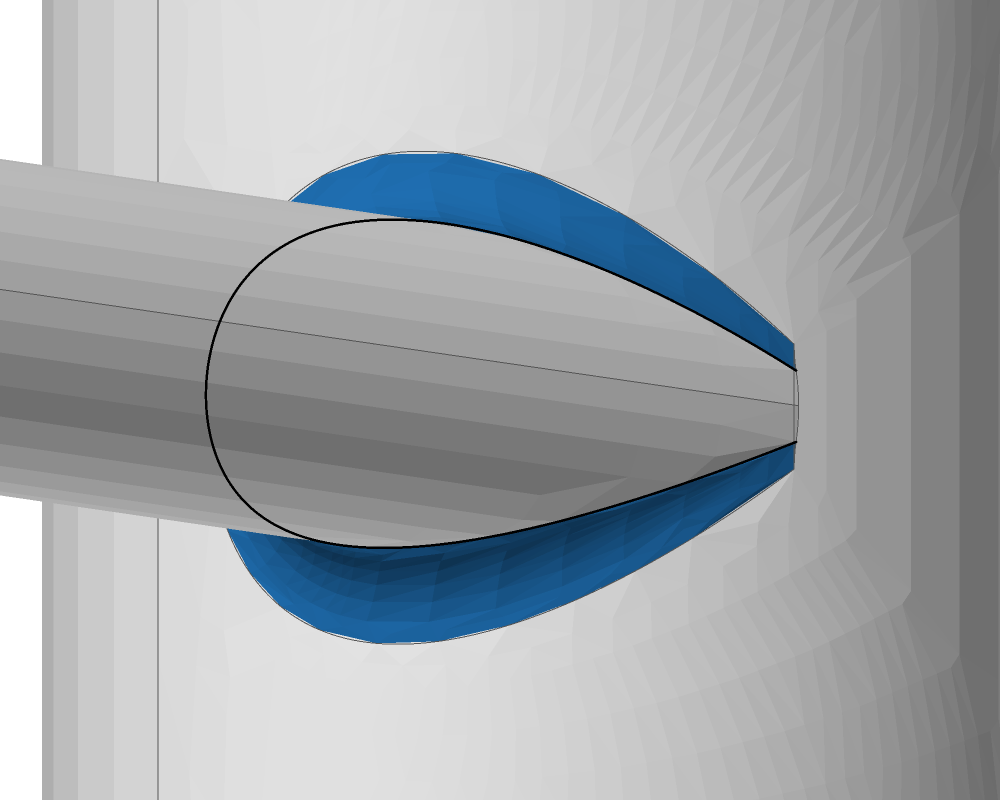
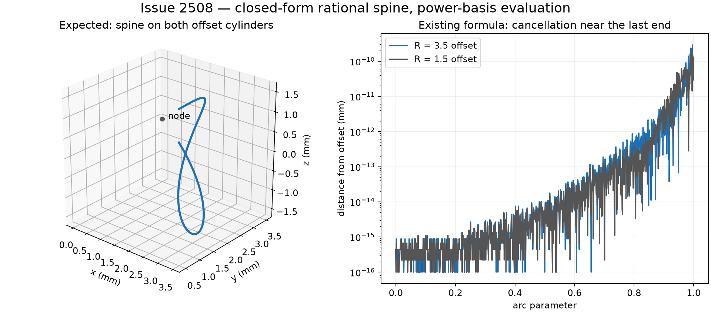

# blend.fillet_exact: construct the nodal quartic in its segment's Bernstein basis (2026-11-06)

Issue #2508; PR #3022. Base: `d3cc2f0aad36ee7d687d051056e342f113865dfd`.
Units: `blend::fillet_exact::rational`, its `blend.fillet_solver_p4` and
`blend.fillet_geom_p3` callers, and exact-round definition retention.

## Input and failure

The existing regression joins an R3 cylinder about z with an R1 cylinder along x
whose axis is at y = 2 and whose end is x = 0.5, and rounds their concave edge at
r = 0.5. The centre line belongs to the R3.5 and R1.5 offsets, touching at
(0, 3.5, 0). Its geometric definition is rational, without fitting or iteration.

Main's round passes its existing 1e-9 mm sampled bar but cannot keep a zero-bound
definition: the spine's Bernstein identity on its offsets fails. Main's direct
spine test measures 1.2963230489049238e-10 mm off its offsets, compared with
`gamma(64) * 3.5 = 2.4868995751603683e-14` mm for its rounding check. The new
definition regression also fails on main: zero exact definitions, expected one.

The actual body's measurements, using the existing `off_ball` helper:

| Measured quantity | Main | Direct Bernstein construction |
| --- | ---: | ---: |
| Maximum sampled ball error, mm | 8.821289254612452e-10 | 6.6058269965196814e-15 |
| Maximum sampled rail error, mm | 8.411107366157466e-10 | 6.217248937900877e-15 |
| Round faces | 1 | 1 |
| Level-2 validity | clean | clean |
| Exact-round definition | absent | NodalQuartic, bound 0 |

Distances are diagnostics, not certificates. Exactness is checked by the existing
coefficient identities on both offset quadrics and on the canal surface; those
identities and their rounding bounds are unchanged. The original 1e-9 mm
ball/rail and endpoint-match bars, and the area tolerance for fitted end trims,
are unchanged. The offset-distance test is strengthened to its rounding bound.

## Cause and construction

`nodal_quartic` expanded the homogeneous quartic into global power coefficients.
`power_to_bernstein` then evaluated Taylor sums to recover each segment. Near the
last end the weight is much smaller than the terms used to form or evaluate it;
conversion cannot recover accuracy already lost in its coefficients.

The replacement uses the same rational cone construction. Let C = A2 - k A1,
g = A1 q + b1, and v0 a cone ray tangent to a branch at node q. For an interpolated
direction w, the cone direction is

`V(w) = (w.C.w) v0 - 2 (v0.C.w) w`.

Its symmetric bilinear polar form is

`P(u,v) = (u.C.v) v0 - (v0.C.u) v - (v0.C.v) u`.

On a segment whose endpoint directions are u and v, the quadratic Bernstein
controls are exactly `P(u,u), P(u,v), P(v,v)`. Bernstein products then give

`W = V.A1.V`, `G = g.V`, `M = q W - 2 G V`.

Thus M/W is the same rational quartic. The code no longer forms power
coefficients; branch and extension sign checks evaluate the cone direction
directly. Segment count, branch choice, extension policy, weight normalization,
positive-weight subdivision and the round's row construction are preserved.
The former arithmetic and the nodal definition exclusion are removed.

This implements the numerical prescription in Tsai and Farouki, *Algorithm 812:
BPOLY*, ACM TOMS 27 (2001), §§1, 3.3, 4.2,
[doi:10.1145/383738.383743](https://doi.org/10.1145/383738.383743).
The rational blend classification is already documented in `generic-blend.md`
§4. No new compatibility flag, retry, fitted spine or relaxed certificate is added.

## Evidence and reproduction

The direct spine regression now checks all 16 segments against both quadric
identities. Another test checks 96 combinations of scales 1e-3/1/1e3, rotation
and translation, two radius pairs, support order, parameter direction and branch
base: 1,536 segment identities. The integration regression certifies the whole
round at zero, rebuilds its JSON record bit for bit, reverses, swaps and
reparameterizes its net, and rejects records with a moved support or spine.
The neighboring conic and other exact-round tests retain their expectations.

`blend.fillet_exact--2508-nodal-bernstein/observe.py` reproduces the actual-body
measurements and renders without modifying kernel sources. Run it from isolated
base and corrected checkouts after the builds in its header. The view is
azimuth -140°, elevation 10°; the close frame is centred at (2, 2, 0) with width
6 mm. The round is highlighted and meshed by `solidcore-tess` through the existing
diagnostics renderer. Only the temporary renderer's camera frame is specified.
The discrepancy is subnanometre, so the pictures identify the affected round;
the geometric identities establish the correction.

| Before | After |
| --- | --- |
|  |  |

The original two-cylinder power-coefficient construction is also reproduced in
`conditioning.py`, with a 70-digit evaluation of those same rounded coefficients.
That control still misses the offsets by about 1.2e-10 mm, isolating coefficient
formation as well as evaluation. It is an independent arithmetic diagnostic,
not a native-kernel comparison or a certificate.

Scope boundary: #3020's unequal-chamfer `round_rows` changes and #2791's N-D
solver changes are independent. No C++ is built or run, and no merged finding is
edited. The current definition ledger contains only the independent offset kind;
it has no nodal-quartic entry to delete.
