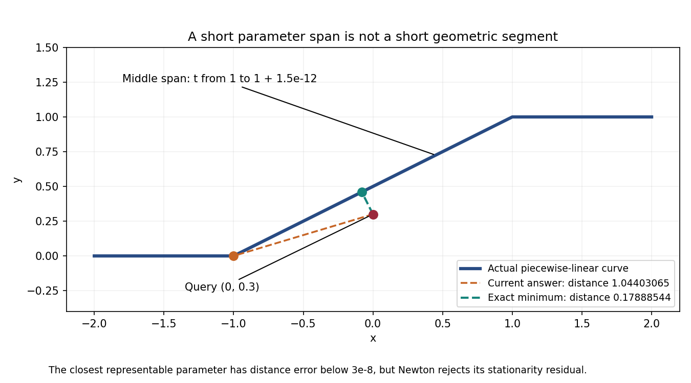

# Projected affine extrema on narrow raw knot spans (#2840)

The full audit of candidate `09495e082` found four changed `topology.brep_p10`
fixtures: `raw_vote_midpoint_gap1.5e-12_trim0/1` and
`raw_vote_midpoint_gap1.9e-12_trim0/1`. Although the resulting retained-face
counts agree with the geometry, the underlying projected minima are wrong.
This is an unresolved defect in that candidate, not evidence of a completed fix.

## Reproduction

Use a degree-one B-spline with unit weights, controls
`(-2,0,0), (-1,0,0), (1,1,0), (2,1,0)` and raw knots
`[0,0,1,1+gap,2,2]`. Preserve these knots with
`BSplineCurve::from_nurb(nurb,3,true)`; the non-borrowed constructor tunes the
knots and would erase this reproduction. Project along unit Z and minimize
distance over the full `[0,2]` interval with tolerance `EFF_ZERO_SQRT = 1e-6`.

For query `(0,0.3,0)`, the exact minimum is `0.4/sqrt(5)` at fraction `0.46`
of the middle segment. For `(0,0.2,0)`, it is `0.6/sqrt(5)` at fraction `0.44`.
Both are closer than either adjoining horizontal segment.

| Gap | Query y | Candidate parameter | Candidate distance | Exact distance |
|---|---:|---:|---:|---:|
| `1.5e-12` | `0.3` | `1` | `1.044030650891055` | `0.17888543819998318` |
| `1.5e-12` | `0.2` | `1` | `1.019803902718557` | `0.2683281572999747` |
| `1.9e-12` | `0.3` | `1` | `1.044030650891055` | `0.17888543819998318` |
| `1.9e-12` | `0.2` | `1` | `1.019803902718557` | `0.2683281572999747` |

The control gap `1e-8` finds both interior minima. The two tiny gaps represent
the same geometric segment, but only a few thousand floating-point parameters
cover it. The nearest representable parameters have stationarity residuals
between `2.09e-5` and `9.93e-5`, above the local root search's acceptable `1e-6`.
Their distance errors are only `8.14e-10` to `2.76e-8`, below the query tolerance.
Normalizing Newton's variable and then evaluating at rounded raw parameters
does not remove that discrepancy. Accepting every failed Newton search would
also be unsound.

## Construction under investigation

An affine span has an exact quadratic projected-distance objective. With
projected displacement `A` and projected start-to-query offset `B`, its minimum
occurs at `clamp(-A dot B / (A dot A),0,1)`; its maximum is at a boundary.
The geometry must be certified affine from its definition, not an approximate
linearity predicate. Map the minimizer to representable parameters, evaluate the
original curve, and enclose the objective error using the existing rounded
interval arithmetic. Refuse a requested accuracy that cannot be established.
Such a refusal must propagate through the public wrapper, rather than become
partial success under the legacy status-suppression policy.

This follows constrained quadratic minimization and the same-objective enclosure
requirement already discussed in [the construction finding](curve.curve_p1--projected-endpoints-small-mitres.md).
The regression tests keep the raw knots and original accuracy, including a
`1e-12` request that cannot be represented and must be refused.

## Why the trimming result alone was insufficient

The lens fixture has forward boundary curves `x=-1+2s`, with upper
`y=0.2s+0.8s^2` and lower `y=-0.2s+1.2s^2`, `s in [0,1]`.
Both lie strictly below the middle projection segment `y=s` inside the interval.
The reference `(-1.5,-1,0)` is below the first segment. KeepPoint therefore
retains the lens and DeletePoint removes it; revised retained-face counts `1/0`
agree, while pinned-native counts are `0/1`.

The probe shows reference classification is correct, both vertices return
on-curve errors as expected, and both midpoint side votes are right-side votes.
But those midpoint votes use a distant kink endpoint, not the closest point.
Their correct signs do not certify the underlying projected query. The sheet's
exact area is `2/15`; no solid-volume claim is made for this fixture.
