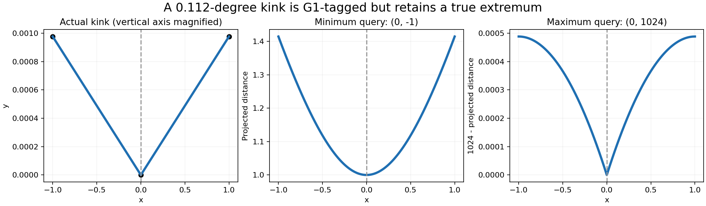

# Exact affine joins in projected point extrema

Review [4501494576](https://github.com/tangency-labs/solidcore/pull/2968#discussion_r4501494576)
identified an inherited #2840 defect: the cache's G1 classification permits a
0.5-degree kink, but the affine solver treated that classification as proof that
the join could not be an endpoint extremum.

The raw degree-one polyline has controls `(-1, 1/1024, 0)`, `(0, 0, 0)`,
`(1, 1/1024, 0)` and knots `[0, 0, 1, 2, 2]`. Its turn is about 0.112 degrees,
so the cache marks the middle knot G1. Projection has normal `(0, 0, 1)`.
For query `(0, -1, 0)` the unique minimum is 1 at parameter 1; the pre-fix
public API returns an empty successful result. For query `(0, 1024, 0)` the
unique maximum is 1024 at parameter 1; the pre-fix API instead returns
1023.9995117190992 at parameter 0. Both failures exceed retention slack `1e-8`.
An exactly collinear control retains its two outer All maxima and excludes the
artificial middle endpoint even with retention slack 10.

Writing `u = |x|` and `e = 1/1024`, the squared minimum objective is
`1 + 2 e u + (1 + e^2) u^2`, strictly increasing for `0 <= u <= 1`.
The squared maximum objective minus `1024^2` is
`u ((1 + e^2) u - 2)`, strictly negative for `0 < u <= 1`.
Thus both expected extrema follow from the exact defining dyadic data,
independently of solver samples.

## Construction

Shewchuk's [Adaptive Precision Floating-Point Arithmetic and Fast Robust
Geometric Predicates](https://www.cs.cmu.edu/~quake/robust.html) explains why
near-zero determinant decisions need exact or certified arithmetic. Here the
existing bounded dyadic product accumulator is extended from four to at most
eight terms; no external implementation is imported. Eight products need at
most 4199 bits, within the existing 4224-bit storage.

An approximate G1 boundary is omitted only if its defining adjacent affine
spans have exactly equal projective endpoint positions, exactly parallel raw
chord differences, and matching nonzero orientation. The cross product is
expanded into eight binary64 products before any subtraction rounds the
chords. Constant positive homogeneous weights cancel from the direction test;
endpoint equality uses exact cross-multiplied weights. Repeated knots and
closed seams must pass the same position test. A subdivision strictly within
one affine span is already smooth. Both the early minimum omission and the
endpoint candidate list use this same criterion.

This changes no cache continuity thresholds, solver accuracy allowance, or
retention tolerance. Failure to establish exact smoothness keeps the candidate.
Non-affine stationary solving is unchanged.

## Validation

The standalone public-API reproduction is
`diagnostics/projected_g1_joins_2840.rs`; permanent regressions are consolidated
in `tests/projected_curve_queries.rs`. Internal predicate coverage includes
subnormal/large coordinates, reversed chords, different homogeneous weights,
a true positional gap, and a kink erased by rounded chord subtraction.
All 15 `curve::curve::p1::tests` pass, including the new exact predicate and
the existing adjacent-float interior-minimum refusal. All 24 projected-query
integration tests pass on the final binary span-lookup version. Strict
`cargo clippy -p solidcore --lib --tests -- -D warnings` and modified-file
rustfmt checks pass;
repository-wide and golden gates belong to the parent
integration rather than this isolated review branch.
