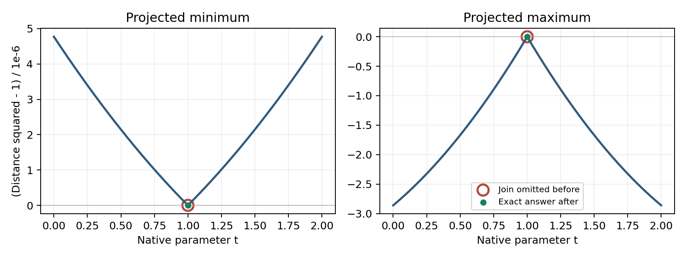
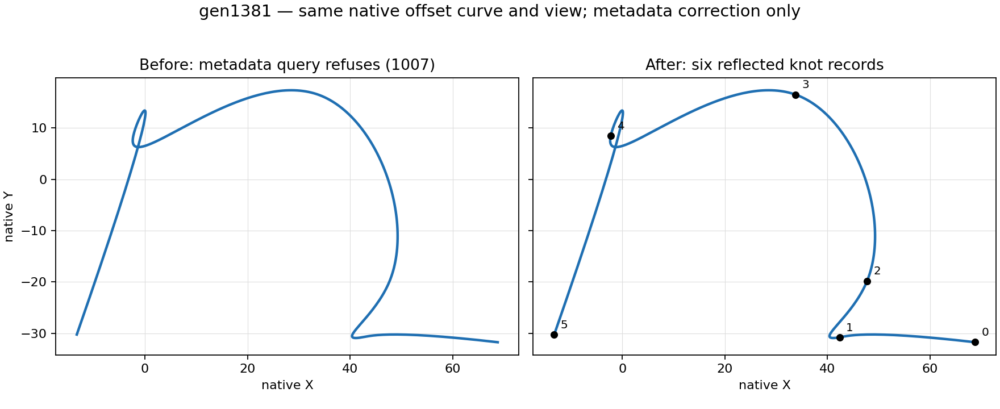

# Projected extrema at a plane UV kink

Review [4501904652](https://github.com/tangency-labs/solidcore/pull/2968#discussion_r4501904652)
identifies a genuine extension of the angular-G1 problem to curves on surfaces.
A plane carrying a native UV spline can receive the cache's G1 label at a small
corner. Omitting that parameter can remove the true projected extremum.

The public regression uses exact dyadic values `a=1/1024` and `d=1/524288`.
Its UV controls are `(-a, 1-d)`, `(0,1)`, `(a,1-d)` for the maximum and
`(-a, 1+d)`, `(0,1)`, `(a,1+d)` for the minimum. Knots are
`[0,0,1,2,2]`, degree one. The plane maps UV to `(u,v,0)`, the query is the
origin and the projection normal is Z. Both true join distances are exactly 1.
The test verifies that the existing continuity classifier calls the join G1.

On the maximum's left span, half the derivative of squared distance is
`a^2*(t-1) + d*(1-d+d*t)`. It is increasing and already strictly positive at
`t=0`, since `d*(1-d)>a^2`. The right span is its reflection. For the minimum,
that derivative is `a^2*(t-1) - d*(1+d-d*t)`, strictly negative throughout the
left span; reflection gives the opposite sign on the right. Neither open span
has a stationary point. Both Single and All requests must therefore retain the
join, rather than relying on an interior stationary search to recover it.
The public regression fails against the pre-fix library.

The plot shows the defining squared objective, not a substituted geometry or
an inferred old returned point. The ring marks the join the old endpoint policy
omitted; the filled dot marks the corrected exact answer. The reproducible
plot helper is `diagnostics/projected_plane_uv_kink.py`.

The fix preserves the native B-spline proof and applies it to a native UV spline
on a plain analytic plane. Positive weights and a UV control hull strictly
inside the plane's analytic domain exclude clamping; the map is then affine,
so an exact native UV tangent identity is preserved. The hull and continuity
facts follow the defining basis, as described in
[MIT's B-spline curve reference](https://web.mit.edu/hyperbook/Patrikalakis-Maekawa-Cho/node17.html).
A Plane label carrying a kept procedural definition does not establish this
identity and cannot omit the join. Private controls cover a genuine kink,
a straight join, artificial subdivisions, the clamping boundary and a kept
corner definition.

This change does not claim an exact smoothness proof for every other curve
wrapper. Other preexisting kind-specific behavior remains outside this narrow
plane-UV repair. The public test is grouped with the existing projected-query
regressions, as requested in
[4496188354](https://github.com/tangency-labs/solidcore/pull/2840#discussion_r4496188354).
Validation: the public regression passes for minimum and maximum in Single and
All modes, returning exactly one solution at parameter 1 with scalar 1. The
private defining-join test passes all five controls. The same public regression
fails against the pre-fix library. Formatting and diff checks pass. Strict
Clippy, compatibility tests and golden replay remain integrated-branch gates.

## Linear wrapper follow-up (review 4503434212)

The same defining corner is also lost through `ProjectedCurve` parallel/rotation
maps and zero-distance `OffsetCurve`. The regression changes the internal knot
to `.5` in the domain `[0,2]`; the geometry and exact derivative proof above are
unchanged after each local affine reparameterization. Baseline maximum queries
return `0.9999985694893212` instead of the exact join value 1. Reversing the offset
moves that join to 1.5, but the original knot API incorrectly still reported .5.

The boundary policy now recursively follows the actual fixed affine projection
map and exact-zero offset parameter map, with the shared 32-level nesting bound.
It does not infer smoothness from the angular continuity label. Offset knot
queries map the requested interval into the base parameterization, reverse the
returned knot/multiplicity order, and mirror the knot values back; continuity
records reverse consistently. Nonfinite, nonordered, or non-invertible mirrored
knots explicitly refuse. For example, a source knot .1 in `[0,1]` cannot be
reported as .9 while claiming its evaluator maps back to the exact defining knot:
`1-(1-.1)` differs from .1 in binary64. This guard does not spend tolerance.

The focused public controls cover four wrappers, min/max, Single/All, reversed
knot multiplicities/continuity order and trimmed knot queries. All 37 projected-query integration tests pass including the roundtrip guard
and stored-label follow-up below; final static/integrated checks remain pending.

A separate broad-retention control remains a confirmed limitation: a straight
parallel-projected spline queried with All and retention 1 returns its true two
endpoint maxima plus a strict minimum and three nonstationary SingleValue points.
The defining right-span objective is `1+((t-.5)/1536)^2`, which is strictly
increasing after .5. Tight retention isolates this wrapper boundary repair and
returns only the two endpoints; it does not repair or justify the broad-retention
classification. The independent reproducer is retained for separate issue work.

This checkpoint does not yet resolve the remaining stored-spline analytic labels
or nonlinear composition policy. In particular, ellipse/hyperbola/parabola
labels evaluate their stored spline and require a definition-based proof; a
label is not itself proof of a smooth native join.

## Evaluator-backed spline labels

The public database readers for `Ellipse`, `Hyperbola` and `Parabola` accept a
stored spline. Their actual point/derivative, knot and continuity dispatchers
use that spline. A public reader regression loads the same degree-one corner
above into each label, independently verifies the evaluated join `(0,1,0)`,
and queries the projected maximum. Before the change all three return only
natural endpoints with value `0.9999985694893212`; the corrected All answer is
the single exact join at .5 with value 1. This does not infer geometry from the
analytic metadata or change database parsing.

Those evaluators now share the native defining-knot test. Rational C0 joins need
more than the previous equal-weight chord shortcut. Write adjacent homogeneous
controls as `(A,wa),(B,wb)` on the left and `(C,wc),(D,wd)` on the right. Exact
position continuity is `B*wc=C*wb`. Up to positive degree/knot/weight factors,
the two tangent numerators are `L=B*wa-A*wb` and `R=D*wc-C*wd`. Each component of
`L cross R` expands into eight signed products of four stored binary64 numbers.
The test proves these sums exactly zero and proves a common nonzero component
has the same sign; opposite directions and unresolved zero tangents are retained.

The existing fixed integer accumulator is generalized, not duplicated. Original
two-factor sums retain 66 words; four-factor sums use 132 words. Four finite
binary64 significands require at most 212 bits, and their summed exponent is in
[-4296,3884]. Eight terms need at most 8395 bits including carry, within 8448.
The only accepted generic sizes are compile-time `(2,66)` and `(4,132)`; no
allocation or recursion depends on a caller-supplied size. Independent Python
Fraction arithmetic agreed on 512 deterministic mixed-sign, extreme-exponent,
permuted-cancellation and subnormal residual cases. Private controls also exercise
full eight-term carry accumulation and one-ulp weighted kinks.

All 37 projected-query integration tests pass at this checkpoint, including the
linear wrappers, non-invertible reflection refusal and all three stored labels.
The complete original p1 private suite plus new arithmetic controls passes all
22 tests. Final static/integrated checks remain pending. The nonzero-offset, perspective and
nonlinear surface/volume composition policies remain separately unresolved;
this evidence must not be described as closing their regularity contract.

## Reversed offset metadata audit (19 golden differences)

The parent `12dda6862` sweep changed 19 of 3123 `curve.offset_curve` records.
An independent replay of the actual constructors against the matching optimized
kernel reproduced all 19. Frozen inputs include each original generator seed;
the runner's unmodified input types, input contract, generator and PRNG were used
to recover them. No curve evaluator changed in this correction.

The evaluator uses `base_parameter(t) = (a+b)-t` when reversed. Therefore knot
locations must be reflected, sorted in reverse source order, and paired with the
same source multiplicities. A bounded metadata query must select the reflected
locations in the caller's interval. Continuity labels similarly follow reversed
indices; their meaning is unchanged by this metadata ordering correction.

| Change | Cases | Independent result |
|---|---|---|
| Corrected knot locations/query membership | gen0073, gen0078, gen0441, gen0480, gen0605, gen0680, gen0791, gen0969, gen1274, gen1406, gen1673, gen1742 | All 12 exact output lists match reflected defining knots, including nested offsets, multiplicities and requested intervals. |
| Reversed continuity index correspondence | gen0082, gen1583, gen1806 | All 3 preserve the prior labels under reversed index order. This does not independently certify inherited absolute nonzero-offset continuity labels. |
| Overly broad metadata refusal | gen0237, gen0701, gen1381, gen1670 | Prior parent returned 1007 because a reflected float did not map back exactly. This is an API regression, not a golden to bless. Metadata must remain available; numerical certificates check mapping accuracy separately. |

The native planar curve is evaluated at the same 257 parameters in both panels.
Only the metadata overlay changes; this is a sampled geometry plot, not a numerical
certificate or a VectorCraft schematic. The knot proof below is independent.

For each of the four refusals, the exact rational inverse lies between adjacent
binary64 wrapper parameters whose evaluator images straddle, but skip, the source
knot. This establishes a numerical certificate boundary, not invalid geometry or
unusable knot metadata. The metadata correction removes its blanket roundtrip
guard and returns the rounded reflected locations. The separate projected-query
preflight must reject an unproved mapped join; simply treating that approximate
location as an exactly smooth join would be unsafe.

The existing metadata regression now expects `[0, 0.9, 1]` with multiplicities
`[2, 1, 2]` although `1-(1-0.1) != 0.1`. It fails with the old 1007 guard against
the parent kernel. Both its metadata-success regression and the separate projected-refusal regression
pass in the coordinated 42-test wrapper run. A preserved regular kernel from that
run (SHA256 `f84ee61ef8adfc3519216690a7043cf328c7227b00cc821a708ec03c1866a119`)
passes the standalone native replay and exact independent checker for **all 19**
records, including the four corrected successes. No golden is changed by this audit.

Reproducible evidence:

- [All defining inputs and seeds](diagnostics/projected_offset_reversal_inputs.jsonl).
- [Old golden versus prior parent outputs](diagnostics/projected_offset_reversal_before_prior.jsonl).
- [Native constructor replay](diagnostics/projected_offset_reversal_native_audit.rs), taking the input JSONL path as its sole argument; compile standalone against the exact kernel rlib and matching dependencies, without modifying a Cargo target.
- [Prior native replay](diagnostics/projected_offset_reversal_native_prior.jsonl).
- [Independent check](diagnostics/projected_offset_reversal_check.py), deriving reflected metadata from the raw defining knots and exact adjacent-float evidence.
- [Per-case proof report](diagnostics/projected_offset_reversal_proof_prior.jsonl), preserving **before**, **prior_parent**, **current** and **expected_metadata** separately, including exact lists, domain mappings and index/multiplicity correspondence.

Run `python plan/findings/diagnostics/projected_offset_reversal_check.py` to
reproduce the prior checkpoint (15 correct changes, four API regressions). After
native replay against the integrated fix, pass `--native <new-replay.jsonl>
--require-success` to require all 19 corrected metadata results. No numerical
tolerance is used in this metadata check; exact binary64 values and rational
inverse relationships are compared.

Green evidence: [native replay](diagnostics/projected_offset_reversal_native_green.jsonl)
and [all 19 proofs](diagnostics/projected_offset_reversal_proof_green.jsonl).
The [geometry plot script](diagnostics/projected_offset_reversal_plot.py) reads
[actual native evaluations](diagnostics/projected_offset_reversal_native_plot.json),
exported by the native replay executable with a second `--plot` argument.

## Nonlinear wrapper definition audit (validation in progress)

The prior checkpoint paragraph does not describe the subsequent policy. The
regularity draft distinguishes a genuine defining boundary (retain it), a proved
smooth artificial subdivision (omit it), and an unproved artificial or singular
boundary (return the projected construction refusal). It does not introduce
cache samples as extrema. All recursive wrapper walks are bounded by the shared
32-level geometry nesting limit.

A nonzero offset can turn a C1 base join into a cusp. The quadratic base with
controls (-2,2),(-1,0),(0,0),(1,0),(2,0), knots [0,0,0,1,1,2,2,2], normal Z and
distance -2 has offset point (0,2) at t=1. Its one-sided derivatives are (-2,0)
and (2,0). Against query (1,2), the projected maximum on [.9,1.1] is exactly 1;
the old result was .8079873760552383 at .9. The draft retains this defining join.
Omitting nonzero-offset joins requires sufficient native C2 regularity, or an
exact straight degree-one join, and interval proof that evaluator tangent repair
and binormal fallback are inactive. At a straight true join, both one-sided jets
are checked because their parameter speeds can differ. Singular artificial
boundaries refuse rather than yielding sampled candidates.

Perspective projection additionally requires its actual rational denominator to
exclude zero. Fixed finite affine volume maps preserve a proved source join.
Direct Conic polynomial/rational branches are handled explicitly, including the
ellipse chart switch and hyperbola poles. Native Iso proofs use the actual varying
tensor direction and positive-weight regularity only inside both active knot
domains, with finite/ordered knots and bounded degrees. Procedural definitions
are not substituted with fitted nets. The unequal-direction-count Iso metadata
bug is separately tracked in #3113; the equal-count missed join is covered here.

Reversed offset knot metadata now remains usable even when a rounded mirrored
knot cannot map exactly back to the defining knot. Before projected traversal,
relevant breaks are checked against outward mapped query intervals. A relevant
noninvertible break refuses that construction; it is not mislabeled smooth, nor
silently represented by its rounded metadata location. This guard also follows
nested directly evaluated wrappers. It does not globally reject unrelated offset
metadata operations.

TangentField inherits UV knots while its evaluator switches to stored endpoint
vectors in endpoint strips and only implements first finite-difference derivatives.
Public projected maximum queries returned successful empty arrays even on constant
subdomains with attained maxima. #3114 records the reproduction and missing actual
construction support. Until that support exists, the draft refuses projected
TangentField queries before cache/target shortcuts, including indirect Projected,
Offset, CrvInVolume and CrvOnSurf chains. This is an explicit unsupported class,
not a claim of complete wrapper construction. Broad-retention All classification
remains separately tracked in #3111.

The initial nonlinear integration checkpoint passed 38 tests. The first expanded
private run passed 25 of 26; an unequal-span fixture was altered by its constructor's
knot fixup before testing the proof. The fixture now preserves its raw stored net.
The final expanded checkpoint passes all 42 public projected-query tests and all
28 private p1 tests, including both one-sided speeds, active tensor-domain
extrapolation refusal and reflected-break query scoping. The metadata success
control passes alongside direct and outer-wrapper projected refusal controls.
Formatting and diff checks pass. Strict Clippy, panic inventory and integrated
golden replay remain pending; no ready or complete claim is made for this draft.
### Integrated metadata golden capture

The optimized runner built at `3407928fb` regenerated `curve.offset_curve` in an
isolated golden directory. Exactly the 19 independently audited metadata records
changed; every captured status and output array equals its independently derived
`expected_metadata` in `projected_offset_reversal_proof_green.jsonl`. Every other
record is byte-equivalent as parsed data, and there are no added, removed or
broken cases. These 19 records are now committed. The four broad 1007 refusals
are not blessed: the metadata API succeeds with rounded reflected knots. No
curve evaluator, tolerance or comparison floor changes in this migration.

### Reflected metadata interval boundaries

Filtering the base knots through inverse-rounded query endpoints can lose a
valid reflected boundary. For reversal about a parameter sum of 1, the base
knots `[0.3,0.7]` map to `[0.30000000000000004,0.7]` in ascending order.
The requested interval `[0.3,0.7]` contains both reflected values. Previously,
the inverse query lower endpoint `1 - 0.7 = 0.30000000000000004` excluded the
base knot 0.3 before reflection, losing the valid returned knot 0.7.

The correction reflects the complete native knot/multiplicity pairs, then
filters them by exact comparisons in the caller's requested coordinates. It
adds no epsilon, snaps no endpoint and does not assert inverse round-trip
identity. Singleton requests distinguish the cases: `[0.7,0.7]` retains 0.7,
`[0.3,0.3]` is empty, and `[0.30000000000000004,0.30000000000000004]` retains that
rounded lower knot. The projected certificate's separate round-trip refusal
remains unchanged.

Validate the original requested endpoints as finite and ordered before any
mapping; constructing a sorted interval must not repair an inverted request.
Also require finite mapped endpoints, because finite input can overflow in the
reflection. After reflection and caller filtering, validate the selected knots
as finite and strictly increasing. Unrelated out-of-query overflow or collapsed
knots must not reject a valid subquery; requesting the complete metadata still
validates and rejects those invalid full lists. Knot and multiplicity counts
remain paired and are checked before filtering.

The public regressions reproduce both original defects and preserve those
query-scoped controls. The full projected-query integration run passes 50 tests
at isolated repair `3972b516e`. All six private offset tests, strict library/tests
Clippy, formatting and diff checks also pass. Integrated golden and full hosted
CI gates remain separate checks on the final merged tree.
