# Projected endpoint extrema and small-profile mitres

Related: #2840 fixes #3087, the small-profile geometry defect recorded in #2811 under #2794.
Units: `curve.curve_p1`, `curve.curve_p4`, `geom.global_solver`;
caller `primitive.primitive_creation_p2`.

## Reproduction and geometry

Sweep an XY circle of radius `r` along `(0,0,0) -> (0,0,L) -> (L,0,L)`,
with both ends capped and the profile moved to the path. Before the fix,
`(r,L,tolerance) = (0.001,0.01,1e-7)` and `(0.001,1,1e-7)` return success
but fail Level2 validity: two vertices have incident-surface gaps
`0.00182842712474619`. The `(0.01,0.1,1e-5)` case has fourteen validation
failures; `(0.1,1,1e-7)` is a valid control.

The exact cylinder equations are `x^2+y^2=r^2` and
`y^2+(z-L)^2=r^2`. Their mitre plane is `x+z=L`; the seam is
`(r cos(t), r sin(t), L-r cos(t))`. The volume is `2*pi*r^2*L`.
This is a nondegenerate 45-degree cylinder/plane cut at every tested scale.

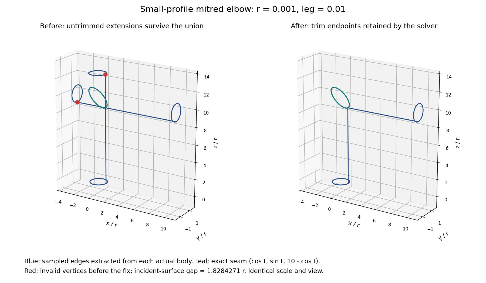

Both panels sample edges from the actual B-reps, with identical axes and view.
The dashed seam is the independent analytic oracle. The before body cannot be
rendered through the normal diagnostics converter: it refuses a sheet touching
itself along an edge. Edge extraction therefore supplies the comparable view.
The corrected body also passes the normal renderer, with no faces refused.

## Cause and correction

Tracing the construction shows the swept pieces are valid before and after the
attempted trims, but the small case retains the extended ends. The first invalid
incidence appears after union. The trim's `find_side_of_curve` projects a reference
point onto a finite cutting curve; the nearest point can be an endpoint.

`CpGlobalSolver::local_solve_branch` already selects such endpoints when the
stationary-point search finds no root. It computes their projected distance,
but leaves `found_solution` false, discarding them. The trim then fails and the
default sweep path continues with untrimmed extensions.

The correction enumerates eligible finite boundaries as `SingleValue` candidates
independently of stationary-point searches. A stationary point can be a minimum
when a maximum was requested, so finding one must not suppress the boundaries.
Each endpoint is admitted only after its distance evaluates successfully. A
failed endpoint evaluation returns its error locally, rather than admitting an
error code as a numeric distance.
Projected extrema propagate failures; other operations retain their legacy status policy. Two further corrections are necessary
to preserve better interior candidates:

- The objective is `D(V)=|N cross V cross N|`. Writing `q=N dot N`, this is
  `q` times orthogonal projected distance. A sphere of radius `r` therefore maps
  inside a projected disk of radius `q*r`. Projected min/max pruning previously
  compared unscaled sphere bounds against a scaled objective incumbent. Both
  projected center distance and radii now scale by `q`, with the query tolerance
  added in objective units. Other projected operations retain their behavior.
- `ProjectedPointMaximize` negated its stationary function but not its derivative.
  For `C(t)=(t,0,0)`, `P=0`, `N=(0,0,s)`, that function is `F(t)=-s^2*t`:
  its derivative must be `-s^2`, not `+s^2`. Both are now negated together.

No new tolerance, geometry-specific case, retry, reference-point adjustment, or
compatibility flag is introduced.

The independent audit exposed the need for these corrections before readiness:
the initial endpoint-only candidate displaced an interior minimum in `gen2419`
(`t=0.19538434989712908`, distance `2.018003877141825`) with an endpoint at
distance `2.0600868346831587`, outside the query tolerance `0.001`.
For `gen0002`, its endpoint distance `6.513722074907321` missed the interior
maximum `9.248675280586827` at `t=0.8258440787616159` (tolerance `0.05`).
These are permanent regressions with independent rational-quadratic oracles:
Bernstein coefficient signs establish a unique stationary root, located by
bisection. The certificates use f64 arithmetic with large sign margins, not
formal outward-rounded interval arithmetic.

## Affine certificate and review corrections

On each degree-one span, project the endpoints with `N cross (C-P) cross N`.
The squared norm is a convex quadratic in the local fraction. Its clamped
stationary fraction supplies the minimum; eligible boundaries supply the maximum.
Outward-rounded intervals enclose the objective and candidates. Parameter
neighbors are checked in the original knot coordinates, without rebuilding knots.
An isolated upper-knot value remains a separate candidate from the left limit.

The review corrections separate retention slack from enclosure rounding, use
exact factors of the mapped analytic-line direction, refuse an interior minimum
that has no representable interior parameter, and refuse projected requests not
covered by the cached domain. Zero-slack and collapsed-line regressions fail with
status 1021 before their fixes. The true unrepresentable-minimum refusal remains
covered, including an adjacent-float span whose fixture explicitly preserves raw
knots. An earlier checkpoint passed 14 internal cache/affine tests after that fixture correction; the stricter final validation is recorded below.

For an analytic line, the mapped endpoint difference factors as
`scale * (b-a) * V`, times a nonzero query/natural-span ratio for bounded maps.
Zero factors are checked before multiplication; otherwise exact parallelism of
`V` decides whether the projection is constant. Subtracting rounded endpoint
positions is insufficient: it can lose true parallelism or erase a tiny
transverse component. Both additional regressions fail against `e71a2e1b9`
and pass with the factorized proof. That earlier checkpoint passed all 21 projected-query tests in debug and
optimized builds; the stricter final counts are recorded below.

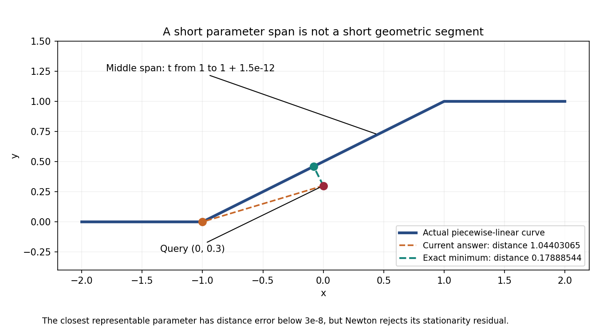
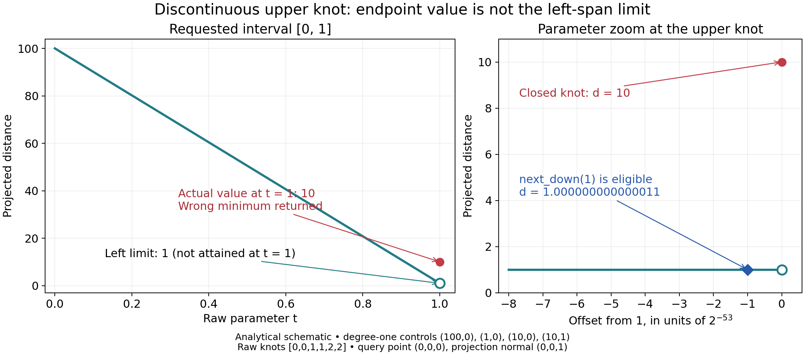

The raw span `[1, 1+1.5e-12]` runs from `(-1,0)` to `(1,1)`.
For query `(0,0.3)`, the exact distance is `0.4/sqrt(5)` and the local
fraction is `0.46`. Every representable parameter near that foot misses the
minimum by more than `1e-12`; the regression requires `NotWithinTolerance`.
Conversely, `intersect.topology_solver_p1/gen1646` has an ordinary interior
minimum near `t=0.6406108473689742`. Its exact distance is approximately
`1.5495187277368766e-16`; the nearest parameter's excess is only
`1.247199610658913e-19`. Zero retention slack must not reject enclosure rounding.

## Current global curve golden changes (review 4501494573)

This audit compares `99ed57c4d4f4cd77d942ac6cd2e4d09f612acb20` with
`3407928fbb6496a5d0c8d22378a876cc3804fc7c`: all 55 changed existing
`curve.curve_p1` records on the original frozen inputs. It supersedes the
historical table below for this comparison. The [complete saved records](diagnostics/projected_global_golden_changes_2968.json)
contain the old golden records, current measured records, exact inputs and full
output arrays, including the two checksum-compressed records.

The final optimized native replay preserves all 55 statuses and 53 raw output
arrays bit for bit relative to the earlier `2e5087da7` evidence. Two analytic-line
minima move by adjacent binary64 representations: `gen0073` changes distance
`2.4569516620450993` to `2.4569516620451006` (three ULPs) and parameter
`7.424378115297848` to `7.4243781152978485` (one ULP); `gen2450` keeps distance
`0.27002492486264307` and changes parameter `2.5540707534588063` to
`2.5540707534588067` (one ULP). Their previous arrays and the earlier evidence head
remain in the JSON. No golden expectation changes for this within-tolerance drift.
The frozen-input archive SHA256 is
`f285cce9638cba8c5ebf0d12f73069efdac07cb6b89055f47f5d0c3557c4a46a`;
the final 55-record raw replay SHA256 is
`444b24249c7c30a47fcd4c518468397dbbc7f7f64bb02f55cc699de9e3836f96`.
Reconstructing every frozen float from its exact u64 bits produces the same output
as the ordinary JSON replay, excluding a transport-rounding explanation.

For these two changed lines, the script additionally uses public native stored
line factors and exact rational arithmetic to derive the quadratic minimum and
evaluate the returned parameter. Both parameters are strictly inside their natural
and requested intervals. The exact minima are approximately
`2.45695166204509951525` and `0.27002492486264330538`; the reported-minus-exact
point-metric errors are `1.11087929335e-15` and `-2.37792993327e-16`.
Their objective gaps from the exact minima are about `1.3341e-31` and `8.0299e-33`.
Exact squared comparisons pass the unchanged relative `1e-9` golden rule.
This independent diagnostic does not invoke the private production point-enclosure
certificate; that construction is covered separately by implementation and tests.
The seven same-view figures are regenerated from these current measured arrays
and visually inspected. The regenerated NumPy report has additional last-bit
changes in its diagnostic polynomial roots across numerical-library versions;
those are not native kernel-output changes. Native-array comparisons above use
binary64 bits, independently of the numerical plotting oracle.

The [independent evaluator and plotting script](diagnostics/projected_global_golden_changes_2968.py)
expands every nonempty knot span into rational polynomials. For projection
`M = (n dot n) I - n n^T`, it writes squared distance as `N(t)/W(t)^2`.
Interior extrema are among the real roots of `N' W - 2 N W'`; evaluating
those roots, span endpoints, and requested interval endpoints gives the
comparison extremum. Positive supplied weights keep denominators nonzero.
Line cases use the exact affine parameterization; Hermite cases use the cubic
endpoint/tangent definition. The root calculation uses NumPy floating-point
polynomial roots; it is an independent numerical oracle, not an interval
certificate. The saved [evaluation report](diagnostics/projected_global_golden_changes_2968_report.json)
lists every returned point, its independently evaluated distance, and its gap
from the enumerated best. Plot sampling only draws the curves.

All 46 successful cases have the reported geometric distances at the returned
parameters and satisfy the original retention slack relative to that extremum.
The script allows `1e-10 * max(1, distance)` only for the independent Python
reconstruction check; this is not a solver tolerance, golden floor, or proof
that all nonbest retained points are stationary. In particular, the additional
endpoints in `gen0572`, `gen1256`, `gen1457`, and `gen1621` are within the original
retention slack; they are not claimed to be isolated unconstrained extrema.

All nine status-1021 records refuse an uncovered requested domain. They do
not claim that the mathematical curve has no answer. No current success is
justified by copying a historical return value.

Each result below is `distance @ parameter`; omitted result metadata is identical
`[type=1, objects=1, variables=1, reserved=0]` for every returned point. The exact
array begins with the point count. `no solutions` is successful `[0]`, distinct
from status 1021 with empty output. The linked JSON preserves every field.

| Case | Before | Current | Current mathematical check / refusal reason |
|---|---|---|---|
| `gen0002` | no solutions | 9.2486752805868271 @ 0.82584407876161836 | max 9.2486752805868271 at 0.82584407876161592; largest returned gap 1.7764e-15 <= slack 0.050000000000000003. |
| `gen0069` | no solutions | 8.8901767919182149 @ 4.2339767627157618 | max 8.8901767919182184 at 4.2339767627157618; largest returned gap 0 <= slack 1.0000000000000001e-05. |
| `gen0073` | 2.4569516620450993 @ 7.4243781152978494 | 2.4569516620451006 @ 7.4243781152978485 | Exact stored-line minimum 2.45695166204509951525; returned parameter admissible, objective gap about 1.3341e-31. |
| `gen0159` | no solutions | 1.033541203184561 @ 1.1388624755787422 | max 1.033541203184561 at 1.1388624755787422; largest returned gap 0 <= slack 0.001. |
| `gen0268` | 0 @ 0 | 95.282075215491687 @ 1 | max 95.282075215491702 at 1; largest returned gap 0 <= slack 0.050000000000000003. |
| `gen0312` | no solutions | 28.246790603072732 @ 0.98007941619113648 | max 28.24679060307276 at 0.98007941619113514; largest returned gap 1.0658e-14 <= slack 1.0000000000000001e-05. |
| `gen0419` | no solutions | 332.06684015374105 @ 1 | max 332.06684015374111 at 1; largest returned gap 0 <= slack 1.0000000000000001e-05. |
| `gen0429` | no solutions | 22.540316380568978 @ 0 | max 22.540316380568978 at 0; largest returned gap 0 <= slack 0.050000000000000003. |
| `gen0457` | 2.5223629445039558e-14 @ 0.29104003360208125 | status 1021; `[]` | Request [-0.15450174803462408, 0.35218219198212913] is not contained in cache domain [0, 1]. |
| `gen0478` | no solutions | 4.7619030295801057 @ 0.74580880176850051 | max 4.7619030295801066 at 0.74580880176850051; largest returned gap 0 <= slack 0.050000000000000003. |
| `gen0572` | 0.0071576915035326634 @ 0.5072601353765418 | 0.0071576915035326634 @ 0.5072601353765418; 0.016737875986831931 @ 0.57557342760196972; 0.02270442517931608 @ 0.41501895441540232 | min 0.0071576915035326616 at 0.50726013537654158; largest returned gap 0.015547 <= slack 0.050000000000000003. |
| `gen0660` | no solutions | 1.4420595249547044 @ 0.30484065810692407 | max 1.4420595249547048 at 0.30484065810692851; largest returned gap 0 <= slack 9.9999999999999995e-07. |
| `gen0757` | no solutions | 10.557927271679803 @ 4.0683848792589856 | max 10.557927271679802 at 4.0683848792589856; largest returned gap 0 <= slack 0.001. |
| `gen0852` | no solutions | status 1021; `[]` | Request [1.0788892254595575, 1.0806593495146779] is not contained in cache domain [0, 1]. |
| `gen0869` | no solutions | 14.774212810947549 @ 1 | max 14.774212810947542 at 1; largest returned gap 0 <= slack 9.9999999999999995e-07. |
| `gen0877` | no solutions | 10.649300098095045 @ 1 | max 10.649300098095047 at 1; largest returned gap 0 <= slack 9.9999999999999995e-07. |
| `gen0903` | no solutions | 5.3562304943464323 @ 1.2914264682598677 | max 5.3562304943464323 at 1.2914264682598677; largest returned gap 0 <= slack 0.050000000000000003. |
| `gen0909` | 0.73163212383281029 @ 0.46331104938392431 | 0.57314391403147991 @ 0; 0.57314391403147935 @ 1 | min 0.57314391403148002 at 0; largest returned gap 0 <= slack 0.001. |
| `gen0975` | no solutions | status 1021; `[]` | Request [9.1110838878227796, 11.50075760044348] is not contained in cache domain [0, 9.8285191721035368]. |
| `gen0983` | no solutions | status 1021; `[]` | Request [-1.5012244873106328, -0.85983642891267775] is not contained in cache domain [0, 7.9492474797840238]. |
| `gen1092` | no solutions | 1.9538402164155864 @ 0.64427276589930793 | max 1.9538402164155868 at 0.64427276589930793; largest returned gap 0 <= slack 9.9999999999999995e-07. |
| `gen1110` | no solutions | 2.3980925297368416 @ 13.726611511845006 | max 2.3980925297368407 at 13.726611511845006; largest returned gap 0 <= slack 0.050000000000000003. |
| `gen1172` | 6.6784454602178034e-17 @ 0.28602071545115759 | 0 @ 0.28602071545115765 | min 0 at 0.28602071545115765; largest returned gap 0 <= slack 0.050000000000000003. |
| `gen1256` | no solutions | 9.3518785127959525 @ 0.01121571674824913; 9.3476106799938581 @ 0 | max 9.3518785127959543 at 0.011215716748249243; largest returned gap 0.0042678 <= slack 0.050000000000000003. |
| `gen1267` | no solutions | status 1021; `[]` | Request [1.3782439467163963, 1.7097656369276324] is not contained in cache domain [-4.7268502029667676, 0.68320624884804726]. |
| `gen1273` | no solutions | 0.065254951376831904 @ 0.53904519426058628 | min 0.065254951376831793 at 0.53904519426058628; largest returned gap 0 <= slack 0.001. |
| `gen1302` | no solutions | 44.199638754463066 @ 0.52441072279730372 | max 44.199638754463066 at 0.52441072279730427; largest returned gap 0 <= slack 0.001. |
| `gen1448` | no solutions | 12.29457040830604 @ -3.0423314947687778 | max 12.294570408306024 at -3.0423314947687778; largest returned gap 0 <= slack 9.9999999999999995e-07. |
| `gen1457` | 4.3438322141615746 @ 0.20373517220503476 | 4.3438322141615746 @ 0.20373517220503476; 4.3797147977505153 @ 0; 4.3797147977505162 @ 1 | min 4.3438322141615755 at 0.20373517220503479; largest returned gap 0.035883 <= slack 0.050000000000000003. |
| `gen1520` | no solutions | 33.789379056506853 @ 2.3849086148836021 | min 33.78937905650686 at 2.3849086148836021; largest returned gap 0 <= slack 1.0000000000000001e-05. |
| `gen1548` | 162.22337078032484 @ 0.94328458912860502 | 0.75822411532265399 @ 0 | min 0.75822411532265421 at 0; largest returned gap 0 <= slack 1.0000000000000001e-05. |
| `gen1554` | no solutions | status 1021; `[]` | Request [-0.014223841201944171, 1.1169569330124063] is not contained in cache domain [0, 1]. |
| `gen1621` | no solutions | 22.088438326716776 @ 0.0049847243869220884; 22.085041647697494 @ 0 | max 22.088438326716776 at 0.0049847243869219106; largest returned gap 0.0033967 <= slack 0.050000000000000003. |
| `gen1657` | 48.896960999198846 @ 0.67695613383414943 | 0.3802896874236637 @ 0 | min 0.38028968742366376 at 0; largest returned gap 0 <= slack 0.050000000000000003. |
| `gen1695` | no solutions | 39.869632717513078 @ 0 | max 39.869632717513085 at 0; largest returned gap 0 <= slack 1.0000000000000001e-05. |
| `gen1699` | 85.585085694095937 @ 5.5867637405271262 | 1.3941829382067421 @ 5.7177741326260971 | min 1.3941829382067272 at 5.7177741326260971; largest returned gap 0 <= slack 1.0000000000000001e-05. |
| `gen1732` | no solutions | 1.5611572970102852 @ 4.86141236791868 | min 1.5611572970102852 at 4.86141236791868; largest returned gap 0 <= slack 9.9999999999999995e-07. |
| `gen1872` | no solutions | 7.3549564229763549 @ 0.38506387034726092 | min 7.3549564229763522 at 0.38506387034726092; largest returned gap 0 <= slack 9.9999999999999995e-07. |
| `gen1876` | 7.2636780630313235e-16 @ -4.0639550817160597 | 1.3914285882969528 @ -2.6326022132199061 | max 1.3914285882969526 at -2.6326022132199061; largest returned gap 0 <= slack 9.9999999999999995e-07. |
| `gen2021` | no solutions | 28.857905823233743 @ 1 | max 28.857905823233743 at 1; largest returned gap 0 <= slack 1.0000000000000001e-05. |
| `gen2092` | no solutions | 8.0542139867220666 @ 0.074766904398441164 | max 8.0542139867220648 at 0.074766904398441178; largest returned gap 0 <= slack 9.9999999999999995e-07. |
| `gen2126` | no solutions | 5.556128313677057 @ 2.8100032256169061 | max 5.556128313677057 at 2.8100032256169061; largest returned gap 0 <= slack 1.0000000000000001e-05. |
| `gen2196` | no solutions | 7.9738378188486907 @ 0.06596314686589877 | max 7.9738378188486898 at 0.065963146865898742; largest returned gap 0 <= slack 0.050000000000000003. |
| `gen2207` | no solutions | status 1021; `[]` | Request [0.87419100217506518, 0.94459092715786475] is not contained in cache domain [-0.23881952170832665, 0.76118047829167335]. |
| `gen2218` | no solutions | 3.5683265921762817 @ 3.0261404497837283 | max 3.5683265921762812 at 3.0261404497837283; largest returned gap 0 <= slack 1.0000000000000001e-05. |
| `gen2292` | 10.531529151927153 @ 0.97397763370896406 | 4.5142803266087421 @ 0 | min 4.5142803266087412 at 0; largest returned gap 0 <= slack 1.0000000000000001e-05. |
| `gen2361` | no solutions | 4.6198607072580273 @ 0.066619966966380756 | max 4.6198607072580273 at 0.066619966966377911; largest returned gap 8.8818e-16 <= slack 9.9999999999999995e-07. |
| `gen2450` | 0.27002492486264312 @ 2.5540707534588072 | 0.27002492486264307 @ 2.5540707534588067 | Exact stored-line minimum 0.27002492486264330538; returned parameter admissible, objective gap about 8.0299e-33. |
| `gen2524` | no solutions | 0.16452101103224887 @ 0.5161062644162443 | max 0.16452101103224909 at 0.51610626441624408; largest returned gap 2.7756e-17 <= slack 9.9999999999999995e-07. |
| `gen2525` | no solutions | status 1021; `[]` | Request [6.5843795421782971, 9.3024172167042547] is not contained in cache domain [0.097910539182596068, 8.4937777191536945]. |
| `gen2611` | 34.173415063360942 @ 0.12001180281277017 | 34.173415063382613 @ 0.12001180281343077 | max 34.17341506338262 at 0.12001180281343077; largest returned gap 0 <= slack 0.001. |
| `gen2740` | no solutions | 39.766866097214823 @ 0.12365865927611258 | max 39.766866097214823 at 0.12365865927611254; largest returned gap 7.1054e-15 <= slack 0.001. |
| `gen2874` | 81.764961013612023 @ 0.69924160525610057 | 42.294050545981115 @ 5.8559804627410896 | min 42.294050545981108 at 5.8559804627410896; largest returned gap 0 <= slack 9.9999999999999995e-07. |
| `gen2883` | no solutions | status 1021; `[]` | Request [0.9300363540079557, 1.119641960869513] is not contained in cache domain [0, 1]. |
| `gen2942` | no solutions | 1.2588335544914846 @ 1 | max 1.2588335544914846 at 1; largest returned gap 0 <= slack 0.050000000000000003. |

The figures overlay the exact old/current reported pairs on the independently
evaluated objective. Domain-refusal panels show requested versus cached intervals.
A red marker can be hidden by an overlapping green marker when the change is
only rounding-sized. All seven figures were visually inspected.

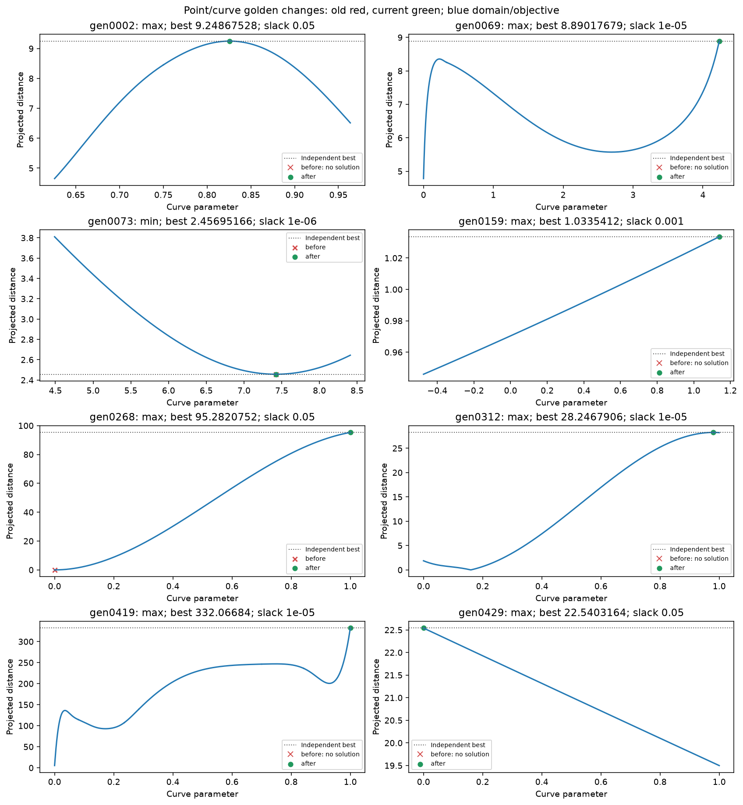

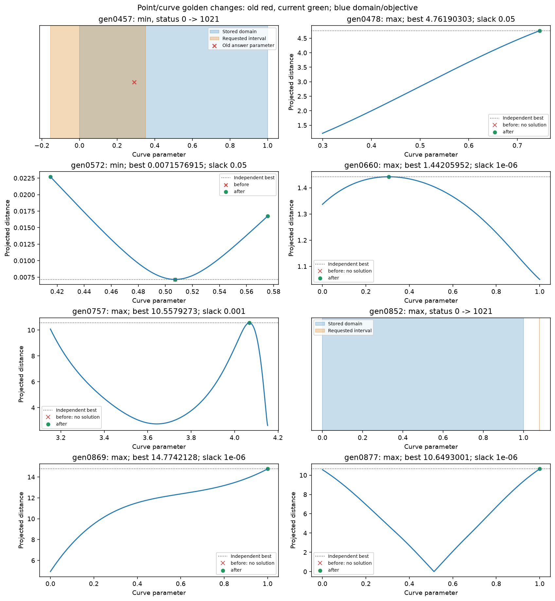

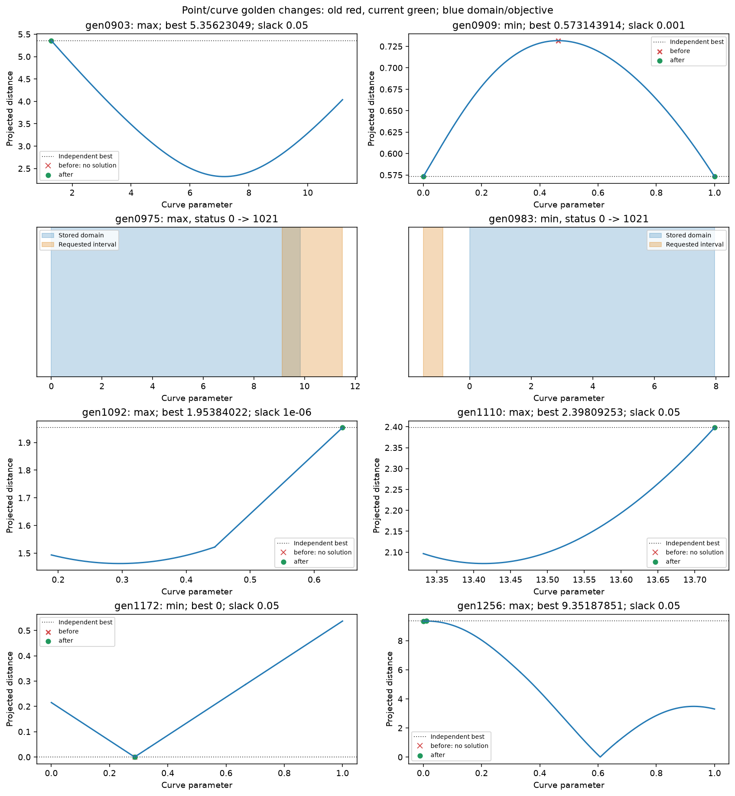

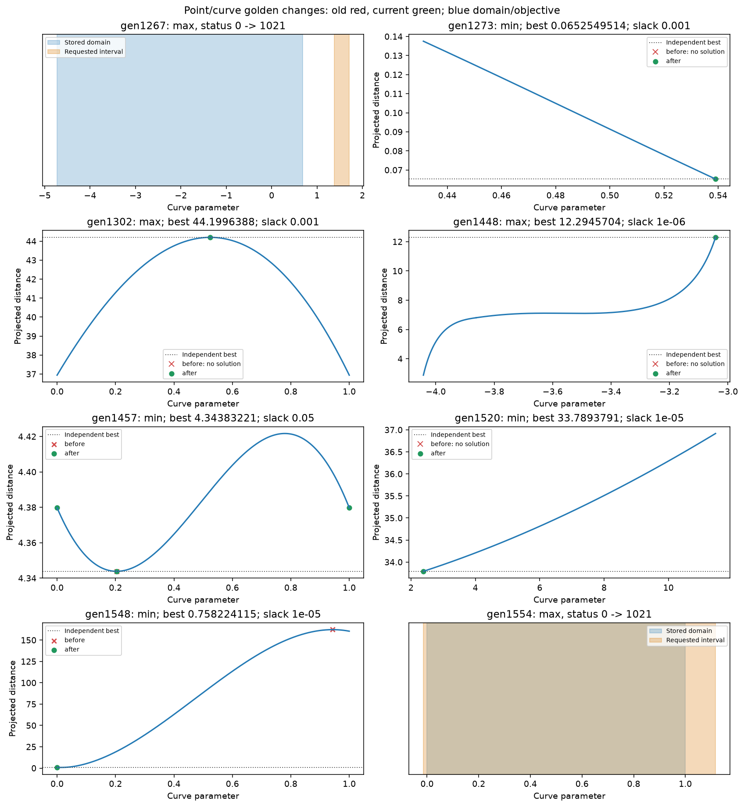

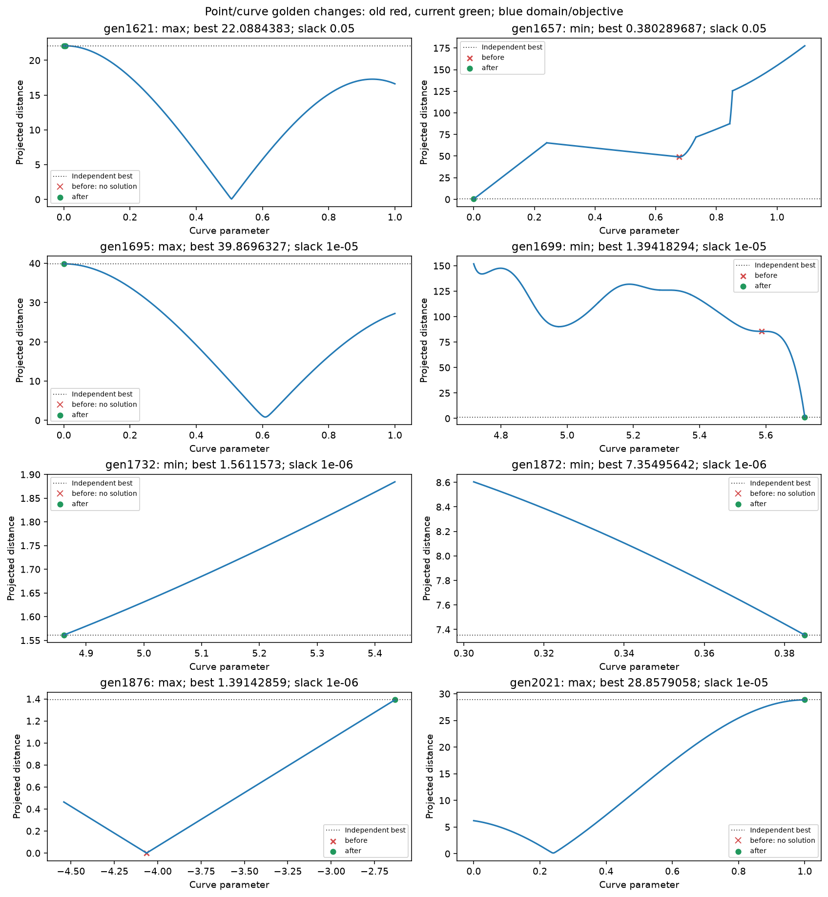

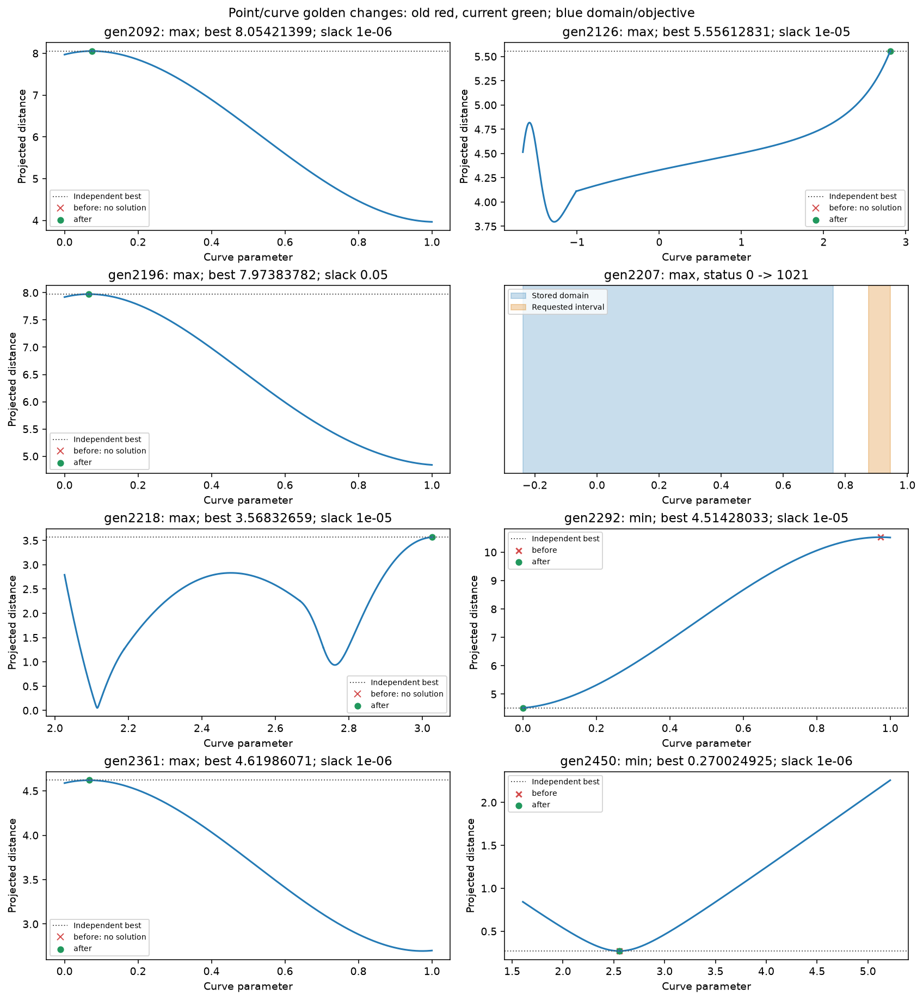

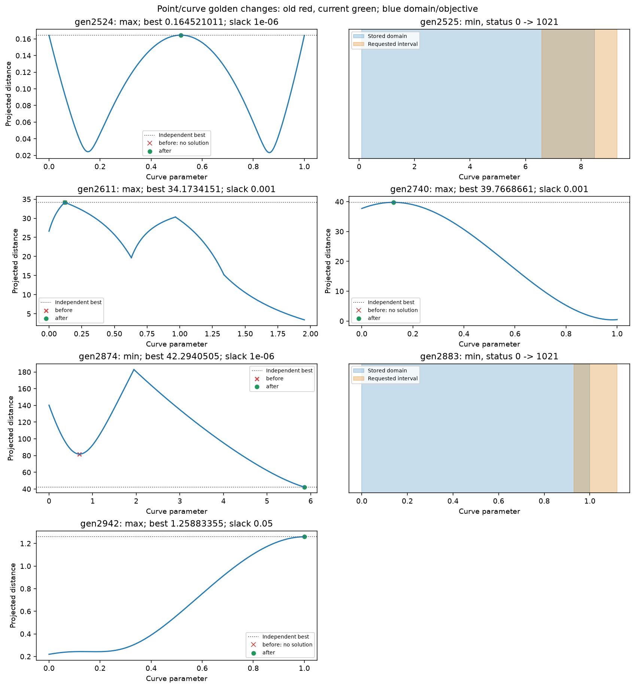

## Historical independent caller audits

These tables preserve the independent geometry audit used to classify changes.
They compare the pre-fix implementation/reference with the earlier candidate,
not a claim that every row has been revalidated at the current head. Current
golden updates must be checked against these oracles. Historical C++ parity
counts, temporary replay programs, and redundant validation snapshots are omitted.

### Global curve extrema

| Case (seed) | Operation | Oracle parameter | Oracle distance | Returned (parameter, distance) | Query tolerance |
|---|---|---:|---:|---|---:|
| gen0002 (7577099422542515487) | max | 0.82584407876161592 | 9.2486752805868271 | (0.82584407876161836, 9.2486752805868271) | 0.050000000000000003 |
| gen0069 (7577099422542515554) | max | 4.2339767627157618 | 8.8901767919182184 | (4.2339767627157618, 8.8901767919182149) | 1.0000000000000001e-05 |
| gen0159 (7577099422542515644) | max | 1.1388624755787422 | 1.033541203184561 | (1.1388624755787422, 1.033541203184561) | 0.001 |
| gen0268 (7577099422542515753) | max | 1 | 95.282075215491702 | (1, 95.282075215491687) | 0.050000000000000003 |
| gen0312 (7577099422542515797) | max | 0.98007941619113514 | 28.24679060307276 | (0.98007941619113648, 28.246790603072732) | 1.0000000000000001e-05 |
| gen0419 (7577099422542515904) | max | 1 | 332.06684015374111 | (1, 332.06684015374105) | 1.0000000000000001e-05 |
| gen0429 (7577099422542515914) | max | 0 | 22.540316380568978 | (0, 22.540316380568978) | 0.050000000000000003 |
| gen0478 (7577099422542515963) | max | 0.74580880176850051 | 4.7619030295801066 | (0.74580880176850051, 4.7619030295801057) | 0.050000000000000003 |
| gen0572 (7577099422542516057) | min | 0.50726013537654158 | 0.0071576915035326616 | (0.5072601353765418, 0.0071576915035326634); (0.57557342760196972, 0.016737875986831931); (0.41501895441540232, 0.02270442517931608) | 0.050000000000000003 |
| gen0660 (7577099422542516145) | max | 0.30484065810692851 | 1.4420595249547048 | (0.30484065810692407, 1.4420595249547044) | 9.9999999999999995e-07 |
| gen0757 (7577099422542516242) | max | 4.0683848792589856 | 10.557927271679802 | (4.0683848792589856, 10.557927271679803) | 0.001 |
| gen0869 (7577099422542516354) | max | 1 | 14.774212810947542 | (1, 14.774212810947549) | 9.9999999999999995e-07 |
| gen0877 (7577099422542516362) | max | 1 | 10.649300098095047 | (1, 10.649300098095045) | 9.9999999999999995e-07 |
| gen0903 (7577099422542516388) | max | 1.2914264682598677 | 5.3562304943464323 | (1.2914264682598677, 5.3562304943464323) | 0.050000000000000003 |
| gen0909 (7577099422542516394) | min | 0 | 0.57314391403148002 | (0, 0.57314391403147991); (1, 0.57314391403147935) | 0.001 |
| gen0975 (7577099422542516460) | max | 9.8285191721035368 | 2.3115157576033059 | (9.8285191721035368, 2.3115157576033067) | 0.050000000000000003 |
| gen1092 (7577099422542516577) | max | 0.64427276589930793 | 1.9538402164155868 | (0.64427276589930793, 1.9538402164155864) | 9.9999999999999995e-07 |
| gen1110 (7577099422542516595) | max | 13.726611511845006 | 2.3980925297368407 | (13.726611511845006, 2.3980925297368416) | 0.050000000000000003 |
| gen1256 (7577099422542516741) | max | 0.011215716748249243 | 9.3518785127959543 | (0.01121571674824913, 9.3518785127959525); (0, 9.3476106799938581) | 0.050000000000000003 |
| gen1273 (7577099422542516758) | min | 0.53904519426058628 | 0.065254951376831793 | (0.53904519426058628, 0.065254951376831904) | 0.001 |
| gen1302 (7577099422542516787) | max | 0.52441072279730427 | 44.199638754463066 | (0.52441072279730372, 44.199638754463066) | 0.001 |
| gen1448 (7577099422542516933) | max | -3.0423314947687778 | 12.294570408306024 | (-3.0423314947687778, 12.29457040830604) | 9.9999999999999995e-07 |
| gen1457 (7577099422542516942) | min | 0.20373517220503479 | 4.3438322141615755 | (0.20373517220503476, 4.3438322141615746); (0, 4.3797147977505153); (1, 4.3797147977505162) | 0.050000000000000003 |
| gen1520 (7577099422542517005) | min | 2.3849086148836021 | 33.78937905650686 | (2.3849086148836021, 33.789379056506853) | 1.0000000000000001e-05 |
| gen1548 (7577099422542517033) | min | 0 | 0.75822411532265421 | (0, 0.75822411532265399) | 1.0000000000000001e-05 |
| gen1554 (7577099422542517039) | max | 0.27476145569451182 | 83.934191046689563 | (0.27476145569451182, 83.934191046689577) | 0.050000000000000003 |
| gen1621 (7577099422542517106) | max | 0.0049847243869219106 | 22.088438326716776 | (0.0049847243869220884, 22.088438326716776); (0, 22.085041647697494) | 0.050000000000000003 |
| gen1657 (7577099422542517142) | min | 0 | 0.38028968742366376 | (0, 0.3802896874236637) | 0.050000000000000003 |
| gen1695 (7577099422542517180) | max | 0 | 39.869632717513085 | (0, 39.869632717513078) | 1.0000000000000001e-05 |
| gen1699 (7577099422542517184) | min | 5.7177741326260971 | 1.3941829382067272 | (5.7177741326260971, 1.3941829382067421) | 1.0000000000000001e-05 |
| gen1732 (7577099422542517217) | min | 4.86141236791868 | 1.5611572970102852 | (4.86141236791868, 1.5611572970102852) | 9.9999999999999995e-07 |
| gen1872 (7577099422542517357) | min | 0.38506387034726092 | 7.3549564229763522 | (0.38506387034726092, 7.3549564229763549) | 9.9999999999999995e-07 |
| gen1876 (7577099422542517361) | max | -2.6326022132199061 | 1.3914285882969526 | (-2.6326022132199061, 1.3914285882969528) | 9.9999999999999995e-07 |
| gen2021 (7577099422542517506) | max | 1 | 28.857905823233743 | (1, 28.857905823233743) | 1.0000000000000001e-05 |
| gen2092 (7577099422542517577) | max | 0.074766904398441178 | 8.0542139867220648 | (0.074766904398441164, 8.0542139867220666) | 9.9999999999999995e-07 |
| gen2126 (7577099422542517611) | max | 2.8100032256169061 | 5.556128313677057 | (2.8100032256169061, 5.556128313677057) | 1.0000000000000001e-05 |
| gen2196 (7577099422542517681) | max | 0.065963146865898742 | 7.9738378188486898 | (0.06596314686589877, 7.9738378188486907) | 0.050000000000000003 |
| gen2218 (7577099422542517703) | max | 3.0261404497837283 | 3.5683265921762812 | (3.0261404497837283, 3.5683265921762817) | 1.0000000000000001e-05 |
| gen2292 (7577099422542517777) | min | 0 | 4.5142803266087412 | (0, 4.5142803266087421) | 1.0000000000000001e-05 |
| gen2361 (7577099422542517846) | max | 0.066619966966377911 | 4.6198607072580273 | (0.066619966966380756, 4.6198607072580273) | 9.9999999999999995e-07 |
| gen2524 (7577099422542518009) | max | 0.51610626441624408 | 0.16452101103224909 | (0.5161062644162443, 0.16452101103224887) | 9.9999999999999995e-07 |
| gen2525 (7577099422542518010) | min | 6.5843795421782971 | 11.549815628097759 | (6.5843795421782971, 11.549815628097758) | 1.0000000000000001e-05 |
| gen2740 (7577099422542518225) | max | 0.12365865927611254 | 39.766866097214823 | (0.12365865927611258, 39.766866097214823) | 0.001 |
| gen2874 (7577099422542518359) | min | 5.8559804627410896 | 42.294050545981108 | (5.8559804627410896, 42.294050545981115) | 9.9999999999999995e-07 |
| gen2942 (7577099422542518427) | max | 1 | 1.2588335544914846 | (1, 1.2588335544914846) | 0.050000000000000003 |

### Affine callers

| Case | Original tolerance | `09495e082` result `(parameter, distance)` | Affine candidate result | Interpretation |
|---|---:|---|---|---|
| gen0073 | 1e-6 | `(7.424378115297849, 2.4569516620450993)` | `(7.424378115297848, 2.4569516620450993)` | Same interior analytic minimum; one adjacent parameter representation changes. |
| gen1172 | 0.05 | `(0.2860207154511576, 6.678445460217803e-17)` | `(0.28602071545115765, 0)` | Near-zero evaluation cancellation at a neighboring parameter; a strict relative distance mismatch remains. |
| gen2450 | 1e-6 | `(2.554070753458807, 0.2700249248626431)` | `(2.5540707534588063, 0.27002492486264307)` | Same interior analytic minimum; parameter and distance rounding change. |
| gen2883 | 0.001 | Empty | Range `[0.9300363540079557, 1]`, both endpoint distances zero | Correct constant-zero range on the requested interval intersected with the stored domain; the requested extrapolated remainder is not covered. |

### Local derivative and convergence

| Case | Native result (t, distance) | Rust result (t, distance) | Independent classification |
|---|---|---|---|
| gen0042 | not found | (2.568630556952937, 53.05559091626183) | New stationary minimum; normalized stationarity residual 1.7e-16. |
| gen0773 | not found | (0.02253138757000629, 33.08376518405103) | New stationary minimum; a separate maximum also exists. |
| gen1144 | (0.2424349354598795, 47.30990639718397) | (0.7897693109735117, 37.0895839403429) | Both valid roots; native maximum, Rust minimum. Changed basin, not a false native result. |
| gen1760 | (6.160833635900556, 1702.746539725838) | not found | Native valid maximum; Rust misses it from this guess. Lost local convergence. |
| gen2335 | not found | (0.2057706791318854, 1.526401246903282) | New stationary minimum. |
| gen2938 | (-1.416959240152698, 842.2781967874612) | (-1.635855706635469, 223.8362336456594) | Both valid roots; native maximum, Rust minimum. Changed basin, not a false native result. |
| gen2940 | (0.08124076285751645, 38.51742584776892) | not found | Native valid maximum; Rust misses it from this guess. Lost local convergence. |

### Exact local-solve golden changes

The seven `curve.curve_p5` changes below are the serialized baseline values,
not rounded values from the historical reference audit above. All seven keep
`status=[0]`, `error=null`, `deferred=null`, and `topology=null`.
`out=[0]` means the local solve did not find an answer; it does **not** claim
that no stationary point exists. `out=[1,1,t,d]` means found, SingleValue,
parameter, and projected distance `d = |N x (C(t)-P) x N|`.

| Case | Previous golden `out` | Current golden `out` |
|---|---|---|
| gen0042 | `[0.0]` | `[1.0, 1.0, 2.568630556952937, 53.055590916261835]` |
| gen0773 | `[0.0]` | `[1.0, 1.0, 0.022531387570006292, 33.08376518405103]` |
| gen1144 | `[1.0, 1.0, 0.2424349354598795, 47.309906397183966]` | `[1.0, 1.0, 0.7897693109735117, 37.0895839403429]` |
| gen1760 | `[1.0, 1.0, 6.160833635900556, 1702.7465397258384]` | `[0.0]` |
| gen2335 | `[0.0]` | `[1.0, 1.0, 0.2057706791318854, 1.5264012469032822]` |
| gen2938 | `[1.0, 1.0, -1.416959240152698, 842.2781967874612]` | `[1.0, 1.0, -1.635855706635469, 223.83623364565938]` |
| gen2940 | `[1.0, 1.0, 0.08124076285751645, 38.51742584768916]` | `[0.0]` |

These cases exercise `ProjectedPointMaximize` through `local_property_analysis`,
whose search is a local zero of the stationary equation. For the projection
`A(v) = N x v x N`, set `V=A(C-P)`, `T=A(C')`, and `U=A(C'')`.
The smooth equation before maximization's sign change is
`F = dot(V,T)/|T|`, with derivative
`F' = (dot(U,V)+dot(T,T))/|T| - dot(T,U)*dot(V,T)/|T|^3`.
Negating `F` requires negating `F'` too. The previous implementation negated
only `F`, reversing the Newton correction. The current implementation uses
the derivative of the function it evaluates.

That correction does not turn this local API into a maximum certificate.
A zero of `F` can be a minimum or a maximum: gen0042, gen0773, and gen2335
now report minima; gen1144 and gen2938 change from maxima to minima.
The two `found=false` outcomes (gen1760 and gen2940) honestly report lost
convergence from these guesses. Their old maxima still exist. None of these
changes proves that the new result is a global maximum or that convergence
improved for every input. Global projected maximum queries use the separate
bounded query path; they must not treat this local result as that certificate.

The [reproduction script](diagnostics/local_projected_roots_2968.py) reads the
[seven saved public-generator inputs](diagnostics/local_projected_roots_2968.json),
rebuilds their rational B-spline or cubic Hermite definitions independently with
SciPy/NumPy, and checks each returned distance and stationary residual. Inputs
come from the public `curve_curve_p5::Runner::generate`, initialized with
`Rng::new(CaseContext::seed_for("curve.curve_p5", index))`; the seeds are saved
alongside them. Before values
are the golden at the PR's main baseline `99ed57c4d`; after values are at
`ef59a836b`. No baseline was changed by this evidence update.

Run `python plan/findings/diagnostics/local_projected_roots_2968.py` with NumPy,
SciPy and Matplotlib. The checked distance agrees with every serialized value
within `2e-12` relative. The table reports the normalized stationarity residual
`dot(V,T)/(|V| |T|)` and `dot(T,T)+dot(V,U)`, half the second derivative of
squared projected distance. Its sign classifies these isolated, nonzero-distance
stationary points. These are floating-point checks of the explicit definitions,
not interval certificates. The largest normalized residual is `2.4e-11`.

| Case / output | Normalized residual | Half squared-distance second derivative | Classification |
|---|---:|---:|---|
| gen0042 / after | -4.25146e-17 | 635.070696 | minimum |
| gen0773 / after | -1.50715e-16 | 140792.067 | minimum |
| gen1144 / before | -9.34221e-17 | -13514.3407 | maximum |
| gen1144 / after | -2.38074e-11 | 2620.16771 | minimum |
| gen1760 / before | 4.86697e-13 | -988886.903 | maximum |
| gen2335 / after | 3.49441e-16 | 4.09934356 | minimum |
| gen2938 / before | -1.12319e-15 | -8832873.23 | maximum |
| gen2938 / after | 1.44851e-14 | 1.10077701e+09 | minimum |
| gen2940 / before | 1.75280e-16 | -20685.4014 | maximum |

Each pair below uses the same projection, geometry, interval and axes. The top
row shows the actual projected curve and returned point; the lower row shows
distance over the requested parameter interval. `found=false` has no returned
point and must not be read as an empty geometry or a proof that roots are absent.
The sampled curves illustrate the analytic checks; they do not certify maxima.

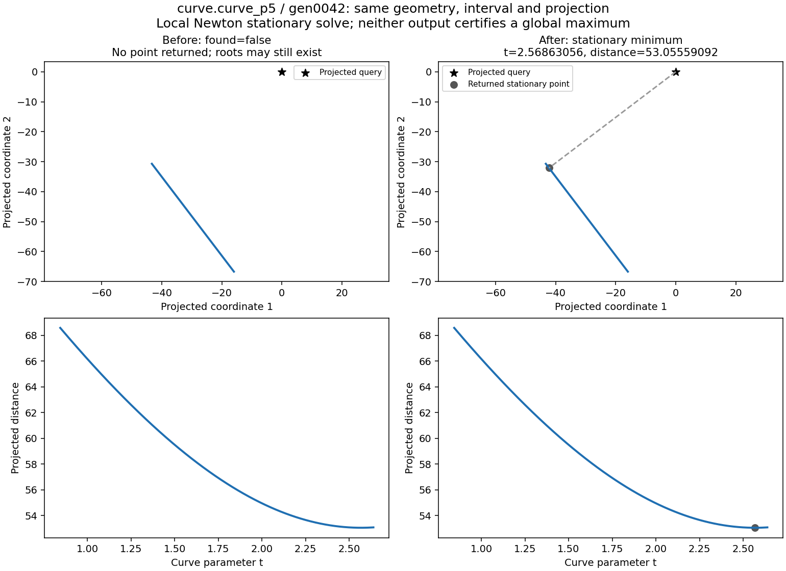

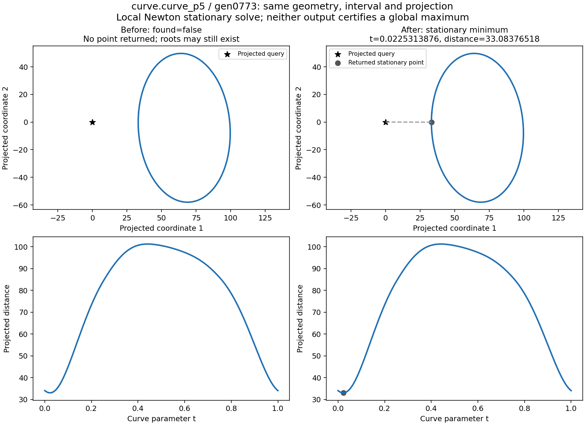

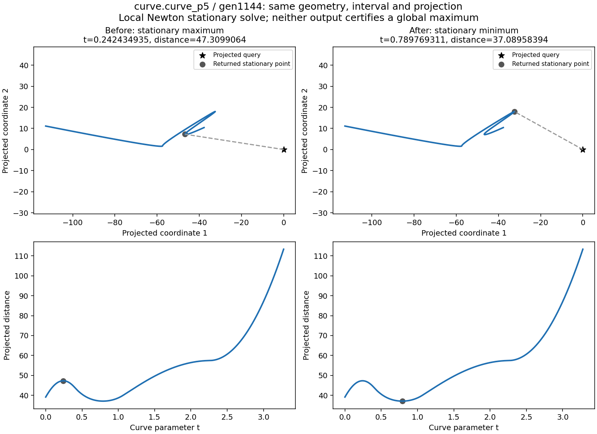

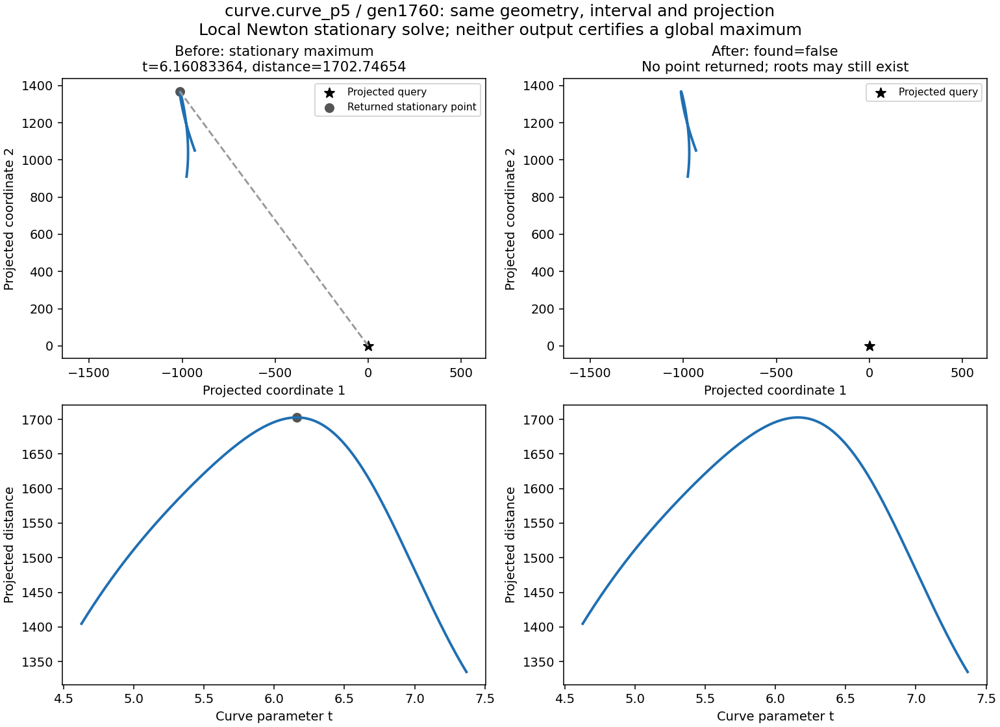

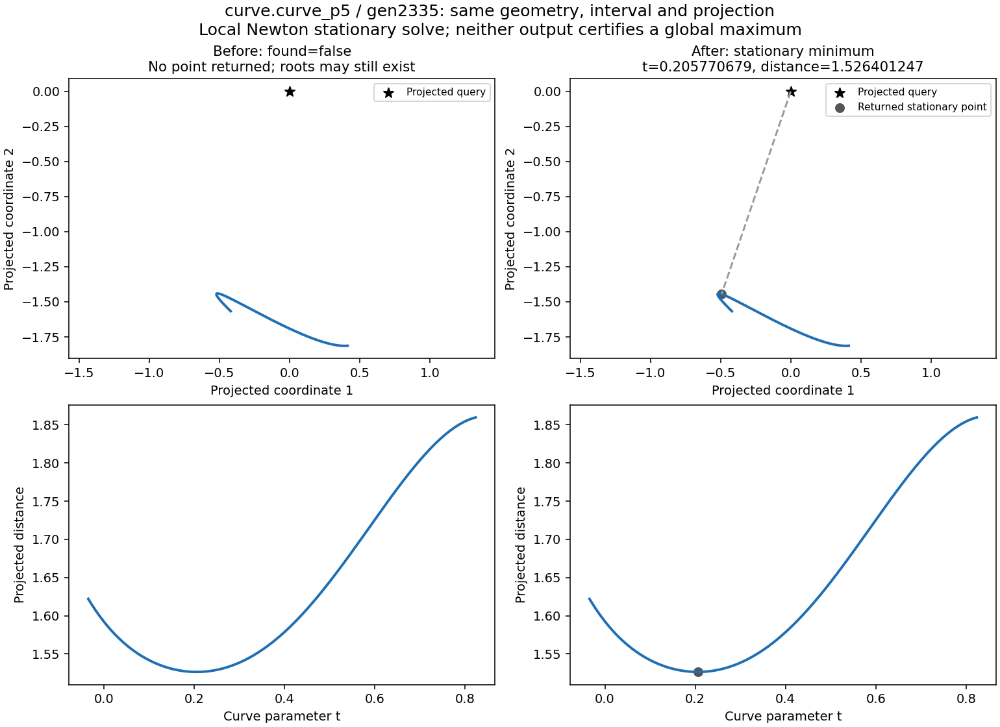

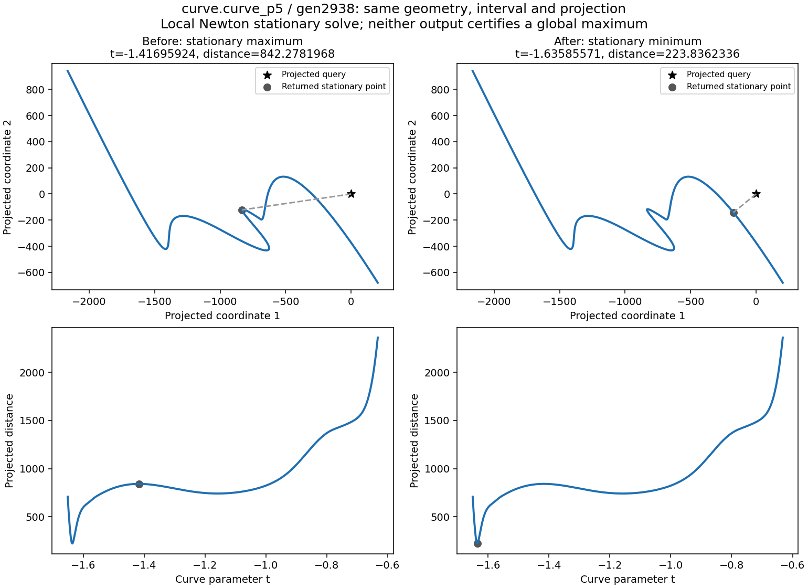

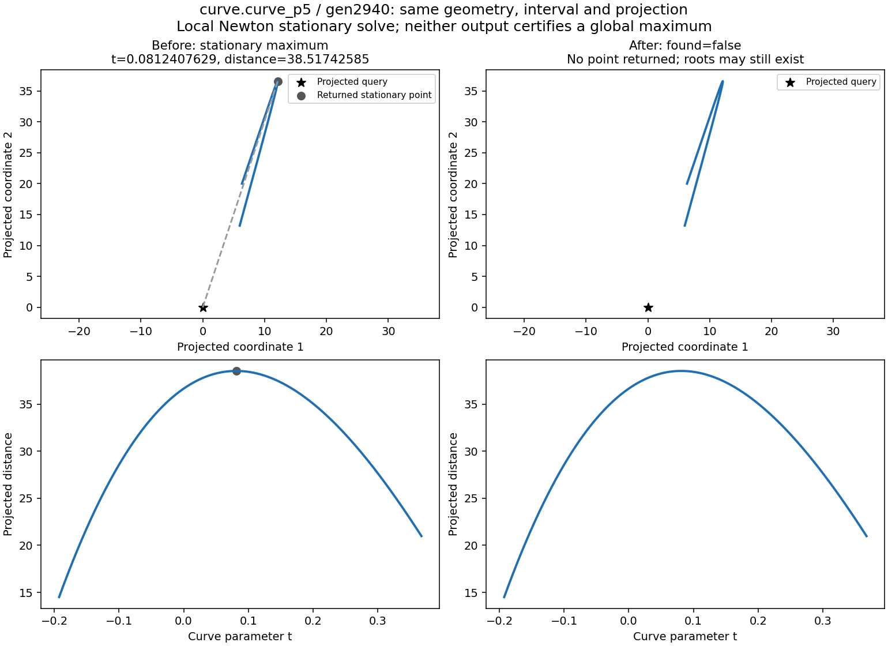

| p4 case | Native derivative | Rust derivative | Qualification |
|---|---:|---:|---|
| circle_property_21 | 0.64309503671411716 | -0.64309503671411716 | Matches independent smooth derivative |
| circle_property_21_null | 0.64309503671411716 | -0.64309503671411716 | Matches independent smooth derivative |
| gen0343 | 48.320386438490615 | -48.320386438490615 | Matches independent smooth derivative |
| gen0446 | 2.0158575156101239 | -2.0158575156101239 | Matches independent smooth derivative |
| gen0563 | 11113.792108902107 | -11113.792108902107 | Matches independent smooth derivative |
| gen0617 | 176.17894853692081 | -176.17894853692081 | Matches independent smooth derivative |
| gen0643 | 1328.1240378492116 | -1328.1240378492116 | Matches independent smooth derivative |
| gen0650 | 3.4752650729169097 | -3.4752650729169097 | Matches independent smooth derivative |
| gen1002 | 0.63172316674649853 | -0.63172316674649853 | Matches independent smooth derivative |
| gen1281 | -4.1947955102473973 | 4.1947955102473973 | Matches independent smooth derivative |
| gen1345 | 6.1274307413620921 | -6.1274307413620921 | Matches independent smooth derivative |
| gen1477 | -0.0042756974771357694 | 0.0042756974771357694 | Regularized zero tangent; sign only |
| gen1506 | 20.304791431505773 | -20.304791431505773 | Matches independent smooth derivative |
| gen1529 | 2313.4048875158164 | -2313.4048875158164 | Matches independent smooth derivative |
| gen1555 | 74.387085994451468 | -74.387085994451468 | Matches independent smooth derivative |
| gen1785 | 17493.959292360487 | -17493.959292360487 | Matches independent smooth derivative |
| gen1866 | -11.485183439048484 | 11.485183439048484 | Matches independent smooth derivative |
| gen2407 | 1.999531352594077 | -1.999531352594077 | Matches independent smooth derivative |
| gen2432 | -2090.9202731335936 | 2090.9202731335936 | Matches independent smooth derivative |
| gen2812 | 79.95773918004042 | -79.95773918004042 | Matches independent smooth derivative |
| gen2828 | -267.3591805617487 | 267.3591805617487 | Matches independent smooth derivative |

### Property stationary points (not a global extrema contract)

| Case | Query tolerance | Returned parameter(s) | Returned distance(s), local classification | Stored-domain maximum | Within query tolerance of maximum? |
|---|---:|---|---|---:|---|
| gen0204 | 0.1 | 0.9197458834128428 | 18.671389006901112, maximum | 33.337131619534404 | No |
| gen0247 | 0.1 | 5.320326948805733 | 3.4109831271925235, maximum | 3.4109831271925244 | Yes |
| gen0275 | 0.001 | 0.14871522759066944 | 29.774575607750659, maximum | 29.774575607750652 | Yes |
| gen0409 | 0.001 | 0.9575602192205206 | 4.6250196404095325, maximum | 4.625019640409532 | Yes |
| gen0509 | 0.001 | 0.9117265070172493 | 23.757505575290121, maximum | 23.757505575290114 | Yes, stored domain only |
| gen0735 | 0.1 | 0.6111736501042818 | 5.4676116781299413, minimum | 5.951094520215661 | No |
| gen0834 | 0.1 | 0.9198480289454729 | 5.0668265331752576, maximum | 5.066826533175257 | Yes |
| gen0933 | 1e-6 | 5.667762158756711 | 0.54203280602605997, maximum | 4.969521868984223 | No |
| gen0936 | 0.001 | 3.0095743060512032 | 5.3749025326382576, maximum | 5.3749025326382585 | Yes |
| gen1531 | 1e-6 | 0.6484668221329991 | 0.50654672270561063, maximum | 4.593165426545604 | No |
| gen1986 | 0.1 | 0.7060548169794392; 0.8337434617502735; 0.5623663475572159 | 0.086458069614975125, maximum; 0.012748673309883067, minimum; 0, minimum | 0.9576757302466963 | No |
| gen2049 | 0.001 | 1.6134778029167118 | 14.493501816701414, maximum | 14.493501816701421 | Yes |
| gen2341 | 1e-6 | 0.7483245754106941 | 13.228091125875489, minimum | 14.63657324597678 | No |
| gen2394 | 0.1 | 0.89496412675213 | 0, minimum | 3.1331587642464043 | No |
| gen2665 | 0.001 | 0.8132747916059548 | 6.621699366041069, maximum | 6.621699366041071 | Yes |
| gen2945 | 1e-6 | 0.1020561860909834 | 29.698809299538972, maximum | 29.698809299538972 | Yes |

### Curve-pair maxima: known incorrect answers remain

| Case | Original tolerance | Native result | Candidate result | Independent conclusion |
|---|---:|---|---|---|
| circle_projected_max | 1e-5 | Two distances 4.5, parameters near `(0.5,0)` and `(0.5,1)` | Same distances, exact parameters `(0.5,0)` and `(0.5,1)` | Both attain the maximum: center separation 3 plus radii 1 and 0.5 gives the triangle bound 4.5. Parameter-rounding differences at the closed seam remain native mismatches, not incorrect geometry. |
| gen0472 | 1e-5 | Two distances 5.0105715611725925; one parameter near zero | Two distances 5.010571561172592; exact zero replaces the near-zero parameter | Neither is a global maximum. Admissible ellipse angles 0 and 90 degrees give distance 5.346613700814649. |
| gen0844 | 0.5 | Distance 0 at `(2.340415323454198,2.340415323454198)` | Distance 0 at `(1.63857830683894,1.63857830683894)` | Neither is a maximum. Corner `(-2.44896896704292,3.043140518489156)` gives 10.979584714079621. |
| gen1839 | 0.0001 | One coincident pair, distance 0 | Original pair plus two pairs with distances about 4.24e-12 and 2.51e-15 | Neither candidate set contains a maximum. Corner `(0.43561427937496744,0.03474215986040488)` gives 4.40801559960347. |
| gen2050 | 0.0001 | One pair, distance about 6.1371363e-8 | Original pair plus two endpoint pairs of the same small distance | Neither candidate set contains a maximum. Corner `(0.42689846142600174,0.30573599521598394)` gives 40.00123197279587. |
| gen2187 | 1e-6 | One pair, distance 0.09955759757712898 | Original pair plus two endpoint pairs of the same small distance | Neither candidate set contains a maximum. Corner `(3.254294670614625,-3.304387257364806)` gives 6.310837322899527. |
| gen2585 | 0.5 | One pair, distance about 0.000128676797868 | Original pair plus two endpoint pairs of the same small distance | Neither candidate set contains a maximum. Corner `(0.6795950883084139,1.0610357492278748)` gives 0.9962268759220879, exceeding the returned distance by more than the original tolerance. |

### Topology query callers

| Case | Native distance | Rust distance | Query tolerance |
|---|---:|---:|---:|
| `gen2326` | `0.00040060002529845016` | `0.00018873029626767892` | `0.0001` |
| `gen2603` | `0.30420753099174874` | `0.0027330816133098457` | `1e-6` |
| `gen2818` | `68417.76422059476` | `23547.453225929043` | `100` |

### Analytic face and subdivided callers

The four cylinder curve/face rows below are known failures, not valid maximum
baselines. In projected coordinates their line spans `[-1, 1]` and the face spans
`[-0.5, 0.5]^2`: every pair has `|dx| <= 1.5`, `|dy| <= 0.5`, and an opposite
endpoint/corner pair attains both bounds. Thus the exact maximum is `sqrt(2.5)`.
Their incorrect `0.5` golden rows are removed and excluded under #3060 until the
pair construction in #3077 graduates the actual corrected outputs.

| Case | Native distance; parameters | Rust distance; parameters | Independent classification |
|---|---|---|---|
| `analytic_face_cyl_x_5_15` | 0.80000000000000004; (1.5707963267948966, 0.69999999999999996) | 1.063014581273465; (1.5707963267948966, 0) | Matches exact point-face maximum; native value is suboptimal even along the silhouette. |
| `analytic_face_cyl_x_6_15` | 0.5; (0.5, 0, 0.5) | 0.5; (0.25, 0, 0) | KNOWN WRONG: 0.5 is suboptimal. The admissible opposite-endpoint pair attains the exact maximum sqrt(2.5)=1.5811388300841898. Excluded under #3060; the pair construction is repaired in #3077, not this parent. |
| `analytic_face_cyl_x_7_15` | 0.5; (0.5, 0, 0.5) | 0.5; (0.25, 0, 0) | KNOWN WRONG: 0.5 is suboptimal. The admissible opposite-endpoint pair attains the exact maximum sqrt(2.5)=1.5811388300841898. Excluded under #3060; the pair construction is repaired in #3077, not this parent. |
| `analytic_face_halfcyl_x_5_15` | 0.80000000000000004; (1.5707963267948966, 0.69999999999999996) | 1.063014581273465; (1.5707963267948966, 0) | Matches exact point-face maximum; native value is suboptimal even along the silhouette. |
| `analytic_face_halfcyl_x_6_15` | 0.5; (0.5, 0, 0.5) | 0.5; (0.25, 0, 0) | KNOWN WRONG: 0.5 is suboptimal. The admissible opposite-endpoint pair attains the exact maximum sqrt(2.5)=1.5811388300841898. Excluded under #3060; the pair construction is repaired in #3077, not this parent. |
| `analytic_face_halfcyl_x_7_15` | 0.5; (0.5, 0, 0.5) | 0.5; (0.25, 0, 0) | KNOWN WRONG: 0.5 is suboptimal. The admissible opposite-endpoint pair attains the exact maximum sqrt(2.5)=1.5811388300841898. Excluded under #3060; the pair construction is repaired in #3077, not this parent. |
| `analytic_face_cone_x_5_15` | 0.85980762113533138; (0.49999999999999989, 0.27009618943233427) | 1.2039996853283075; (0.5, 1) | Matches exact point-face maximum; native value is suboptimal. |
| `analytic_face_sphere_band_5_15` | empty | 0.86054198087056166; (0.65499056183776805, 0.50000000000000011) | Reported-distance gap 1.314667583729e-5 exceeds query tolerance; approximate-silhouette output, not a strict corrected-result claim. |
| `analytic_face_sphere_quarter_5_15` | empty | 0.76157731058639078; (1, 0.50000000000000011) | Matches exact point-face maximum; native empty. |
| `analytic_face_torus_x_5_15` | 1.3756803885793853; (0.49997295102453776, 0.75) | 1.5652926944322216; (0.5, 0.97356185800456529) | Reported-distance gap 1.949364369036e-6 is within query tolerance, but exceeds 1e-9 relative; approximate-silhouette output. |
| `analytic_face_torus_x_6_15` | 1.25; (0.50000000000000011, 0, 4.1645158291059437e-15) | 1.25; (0.5, 0, 0) | KNOWN WRONG: native pair (t,u,v)=(0,0,0) attains sqrt(41)/4=1.6007810593582121, exceeding 1.25. Excluded here; #3077 repairs the half-torus pairs, while #3109 tracks full-torus surface attainment after that repair. |
| `analytic_face_torus_x_7_15` | 1.25; (0.50000000000000011, 0, 4.1645158291059437e-15) | 1.25; (0.5, 0, 0) | KNOWN WRONG: native pair (t,u,v)=(0,0,0) attains sqrt(41)/4=1.6007810593582121, exceeding 1.25. Excluded here; #3077 repairs the half-torus pairs, while #3109 tracks full-torus surface attainment after that repair. |
| `analytic_face_torus_half_x_5_15` | empty | 1.5652946437965907; (1, 0.97379278043265505) | Matches exact point-face maximum; native empty. |
| `analytic_face_torus_half_x_6_15` | 1.25; (0.50000000000000011, 0, 4.1645158291059437e-15) | 1.25; (0.5, 0, 0) | KNOWN WRONG: native pair (t,u,v)=(0,0,0) attains sqrt(41)/4=1.6007810593582121, exceeding 1.25. Excluded here; #3077 repairs the half-torus pairs, while #3109 tracks full-torus surface attainment after that repair. |
| `analytic_face_torus_half_x_7_15` | 1.25; (0.50000000000000011, 0, 4.1645158291059437e-15) | 1.25; (0.5, 0, 0) | KNOWN WRONG: native pair (t,u,v)=(0,0,0) attains sqrt(41)/4=1.6007810593582121, exceeding 1.25. Excluded here; #3077 repairs the half-torus pairs, while #3109 tracks full-torus surface attainment after that repair. |
| Case | Native count | Rust count | Native best | Rust / oracle best | Added only endpoints |
|---|---:|---:|---:|---:|---|
| `static_operation_matrix_1_15_0_0` | 1 | 1 | 0.10000000000000001 | 1.7 | yes |
| `static_operation_matrix_1_15_0_1` | 1 | 1 | 0.10000000000000001 | 1.7 | yes |
| `static_operation_matrix_1_15_1_0` | 1 | 1 | 0.10000000000000001 | 1.7 | yes |
| `static_operation_matrix_1_15_1_1` | 1 | 1 | 0.10000000000000001 | 1.7 | yes |
| `subdivided_1_14_1_12_11_2_1` | 5 | 12 | 0.5 | 0.5 | yes |
| `subdivided_1_14_1_12_11_2_3` | 5 | 12 | 0.5 | 0.5 | yes |
| `subdivided_1_14_1_12_11_50_1` | 5 | 12 | 0.5 | 0.5 | yes |
| `subdivided_1_14_1_12_11_50_3` | 5 | 12 | 0.5 | 0.5 | yes |
| `subdivided_1_14_1_40_30_2_1` | 16 | 40 | 0.5 | 0.5 | yes |
| `subdivided_1_14_1_40_30_2_3` | 16 | 40 | 0.5 | 0.5 | yes |
| `subdivided_1_14_1_40_30_50_1` | 16 | 40 | 0.5 | 0.5 | yes |
| `subdivided_1_14_1_40_30_50_3` | 16 | 40 | 0.5 | 0.5 | yes |
| `subdivided_1_14_1000_12_11_2_1` | 1 | 3 | 500 | 500 | yes |
| `subdivided_1_14_1000_12_11_2_3` | 1 | 3 | 500 | 500 | yes |
| `subdivided_1_14_1000_12_11_50_1` | 1 | 3 | 500 | 500 | yes |
| `subdivided_1_14_1000_12_11_50_3` | 1 | 3 | 500 | 500 | yes |
| `subdivided_1_14_1000_40_30_2_1` | 4 | 12 | 500 | 500 | yes |
| `subdivided_1_14_1000_40_30_2_3` | 4 | 12 | 500 | 500 | yes |
| `subdivided_1_14_1000_40_30_50_1` | 4 | 12 | 500 | 500 | yes |
| `subdivided_1_14_1000_40_30_50_3` | 4 | 12 | 500 | 500 | yes |
| `subdivided_1_14_1e+06_12_11_2_1` | 1 | 3 | 500000 | 500000 | yes |
| `subdivided_1_14_1e+06_12_11_2_3` | 1 | 3 | 500000 | 500000 | yes |
| `subdivided_1_14_1e+06_12_11_50_1` | 1 | 3 | 500000 | 500000 | yes |
| `subdivided_1_14_1e+06_12_11_50_3` | 1 | 3 | 500000 | 500000 | yes |
| `subdivided_1_14_1e+06_40_30_2_1` | 4 | 12 | 500000 | 500000 | yes |
| `subdivided_1_14_1e+06_40_30_2_3` | 4 | 12 | 500000 | 500000 | yes |
| `subdivided_1_14_1e+06_40_30_50_1` | 4 | 12 | 500000 | 500000 | yes |
| `subdivided_1_14_1e+06_40_30_50_3` | 4 | 12 | 500000 | 500000 | yes |

The audit script now checks maximality explicitly for the four cylinder
curve/edge projected maxima (`analytic_face_{cyl_x,halfcyl_x}_{6,7}_15`).
Each cylinder projects onto the rectangle [-0.5,0.5] x [-0.5,0.5], while
the query segment projects onto [-1,1] x {0}. Convexity of squared distance
in each coordinate places the maximum at opposite x endpoints with |y|=0.5:
`sqrt(1.5^2 + 0.5^2) = 1.5811388300841898`. The reported 0.5 fails this
check before and after the parameter changes. The new CSV column says `false`,
not a successful maximum certificate. These are additional concrete pair-query
reproductions for #3060; #2968 only certifies point/face maxima.

### Trimming callers: unresolved outputs are not blessed

| Case | Native result | Candidate result | Assessment |
|---|---|---|---|
| `pat_misses` | Error 1001 | 26 faces, 48 edges, 24 vertices | Keeping the entire filleted box is supported by the side proof below. |
| `pat_plain_misses` | Error 1001 | 6 faces, 12 edges, 8 vertices | Keeping the entire plain box is supported by the same proof. |
| `gen0070` | 1 face, 4 edges, 4 vertices | Empty | Unresolved; no independent proof supports deleting every face. |
| `gen0084` | 3 faces, 9 edges, 7 vertices | 5 faces, 16 edges, 12 vertices | Unresolved, with opposite-side retained vertices documented below. |
| `gen0086` | 2 faces, 7 edges, 6 vertices | 3 faces, 11 edges, 9 vertices | Unresolved; larger face count is not evidence of correctness. |

### Endpoint side and tolerant visibility

`topology.brep_p1/find_side_6`: for the projected cubic
`C(t)=(3t,6t-15t^2+9t^3)`, query `(-1,0)`, the unique minimum is at `t=0`.
The tangent/offset cross product is positive, proving left (`right=false`).
The pre-fix output was status 1001/UNSURE; success/false is correct.

`blend.hcr/gen0392`: the square-wire interval starts at
`0.014419226325001276`. Its distance from vertex 0 is
`0.0008*t = 1.153538106000102e-5`, within the existing combined zone `2e-5`.
The change Unknown -> Vertex therefore follows the tolerant classification
contract; it does not claim exact coincidence or increase a tolerance.

### Remaining limitations

The sphere-band maximum `0.8605419808705617` is short of the exact
`0.860555127546399` by `1.314667583729e-5`, exceeding the `1e-5` request.
This belongs to #2967/#2968, separately from the endpoint fix.
The six nonmaximum curve-pair outputs and unresolved finite-trim outputs above
must not be blessed as correct. The trim replay showed tied/opposing votes;
more retained faces, or an empty result, is not a correctness proof.

## References and durable regressions

The tests are consolidated into `crates/solidcore/tests/projected_curve_queries.rs`
and `crates/solidcore/tests/wr_660_planar_path_pose.rs`. The former keeps the
closed-form line/quadratic, raw-knot, bounds, and endpoint oracles; the latter
checks the actual elbow's Level2 validity and analytic volume.

- Boyd and Vandenberghe, *Convex Optimization*, section 4.2.3: constrained extrema
  include boundaries, not only stationary points.
- Miller and Goldman, *Using Tangent Balls to Find Plane Sections of Natural
  Quadrics* (1992), pp. 72-75: cylinder/plane ellipse semiaxes `r` and
  `r/abs(axis dot normal)`.
- The repository's `docs/definitions-and-certificates.md`, section 4.2: rounded
  interval enclosures include arithmetic error and are not sample estimates.

## Historical parent goldens migration after numerical review

This section records the #2840 migration, before the #2968 accuracy fix. The
sphere exclusion and counts below are historical. For the restored sphere record,
updated torus maximum and current traversal counts, see the
[current projected-maximum audit](intersect.topology_solver--projected-maximum-domain-certificate.md#golden-audit).

The reviewed run updates or adds 201 records (190 existing, 11 new fixtures).
The exact old/new serialized values are in the corresponding golden-file diff;
small within-comparison rounding changes are retained too. Eleven records are
excluded instead of blessed: six disproved pair maxima under #3060, four
unverified finite-cutter keep/delete results under #3061, and the sphere-band
accuracy failure under #2967. At that checkpoint the original elbow records remained excluded; they are graduated below.

| Unit | Updated/added | Geometric or API justification |
|---|---:|---|
| blend.hcr | 1 | gen0392's constrained endpoint is 1.153538106000102e-5 from the vertex, within the existing 2e-5 classification zone; Unknown becomes Vertex. |
| curve.curve_p1 | 61 | Per-span stationary-root and boundary audit above; affine enclosures; newly uncovered requests return 1021 rather than a result over a strict subset. Six fixtures exercise endpoints and local/global distinctions. |
| curve.curve_p4 | 24 | Negating the maximization stationary function also negates its derivative. For circle_property_21, +0.64309503671411716 becomes -0.64309503671411716. Three line fixtures check the scaled derivative directly. |
| curve.curve_p5 | 7 | Correct derivatives change local Newton basins and convergence. Returned roots were independently checked; gen1760 and gen2940 explicitly report nonconvergence, not a falsely certified maximum. |
| curve.curve_p7 | 16 | Added roots satisfy the stationary polynomial; this property-analysis path is not asserted to return the constrained global maximum. The independent classifications above disclose minima and secondary maxima. |
| curve.curve_p9 | 1 | circle_projected_max keeps distance 4.5 = center separation 3 + radii 1 + 0.5; seam parameters become exact endpoints. All six suboptimal pair cases are excluded under #3060. |
| geom.global_solver | 2 | New scaled-normal fixtures verify disk radii and center distances use the same double-cross metric as the incumbent. |
| intersect.topology_solver_p1 | 42 | Valid endpoint additions/rounding are retained; incomplete domains return 1021. gen1646 now completes all three calls with reported distance 0 and t=0.6406108473689741, within its arithmetic enclosure of the near-zero true distance. Reported 0 is not an assertion of exact incidence. |
| intersect.topology_solver_p2 | 40 | Closed-form cylinder/cone/sphere/torus audits and unchanged-best subdivision endpoint additions above. The torus point-face maximum differs from the exact oracle by 1.949364369036e-6, within its 1e-5 request. The sphere-band case was excluded in this parent migration; #2968 restores it, as detailed in the current audit linked above. |
| primitive.api_trim_ops | 2 | pat_misses and pat_plain_misses retain the complete box, proved by the finite-cutter side inequality below. Four unverified finite-cutter outputs are excluded under #3061. |
| topology.brep_p1 | 1 | find_side_6 changes 1001/UNSURE to success/left, by the endpoint tangent cross product above. |
| topology.brep_p10 | 4 | The raw-knot lens is entirely reference-side: KeepPoint retains one face and DeletePoint retains none, for both narrow knot widths. |

For the two missed-box trim cases, the cutter is
`x(t)=100+3t`, `y(t)=-2+21t-36t^2+19t^3`, `0<=t<=1`.
The box and reference project into `0<=qx<=10`, `0<=qy<=5`.
The squared-distance derivative divided by two is bounded below by
`3*(x-qx)+(y-qy)*y' >= 270-147 = 123 > 0`, so the nearest point is the
first endpoint. Its side expression `3*(qy+2)-21*(qx-100)` is positive
throughout the box and at the reference. The filleted box is a subset.

The returned geometry is checked directly by
`missed_cutter_keeps_geometry::{pat_plain_misses_retains_complete_input_geometry,
pat_misses_retains_complete_filleted_input_geometry}` in
`crates/solidcore/tests/projected_curve_queries.rs`. Both tests construct the
exact golden fixture through the same public box, fillet, curve and trim APIs.
Before and after the trim they compare complete binary curve and surface
records: analytic definitions and placements, NURBS control points, weights,
knots and orientations, plus UV trim definitions. They also compare vertex
positions, edge intervals, face domains, tolerances and oriented boundary
connectivity. This is exact record equality, with no sampling or numerical
tolerance, and establishes the same bounded surface definitions and enclosed
body. Serialization-only NURBs are materialized on ordinary surface copies
with fresh cache slots, so the check does not prime the operation's cache.

The optimized production library passes both checks: 198 geometry/topology
records for the plain box and 786 for the filleted box are unchanged. As a
negative control, each test constructs a valid box translated by `(1,2,3)`
with identical face/edge/vertex counts and confirms the same comparison rejects
it. A matching face's full surface-definition bytes must differ too; a change
in arena identifiers alone cannot satisfy the control. Thus topology counts
cannot conceal a moved or altered returned body. No golden or kernel code is
changed by this additional regression evidence.

For the raw-knot lens, both forward boundaries have `x=-1+2s`, with
`y_upper=0.2s+0.8s^2` and `y_lower=-0.2s+1.2s^2` for `0<=s<=1`.
They lie below the cutting segment `y=s` in the interior. The reference
`(-1.5,-1)` is on that same side, proving retained-face counts 1/0 for
KeepPoint/DeletePoint. The affine tests independently check the underlying
minimum; correct face votes alone are not used as its certificate.

The fresh finite-trim case gen0018 is TrimProjectParallel on a filleted box,
with a finite arc and DeletePoint. It returns 27 faces / 60 edges / 33 vertices;
its record changes from 1587 to 1703 values. It is explicitly unverified under
#3061, alongside gen0070, gen0084 and gen0086, not silently blessed.

Validation on the factorized line-direction implementation: formatting, strict
workspace/all-target Clippy, WASM, and all 21 projected-query integration tests
pass. The complete golden sweep passes all 283 units with no unexpected changes
or broken cases, using the documented known-failure exclusions. The full Rust
suite passes 5235/5235 tests, with 47 skipped, using CI's pinned Nextest 0.9.150
and goldens profile (overflow checks and debug assertions enabled). This includes
all 14 internal affine/cache tests. The doctest command also succeeds; the crate
currently has no executable doctests. The earlier sequential debug/optimized
integration runs were superseded by this complete CI-profile run.

The kernel rig remains blocked by the unchanged 180-second deadline for
`fillets/cov-fillet-section-curvature-boss-root-r2`, already tracked on main in
#2989. It graded 368 cases: 285 pass, one timeout, 69 unsupported and 13
known-failing; 711 cases were not run. A case-only replay also timed out at
180.03 seconds. Other validation jobs were paused during that replay, but were
running at its start; this is not a controlled main-versus-PR timing comparison
and does not establish regression attribution. The captured union-case replay
passes. No deadline, tolerance, fixture or classification was changed to hide
the timeout. Hosted CI separately requires repository-admin workflow approval.

## Historical projected-face checkpoint (superseded by strict review work)

The following records the earlier `711b12437` checkpoint. Its combined caller/
comparison-point allowance was subsequently rejected in review and is not the
current certificate contract. The strict own-enclosure revision and its separate validation are recorded
below; the earlier 33-test result does not validate that revision.

The face certificate now distinguishes retention slack from arithmetic rounding.
For a face-owned incumbent it uses the lower endpoint of its singleton metric
interval, plus the caller's slack and that interval's width. Each parameter box
may additionally use the width of the metric interval at its single midpoint.
No geometric parameter-box width is counted as arithmetic error, and no absolute
or relative accuracy floor is introduced. A previous feasible incumbent from
another object receives no additional incumbent rounding allowance here.

The zero-slack plane regression returns the exact constrained corner maximum for
normals `Z` and `2Z`; changing the reported scalar by four times its computed point
enclosure width is rejected in either direction. The quadratic hidden-peak test
also closes at zero slack while rejecting a lower, nonmaximal candidate.
This does not claim complete candidate construction for every surface: a radius
0.5 sphere patch over longitude [-90,90] and latitude [-60,60], queried from
(-1,0,2) along Z at zero slack, currently constructs a boundary value 1.25 and
refuses it because the interior maximum is 1.5. Arithmetic allowance does not
turn that missing-candidate case into a successful answer.

The near-zero point-answer shortcut now excludes the entire Maximize category,
including ordinary and directed maxima. A full torus with radii 1 and 0.25 queried
at its sole seam vertex has maximum distance 2.5, rather than the early vertex
answer 0; the directed case at an X offset of 5e-7 has maximum 2.5000005.
The regression uses the body's proven owner identities and asserts two seam
curves and one face are present in its cache. Arena-only keys on this generated
fixture omitted the seam curves and were an invalid diagnostic setup, not a new
kernel accuracy issue. Both analytic expectations remain unchanged.

All 33 focused topology-solver tests pass for this review change. Full validation
of the final parent/main merges remains a separate gate; earlier full-suite
results above are not attributed to these later changes.
## Original seeded elbow cases

The direct replay in `diagnostics/check_small_elbow_cases.rs` obtains `gen0092`
and `gen0189` from the actual seeded runner, rebuilds their curves and flags,
and checks the returned bodies independently of the runner's success flag.
At checkpoint `ed6119602` both inputs are identical and both pass Level2 validity
with no failed checks. Their measured volume is `6.283172176379765e-8`, versus
`pi * 0.001^2 * 0.02 = 6.283185307179586e-8`: relative error
`2.089831698288911e-6`, within the existing `1e-4` volume assertion.
The exact inputs, values and generated golden records are retained in
`diagnostics/small_elbow_seeded_cases.json`.

Both formerly excluded records now have actual runner-generated goldens:
`record = [0,0,0,0,0,0,0,0,0,0,1]`. The success status alone would not establish
the fix: the validity and volume checks above distinguish the corrected body
from the old successful-but-invalid body. The old vertices were
`0.00182842712474619` off their incident faces.

The cases are generated golden inputs, not entries in `tests/kernel_cases`;
there is no existing gallery entry or `gallery_note` to change. The ignored
file-writing exporter has been removed from the ordinary regression test file;
the explicit diagnostic helper replaces it. The fixture filenames now describe
the behavior, while their stable case identifiers preserve audit correspondence.

The shaded after image is rendered by `solidcore-diag` at azimuth -55 degrees,
elevation 22 degrees, size 1200 by 900, using the binary SMB emitted by the helper:

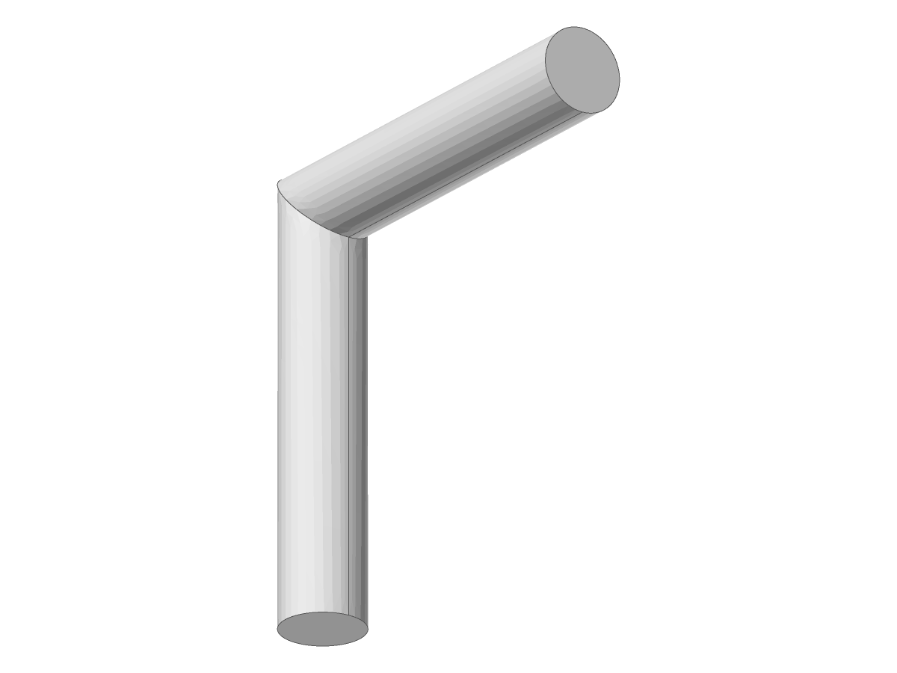

The shaded path refuses to convert the old invalid body to a mesh
("a sheet touching itself along an edge"). The explicit `--wireframe` mode in
#3089 (diagnostics commit `f62bab308`) renders both bodies' native edges without
attempting that conversion. Both images below use the same azimuth, elevation,
image size and `--edges-above 0.00002` setting. The reports explicitly identify
wireframe mode and `mesh.attempted: false`; no repaired or substituted body is
used as the before image.

| Before: invalid small elbow | After: valid small elbow |
|---|---|
| 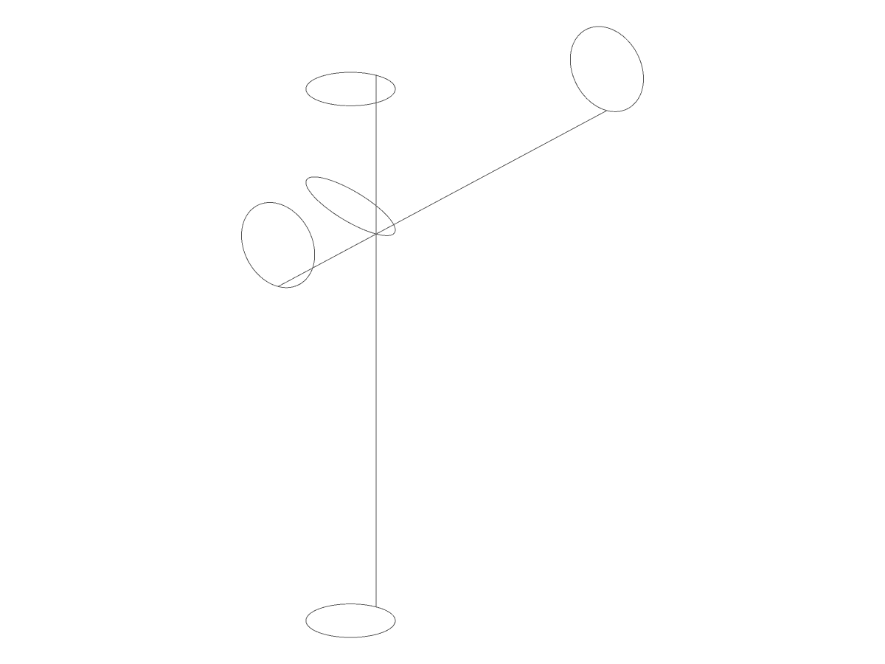 | 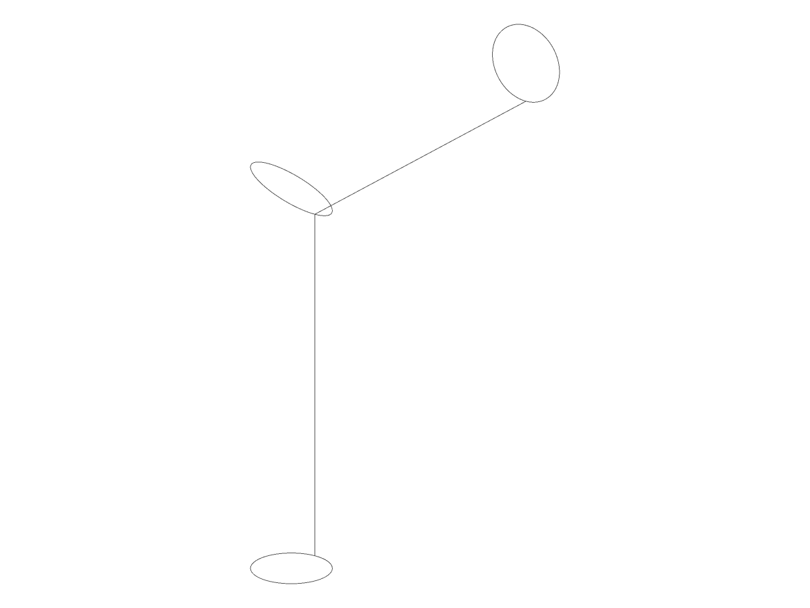 |


## Strict projected-face certificate revision

The current construction uses only the returned point's own definition-based
metric enclosure. Caller distance tolerance selects retained answers; it never
increases the construction cutoff. A face, edge, or vertex incumbent is enclosed
from its actual geometry and native parameter side, and its reported scalar must
lie inside that enclosure. Unsupported incumbent definitions explicitly refuse
certification instead of trusting an unchecked reported distance.

Native UV refinement uses at most 48 active-set Newton steps to improve the
candidate on its exact rectangular trim. This is candidate generation, not a
maximality proof. The independent whole-face check uses homogeneous Bernstein
coefficients of `U^2 W^2 - |N x (H-QW) x N|^2`, where `U` is that same candidate's
own upper metric enclosure. Positive native weights and nonnegative residual
coefficient lower bounds prove the bound over every requested knot patch.
Neither another point's arithmetic width nor geometric parameter uncertainty
is added to `U`.

This bounded proof supports degree at most 8 in each surface parameter, visits
at most 4096 subdivision cells, and uses depth at most 64. Higher degrees,
exhausted budgets, unresolved coefficient signs, and uncovered discontinuous
upper boundaries explicitly refuse certification. Degree-8 success and
otherwise equivalent degree-9 refusal are tested separately. These bounds are
implementation limits, not evidence that the unsupported geometric query has
no answer; affected golden cases must be audited before updating expectations.

A zero projection normal has identically zero projected numerator. It therefore
certifies at upper bound zero without an arithmetic floor. Negative or nonfinite
upper bounds and invalid inputs remain refusals. Native discontinuous knots
use the actual evaluator's default side for the candidate; the other side is
never treated as point rounding. An isolated native-right value at a requested
upper boundary remains a refusal until it is included in the global proof.

Validation of this integrated revision: all 44 topology-solver unit tests pass,
including all eight cases that the strict mean-value bound previously refused.
The original plane, sphere, trimmed/banded sphere, tilted projection, torus and
traversal-order expectations are unchanged. The seven residual-specific tests
include independent polynomial, rational-weight, knot-extraction and degree-limit
controls. Strict library/tests Clippy and formatting pass. The panic-site
inventory reports no unlisted sites; its Windows base-revision lookup uses a
backslash path, so the authoritative base-list ratchet remains a Linux gate.
Broad golden validation remains separate; earlier full-suite totals above
belong to their identified historical checkpoints.

## Exact joins and strict affine construction

Review [4501494576](https://github.com/tangency-labs/solidcore/pull/2968#discussion_r4501494576)
identified an inherited #2840 defect: the cache's G1 classification permits a
0.5-degree kink, but the affine solver treated that classification as proof that
the join could not be an endpoint extremum.

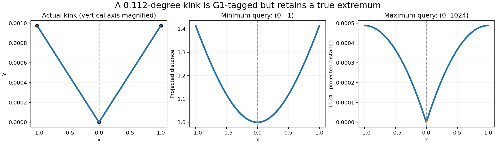

The raw degree-one polyline has controls `(-1, 1/1024, 0)`, `(0, 0, 0)`,
`(1, 1/1024, 0)` and knots `[0, 0, 1, 2, 2]`. Its turn is about 0.112 degrees,
so the cache marks the middle knot G1. Projection has normal `(0, 0, 1)`.
For query `(0, -1, 0)` the unique minimum is 1 at parameter 1; the pre-fix
public API returns an empty successful result. For query `(0, 1024, 0)` the
unique maximum is 1024 at parameter 1; the pre-fix API instead returns
1023.9995117190992 at parameter 0. Both failures exceed retention slack `1e-8`.
An exactly collinear control retains its two outer All maxima and excludes the
artificial middle endpoint even with retention slack 10.

Writing `u = |x|` and `e = 1/1024`, the squared minimum objective is
`1 + 2 e u + (1 + e^2) u^2`, strictly increasing for `0 <= u <= 1`.
The squared maximum objective minus `1024^2` is
`u ((1 + e^2) u - 2)`, strictly negative for `0 < u <= 1`.
Thus both expected extrema follow from the exact defining dyadic data,
independently of solver samples.

### Construction

Shewchuk's [Adaptive Precision Floating-Point Arithmetic and Fast Robust
Geometric Predicates](https://www.cs.cmu.edu/~quake/robust.html) explains why
near-zero determinant decisions need exact or certified arithmetic. Here the
existing bounded dyadic product accumulator is extended from four to at most
eight terms; no external implementation is imported. Eight products need at
most 4199 bits, within the existing 4224-bit storage.

An approximate G1 boundary is omitted only if its defining adjacent affine
spans have exactly equal projective endpoint positions, exactly parallel raw
chord differences, and matching nonzero orientation. The cross product is
expanded into eight binary64 products before any subtraction rounds the
chords. Constant positive homogeneous weights cancel from the direction test;
endpoint equality uses exact cross-multiplied weights. Repeated knots and
closed seams must pass the same position test. A subdivision strictly within
one affine span is already smooth. Both the early minimum omission and the
endpoint candidate list use this same criterion.

This changes no cache continuity thresholds, solver accuracy allowance, or
retention tolerance. Failure to establish exact smoothness keeps the candidate.
Non-affine stationary solving is unchanged.

### Validation

The standalone public-API reproduction is
`diagnostics/projected_g1_joins_2840.rs`; permanent regressions are consolidated
in `tests/projected_curve_queries.rs`. Internal predicate coverage includes
subnormal/large coordinates, reversed chords, different homogeneous weights,
a true positional gap, and a kink erased by rounded chord subtraction.
All 15 `curve::curve::p1::tests` pass, including the new exact predicate and
the existing adjacent-float interior-minimum refusal. All 24 projected-query
integration tests pass on the final binary span-lookup version. Strict
`cargo clippy -p solidcore --lib --tests -- -D warnings` and modified-file
rustfmt checks pass;
repository-wide and golden gates belong to the parent
integration rather than this isolated review branch.

### Follow-up: cubic joins and retention slack

The same angular-cache omission also affected native cubic C0 knots. The new
public regression uses two cubic Bezier spans with controls
`(x, |x|/1024, 0)` for integer `x = -3..3` and a triple middle knot. It is the
same small kink drawn above, scaled by three. Its projected minimum from
`(0,-1,0)` is 1, and its projected maximum from `(0,4096,0)` is 4096, both at
the middle knot. Before the follow-up the maximum is wrong; the minimum passes.
Native knot multiplicity now proves C1 continuity where applicable. At C0 knots
the defining endpoint chords must pass the exact position/direction predicate;
the existing policies for other geometry types are unchanged.

The [maintainer contract](https://github.com/tangency-labs/solidcore/pull/2840#discussion_r4496188362)
separates retention slack from construction accuracy. A new mutation regression
confirms that the raw `1.5e-12` span's unrepresentable minimum wrongly succeeds
when slack rises to `1e-4`. The affine certificate now compares the whole-objective
bound against the selected candidate's own enclosure: global upper <= candidate
upper for a maximum, global lower >= candidate lower for a minimum. It cannot
borrow slack or another point's enclosure width. A scalar outside its independently
computed candidate enclosure is refused. Retention filtering remains unchanged.

The carrier lower bound is computed directly as
`|N|^2 |(A-Q) dot (N cross D)| / |N cross D|`, using the defining anchor and raw
direction factors. This avoids a dependency-expanded bound at a rounded foot.
The mathematical endpoint difference is also enclosed from those factors before
world-space endpoint subtraction can erase a short direction. A whole leaf may
be skipped only when its objective lower bound exceeds an independently enclosed
incumbent's upper bound plus retention slack. This is a proof that none of its
answers can be retained, not permission to publish an inaccurate local minimum.

Carrier arithmetic steps the result of each correctly rounded binary64 operation
one representable value outward. Exact zero/one identities avoid needless
dependency expansion; nonfinite operands/results and a denominator containing zero
give an unbounded interval and cannot certify success. This includes subnormal
and signed-zero boundaries without the older interval helper's fixed absolute
padding. Only the objective proof is tightened: candidate point enclosures are
unchanged. Unit checks cover a nonrepresentable rational quotient, half a minimum
subnormal, signed zero, overflow, division by zero, cancellation, and a 3-4-5 norm.
When the constrained foot is outside the segment, the analytical endpoint bound
is used directly instead of expanding an interpolation at fraction zero or one.

The exact [representability oracle](diagnostics/projected_affine_representability.py)
uses rational input bits and the quadratic
`5(s-(2+y)/5)^2+(1-2y)^2/5`. The two binary64 parameters bracketing its exact foot
include the best representable parameter. The original raw spans remain covered:

| Knot width | Parameter scale | Query y | Least representable excess |
|---|---|---|---|
| `1.5e-12` | 1 | 0.2 / 0.3 | `8.167385e-9` / `2.756492e-8` |
| `1.9e-12` | 1 | 0.2 / 0.3 | `8.143492e-10` / `9.237773e-9` |
| `1.5e-12` | `1e6` | 0.2 / 0.3 | `8.980330e-11` / `1.091110e-8` |

These exceed rounding at unit geometric scale and now require explicit refusal,
including with nonunit normals and unchanged positive retention slack. The
successful width-`1e-8` controls have excesses `5.05e-17` through `1.05e-15`;
their success still requires the production own-enclosure proof. No test tolerance
is increased to accept the old geometric errors. The adjacent-float refusal and
the zero-retention near-zero minimum remain required controls.

The original `gen1172` kink at `t=1/3` is not an extremum: exact rational
evaluation gives positive left and right squared-distance derivative signs,
with values approximately `0.017863361436596496` and `0.01786536879786583`.
The newly added conservative endpoint at distance `0.03560538710098969` must
therefore be removed even though it lies within slack 0.05. A defining-data
one-sided sign check excludes it after proving exact positional continuity;
the true near-collinear kink extrema remain candidates.

Mutation baseline: the library built from `0406d00e9` (same p1 construction as
parent `ed6119602`) was linked with the new public tests using `rustc --test`.
`retention_slack_cannot_make_an_unrepresentable_minimum_accurate` failed at slack
`1e-4`; `cubic_near_collinear_join_retains_projected_extrema` failed on projected
maximum Single (true value 4096). Green commands are
`cargo test -p solidcore --test projected_curve_queries` and
`cargo test -p solidcore --lib curve::curve::p1::tests`; final results are recorded
with the implementation handoff. The source branch merges parent `ed6119602`
at `bee1aa6ab`; no published history is rewritten.

### Dyadic arithmetic bounds and exact direction factors

The masked binary64 exponent is at most 2047, so conversion to `i32` is exact;
finite inputs limit it to 2046. `parts` therefore produces exponents in
`[-1074,971]` and significands below `2^53`. A product fits in 106 bits of `u128`.
`ea + eb + 2148` lies in `[0,4090]`, so its `usize` cast is lossless on wasm32
and native targets. The high product word is shifted by at most 4154. Eight
same-sign products occupy at most 4199 bits, within 66 words (4224 bits).
`shift % 64` has the literal nonzero divisor 64 and gives a shift from 0 through
63; the other shifts are the constant 64 on `u128`. Adding two low words is at
most `2^65-2`; the `u64` casts intentionally retain low words while the high bits
are carried. All accumulator access is checked. These bounds are also next to
the operations in the source. The panic inventory automatically proves literal
nonzero divisors; no unproved panic site is being parked in its table.

The exact factors implement the mathematical `end - start` direction without
first rounding two evaluated endpoints. For a mapped line it is a scalar times
the defining vector; zero scalar factors and exact vector parallelism determine
constant projection. Two public cases require this distinction:

| Regression | Rounded endpoint subtraction loses | Exact-factor behavior |
|---|---|---|
| `mapped_line_parallelism_survives_endpoint_rounding` | True parallelism for the line from `(0.1,0.2,0.3)` to `(1.7,2.9,4.2)` | Returns the constant projected range at zero slack |
| `mapped_line_does_not_erase_a_small_transverse_direction` | The `1e-16` transverse component added to coordinate 1 | Keeps isolated values rather than claiming a constant range |

For native spans the raw difference is expanded directly into exact product
identities. Its constant positive weight and parameter scale do not change
parallelism. The scalar direction is never inferred from a tolerance or samples.
The local next-parameter helpers retain Rust 1.85 support: standard
[`next_up`/`next_down`](https://doc.rust-lang.org/std/primitive.f64.html#method.next_up)
stabilized in Rust 1.86.

Final strict-construction validation (source branch based on `bee1aa6ab`):

- `cargo test -p solidcore --lib curve::curve::p1::tests`: 18 passed, including
  directed arithmetic boundaries and actual right-valued native point enclosures.
- The optimized `curve.curve_p1` golden replay of the strict construction:
  3102 cases passed; changed 0, added 0, removed 0, broken 0. This includes the
  corrected `gen1172` behavior without changing a golden expectation.
- `python plan/findings/diagnostics/projected_affine_representability.py`:
  exact rational representability checks passed for all twelve controls.

The shared internal `affine_projected_point_enclosure` gives callers an enclosure
of the actual native point, not a neighboring span limit. It selects the right
control at an interior linear-spline knot and the actual first/last control at
natural endpoints. Unsupported curved or variable-weight affine-span interiors
return no enclosure. Its regression distinguishes a discontinuous right value
10 from the left limit 1 and also checks a mapped analytic-line point.

#### End-to-end endpoint mutation

The checked construction passed all 28 public projected-curve regressions. To
isolate the elbow fix, the same source on base `bee1aa6ab` was mutated only by
changing `if !omit` to `if false && !omit` in the affine endpoint candidate loop
and `if projected_extremum` to `if false && projected_extremum` immediately before
the generic constrained endpoint loop. No metric, tolerance, or elbow fixture
changed. The SHA-256 hashes of `crates/solidcore/src/curve/curve/p1.rs` for this
experiment were:

- baseline/restored: `778772381c17132f939781a402038404916961b796734201d697756efb3bbe2e`;
- endpoint-disabled mutation: `3493b2a98a4cb228288960257c1b153d46bde55c374b3f17d43676d056d0cdbc`.

Both runs used:

```text
cargo test -p solidcore --test wr_660_planar_path_pose small_profile_mitres::small_radius_short_legs -- --exact --nocapture
```

The mutation failed the body-validity assertion for radius `0.001`, leg `0.01`,
and construction tolerance `1e-7`. It reported two vertex-face gaps of
`0.0018284271` against the validity tolerance `2e-5`. Restoring the baseline bytes,
verifying their hash, and rebuilding made the identical test pass (1 passed,
11 filtered). The mutation is not part of the implementation. Subsequent
repository-edition formatting only reordered imports and formatted assertions;
the final source hash is
`1f0abc62cf3b39915c631bcf2fbc6b451dabdfbb2bdcd872fecbcdc51ebb2308`.

`cargo clippy -p solidcore --lib --tests -- -D warnings` passed on the final
implementation and tests. The modified Rust files pass repository-edition
formatting; `git diff --check` passes.
