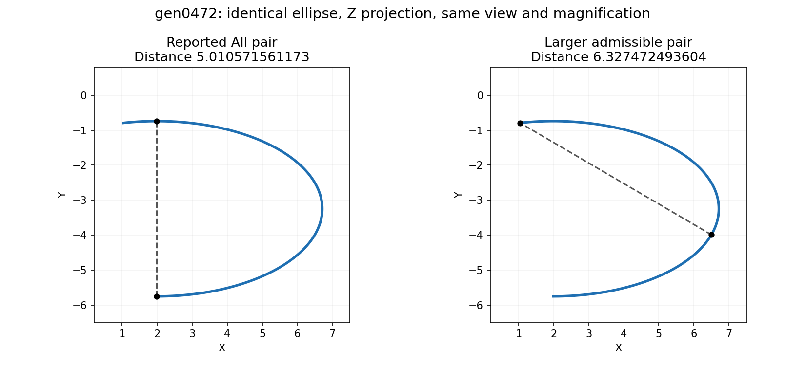

# Finite ellipse maximum construction: research for the remaining All case

This is a design note, not a new dispatch or a certified root implementation.
`gen0472` remains open until complete finite enumeration is implemented and audited.

The dashed chord measures the returned pair at left and the larger witness at right;
this is measured geometry, not a claim that the new root construction is complete.

## Existing failure and a stronger feasible witness

The native ellipse has radii `a=4.723327346620286`,
`b=2.505285780586296`, STEP angles `[-90,101.59684508222117]` and
NURBS natural interval `[0,1]`. Its requested intervals cover that natural domain.
For the Z projection, independent rational-arc evaluation gives a feasible pair:

- STEP angles approximately `(-17.253404145366,101.59684508222117)` degrees;
- native NURBS parameters approximately `(0.3812096251375738,1)`;
- projected distance `6.327472493603755` (and the swapped pair).

This is a numerical witness, not a root-completeness certificate. It is larger
than the original issue's already sufficient STEP 0/90 witness. No expected
output or known-failure exclusion is changed by this note.

## Analytic reduction for one identical ellipse

For `E(theta)=(a cos(theta),b sin(theta))`, put
`m=(theta+phi)/2` and `d=(theta-phi)/2`. Direct expansion gives

`D² = 4 sin²(d) [a² sin²(m) + b² cos²(m)]`.

With positive unequal radii, a distinct interior stationary pair must have
`d=pi/2 mod pi` and `m=0 or pi/2 mod pi`: the principal-axis antipodes.
The diagonal has zero distance and cannot be a nonconstant maximum. Thus a
finite complete candidate set comprises those interior pairs, all rectangle
corners, and every stationary root on each parameter edge.

For a fixed edge angle `theta`, the other angle `phi` satisfies

`(b²-a²) sin(phi) cos(phi) + a² cos(theta) sin(phi) - b² sin(theta) cos(phi) = 0`.

The half-angle substitution `z=tan(phi/2)` yields the quartic

`b² sin(theta) z⁴ + 2(a²-b²+a² cos(theta)) z³`
`+ 2(b²-a²+a² cos(theta)) z - b² sin(theta) = 0`.

The chart pole `phi=pi mod 2pi` must also be tested explicitly. Chart splitting,
root isolation, endpoint inclusion, inward derivative signs, and the second
variation distinguish maxima from other stationary points. Merely finding some
quartic roots is not a completeness proof.

The same edge reduction can be expressed directly in native rational parameters:
for `C(t)=Y(t)/W(t)` with quadratic homogeneous polynomials and fixed point `Q`,
set `A=Y-QW`. The derivative numerator of squared distance is
`2(A dot A')W - 2(A dot A)W'`; its degree-five leading terms cancel, leaving at
most a quartic. This avoids guessing STEP-to-NURBS parameter conversion during
certification and preserves the original requested intervals.

## Safe next implementation boundary

Reuse `curve_on_quadrics` for the analytic exact class, and the existing
`conic_turn` certificate to establish a nonzero, nonreversing angular traversal.
Attached arbitrary nets must not be assumed to have the canonical parameter map.
For a general projection, the two projected semiaxes form a 2x2 Gram matrix;
its eigenvalues identify a nondegenerate noncircular ellipse after a phase shift.
Non-unit normal scaling remains in the projected semiaxes. Equal eigenvalues,
rank loss, repeated roots, unresolved endpoint identity, or unproved angular
coverage need explicit handling or refusal, never sampled enumeration.

`geom::polynomial::solve_quartic` provides approximate root candidates, not
certified isolation. A bounded interval/Bernstein root exclusion and uniqueness
pass must cover every native arc piece, with point-enclosure rounding kept
separate from retention slack. The existing finite-candidate accumulator should
own retention and ordered duplicate rules.

A line/ellipse maximum is convex in the line parameter, so it reduces to the
two line endpoints and complete point/ellipse edge constructions. Different
ellipse pairs require a separate coupled stationary-system proof; they are not
covered by the identical-ellipse reduction. In particular the existing
`circle_projected_max` fixture (distinct offset circles, maximum 4.5) must retain
its existing behavior. Identical circles may have an antipodal continuum, whose
joint-parameter range representation is still a maintainer question.

## Primary reference and scope of inference

[Eberly, *Distance from a Point to an Ellipse, an Ellipsoid, or a Hyperellipsoid*,
section 2.1](https://www.geometrictools.com/Documentation/DistancePointEllipseEllipsoid.pdf)
derives the stationary normal equation for point/ellipse distance. Its closest-
point monotone-root branch is not an algorithm for enumerating every farthest
stationary point. The quartic and identical-pair reduction above are direct
algebraic derivations for this maximum problem. Complete interval root exclusion
would follow the bounded-search principles already cited in the main #3060
finding; no sampled search or approximate quartic solver alone is a certificate.

## Test-only native edge isolation prototype

The separate follow-up has a bounded interval edge isolator, still outside
production dispatch. On every native knot piece it encloses
`g=(P-Q) dot P'` and `g'=P' dot P'+(P-Q) dot P''` after the complete double-cross
projection. A nonzero g excludes stationarity; positive g' excludes a maximum.
Strict opposite endpoint signs and negative g' prove exactly one strict maximum.
Interval Newton intersections then contract that already established root.
The returned root bracket remains geometric uncertainty, separate from every
point-evaluation rounding allowance. Unresolved endpoint identities, repeated
roots, non-finite enclosures or exhausted fixed budgets refuse.

For a nondegenerate noncircular projected identical ellipse, minor-axis antipodes
are saddle points of the pair objective. Only the major-axis antipodes can be
interior pair maxima. Those points are also the strict maxima of projected
squared distance to the ellipse center, so the same complete native 1D root
construction can locate them without guessing an angular parameter conversion.
A future finite construction must still prove the exact conic class and regular
traversal, classify edge/corner inward derivatives, pair the opposite center
maxima, bound their objective enclosures, and apply the shared All retention
and ordered duplicate rules. The edge prototype alone does not fix gen0472.

The first three focused prototype tests pass, including the original native edge
root and Taylor objective enclosure. Strict library/tests Clippy and changed-file
formatting pass. Independent read-only review found the current edge proof sound;
multiple-root subdivision coverage is the next regression before production.
