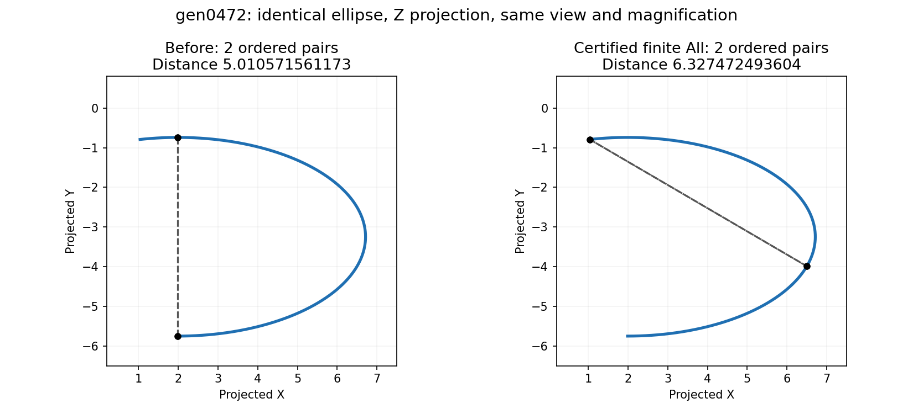

# Finite ellipse maximum construction for the original All case

PR #3081 implements the finite All construction for identical native noncircular
open ellipse arcs. Public integration e1930057d passes 38 focused tests, including
the original gen0472 request. The frozen cohort audit changes only gen0472, whose corrected actual runner
output is now graduated into the goldens; this does not close #3060's remaining
general curved-pair cases.

The dashed chord measures the returned pair at left and the larger witness at right;
this is measured geometry, not a claim that the new root construction is complete.

## Verified public before/after

The original output contains two swapped pairs at `5.010571561172592`. The
corrected output contains two swapped pairs at `6.3274724936037545`, with native
parameters `(1, 0.38120962513757384)` and its swap. The complete finite root
construction certifies these points; caller retention remains `1e-5`.

The frozen 75-case All audit at 751666c9b has exactly one changed case, gen0472,
zero new refusals and zero decoding errors; every input is unchanged. The actual
filtered runner bless adds one golden, with zero broken cases. Only gen0472 is
removed from inherited known failures, leaving 44 unrepaired All cases under
#3060. The historical 45-row counterexample artifact remains baseline evidence.

## Existing failure and a stronger feasible witness

The native ellipse has radii `a=4.723327346620286`,
`b=2.505285780586296`, STEP angles `[-90,101.59684508222117]` and
NURBS natural interval `[0,1]`. Its requested intervals cover that natural domain.
For the Z projection, independent rational-arc evaluation gives a feasible pair:

- STEP angles approximately `(-17.253404145366,101.59684508222117)` degrees;
- native NURBS parameters approximately `(0.3812096251375738,1)`;
- projected distance `6.327472493603755` (and the swapped pair).

This is a numerical witness, not a root-completeness certificate. It is larger
than the original issue's already sufficient STEP 0/90 witness. The corrected expected output must come from the public runner after the
complete construction and affected-case audit, not from this numerical witness.

## Analytic reduction for one identical ellipse

For `E(theta)=(a cos(theta),b sin(theta))`, put
`m=(theta+phi)/2` and `d=(theta-phi)/2`. Direct expansion gives

`D² = 4 sin²(d) [a² sin²(m) + b² cos²(m)]`.

With positive unequal radii, a distinct interior stationary pair must have
`d=pi/2 mod pi` and `m=0 or pi/2 mod pi`: the principal-axis antipodes.
The diagonal has zero distance and cannot be a nonconstant maximum. Thus a
finite complete candidate set comprises those interior pairs, all rectangle
corners, and every stationary root on each parameter edge.

For a fixed edge angle `theta`, the other angle `phi` satisfies

`(b²-a²) sin(phi) cos(phi) + a² cos(theta) sin(phi) - b² sin(theta) cos(phi) = 0`.

The half-angle substitution `z=tan(phi/2)` yields the quartic

`b² sin(theta) z⁴ + 2(a²-b²+a² cos(theta)) z³`
`+ 2(b²-a²+a² cos(theta)) z - b² sin(theta) = 0`.

The chart pole `phi=pi mod 2pi` must also be tested explicitly. Chart splitting,
root isolation, endpoint inclusion, inward derivative signs, and the second
variation distinguish maxima from other stationary points. Merely finding some
quartic roots is not a completeness proof.

The same edge reduction can be expressed directly in native rational parameters:
for `C(t)=Y(t)/W(t)` with quadratic homogeneous polynomials and fixed point `Q`,
set `A=Y-QW`. The derivative numerator of squared distance is
`2(A dot A')W - 2(A dot A)W'`; its degree-five leading terms cancel, leaving at
most a quartic. This avoids guessing STEP-to-NURBS parameter conversion during
certification and preserves the original requested intervals.

## Design boundary and excluded classes

Reuse `curve_on_quadrics` for the analytic exact class, and the existing
`conic_turn` certificate to establish a nonzero, nonreversing angular traversal.
Attached arbitrary nets must not be assumed to have the canonical parameter map.
For a general projection, the two projected semiaxes form a 2x2 Gram matrix;
its eigenvalues identify a nondegenerate noncircular ellipse after a phase shift.
Non-unit normal scaling remains in the projected semiaxes. Equal eigenvalues,
rank loss, repeated roots, unresolved endpoint identity, or unproved angular
coverage need explicit handling or refusal, never sampled enumeration.

`geom::polynomial::solve_quartic` provides approximate root candidates, not
certified isolation. The implemented bounded interval exclusion and uniqueness pass covers every
native arc piece, with point-enclosure rounding kept separate from retention
slack. The existing finite-candidate accumulator owns retention and ordered
duplicate rules.

A line/ellipse maximum is convex in the line parameter, so it reduces to the
two line endpoints and complete point/ellipse edge constructions. Different
ellipse pairs require a separate coupled stationary-system proof; they are not
covered by the identical-ellipse reduction. In particular the existing
`circle_projected_max` fixture (distinct offset circles, maximum 4.5) must retain
its existing behavior. Identical circles may have an antipodal continuum, whose
joint-parameter range representation is still a maintainer question.

## Primary reference and scope of inference

[Eberly, *Distance from a Point to an Ellipse, an Ellipsoid, or a Hyperellipsoid*,
section 2.1](https://www.geometrictools.com/Documentation/DistancePointEllipseEllipsoid.pdf)
derives the stationary normal equation for point/ellipse distance. Its closest-
point monotone-root branch is not an algorithm for enumerating every farthest
stationary point. The quartic and identical-pair reduction above are direct
algebraic derivations for this maximum problem. Complete interval root exclusion follows the bounded-search principles already
cited in the main #3060 finding; no sampled search or approximate quartic solver
alone is a certificate.

## Implemented finite construction

The public All dispatcher selects identical native noncircular open ellipse
arcs structurally, before attempting proof. The stored angular span must satisfy
0 < span < 360 degrees; the actual native form separately passes the existing
analytic exact-class and regular open-traversal checks. Positive projected Gram
determinant and nonzero eigenvalue discriminant establish a nondegenerate,
noncircular projected ellipse. Full-turn gen2263 and gen2689 remain outside this
initial class, as does the distinct offset-circle compatibility fixture.

Each native knot piece encloses `g=(P-Q) dot P'` and
`g'=P' dot P'+(P-Q) dot P''` under the complete double-cross projection. Nonzero g
excludes stationarity; positive g' excludes a maximum. Strict opposite endpoint
signs and negative g' prove exactly one strict maximum. Interval Newton contracts
that established root. All native edge pieces are covered, with a shared
4,096-cell budget, depth 48 and 64 Newton contractions. Unresolved endpoint
identity, repeated roots, projected degeneracy and exhausted work refuse.

Strict inward derivative signs classify corners and fixed-side edge maxima.
For an identical noncircular projected ellipse, minor-axis antipodes are saddles;
opposite major-axis points are the only distinct interior pair maxima. The
same complete one-dimensional root construction finds these through maxima of
squared distance to the center, without guessing a STEP-to-native mapping.
Continuous internal native knots are required. Unknown classification refuses.

Root-location uncertainty stays geometric. A Taylor objective enclosure includes
its complete remainder. The remainder is grouped with the smallest squared
component before the final sum, and intersected with the original independently
valid bound. This removes avoidable full-scale rounding while every operation
remains outward rounded; no term is discarded and no candidate interval is
widened. Finite/nonempty intersections are checked before square root.

Each returned representative is one feasible parameter pair whose independently
computed point interval contains both its reported scalar and the isolated root
objective upper bound. Caller retention is never construction accuracy, following
the [maintainer contract](https://github.com/tangency-labs/solidcore/pull/2840#discussion_r4496188362).
A root whose complete objective bound lies outside the retention band can be
excluded before constructing a rounded representative. Existing All sorting and
ordered duplicate handling are reused. Final guards ensure the actual returned
set still covers the complete objective bound and contains every unexcluded
candidate under the existing duplicate equivalence. Ambiguous ordering refuses.

## Validation status

At e1930057d all 38 focused tests pass. Coverage includes original gen0472 with
its original requested intervals, unit/non-unit normals, both legacy error flags,
incumbent cutoff, selected rank-loss refusal, two isolated roots with an intervening
minimum, repeated-root refusal, reversed traversal and closed-seam exclusion.
Independent review checked the edge proof, interior reduction, strict point
construction, outward regrouping and public dispatch boundary.

Strict `cargo clippy -p solidcore --lib --tests -- -D warnings` passes at the
same public integration checkpoint. The 75-case scope audit and filtered golden
graduation pass as detailed above. Final parent propagation and broader gates
remain pending. No sampled rendering or independent optimization is
used as a completeness certificate. Remaining general All cases stay under #3060.
