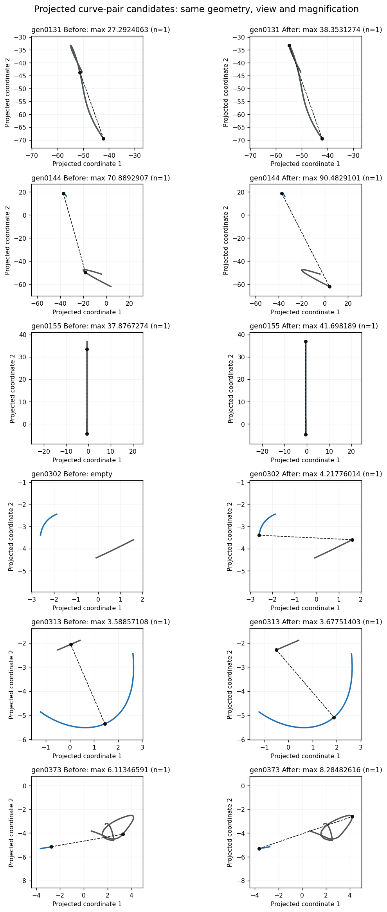
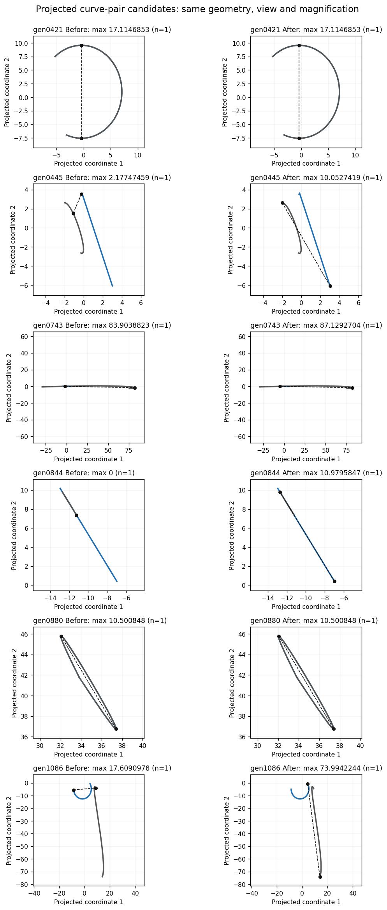
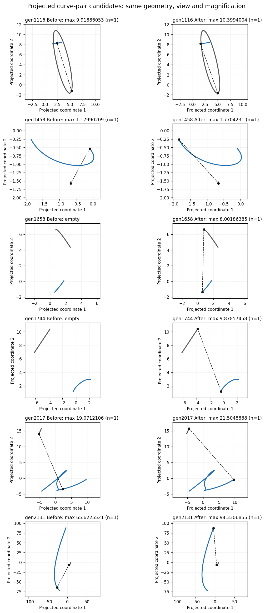
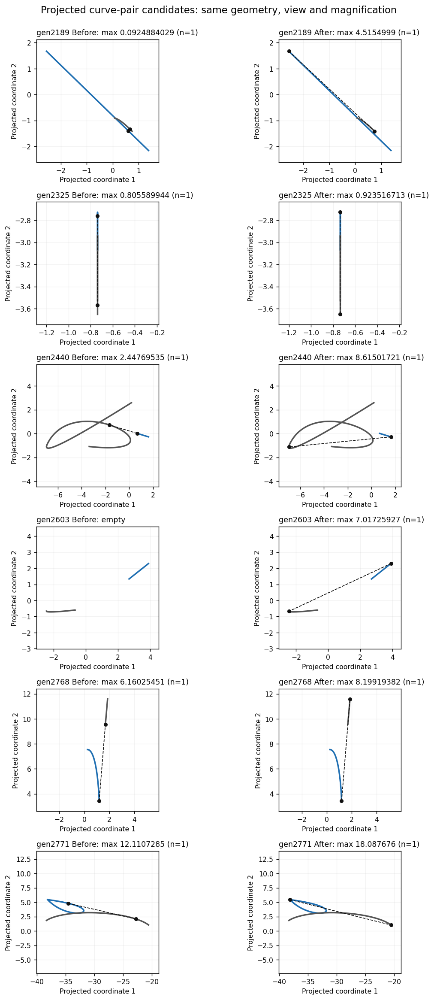
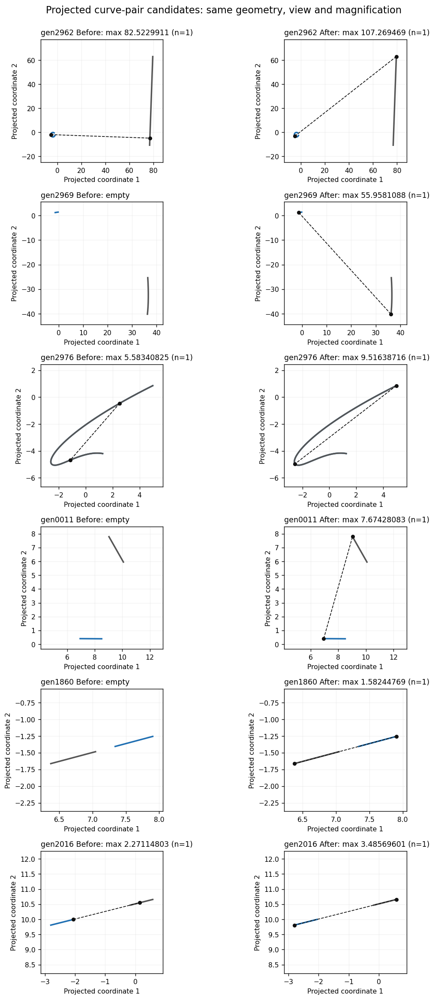
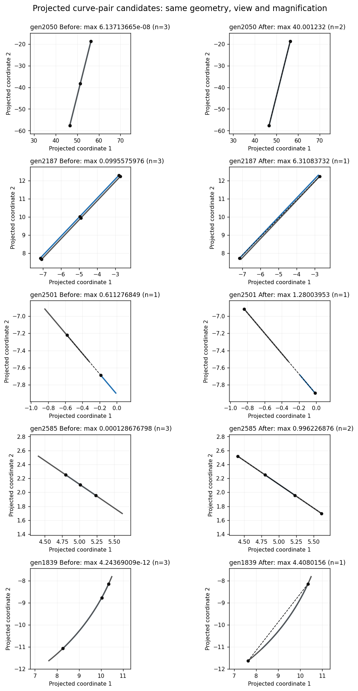
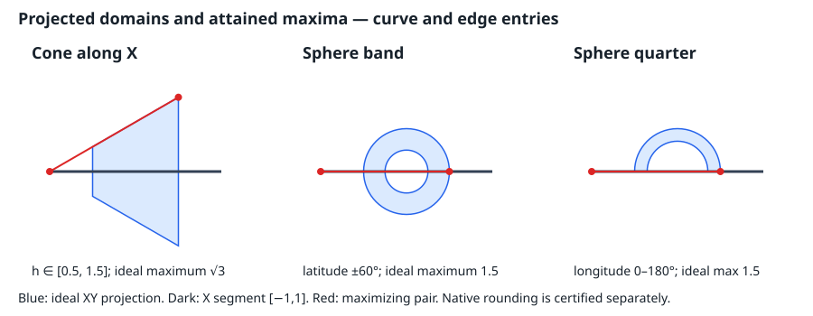

# Frozen projected-pair audit: strict Single construction at 46bd74511

This record audits the scoped Single and finite affine All construction. It does not claim to close #3060. Baseline is the parent implementation; all inputs are frozen and replayed unchanged. No tolerance, expected output or exclusion is changed by this evidence commit.

## Single and cylinder cohort

All 31 generated Single projected maximum requests among the 3,000 seeds, plus four cylinder fixtures, were replayed. There are 31 changed outputs, no new refusals and no decode errors. The three empty natural-domain intersections (gen2506, gen2915, gen2993) and the incumbent-filtered gen0717 remain unchanged. The OOB-enabled gen2915 result preserves existing cache-domain clipping; it does not certify extrapolation outside the natural interval.

The after data and figures now use the strict construction at `46bd74511`.
The global objective upper bound fits the returned point's own independently
computed arithmetic enclosure; its reported scalar lies inside that same
interval. Caller retention slack and other point widths do not loosen this
certificate. This follows the [maintainer contract](https://github.com/tangency-labs/solidcore/pull/2840#discussion_r4496188362).

The final guard replay at 9402730dd has bitwise-identical inputs, outputs and
solutions to 46bd74511 across both cohorts (only timing metadata differs).
A separate [public Rust remeasurement](diagnostics/projected_pair_single_native_3060.jsonl)
reconstructs all 31 generated inputs, reruns the public solver, then reevaluates
every returned parameter through `Curve::evaluate_point`. It reports zero
inadmissible parameters, zero solver/audit errors and exactly zero scalar
remeasurement differences. The four cylinder rows have the independent analytic
endpoint proof recorded below.

All returned parameters are admissible. Independent native line/Hermite/rational
evaluation agrees with each reported scalar within 7.11e-15. Independent
optimization's largest positive excess over an answer is 2.85e-14; those signed
differences are shown below, not treated as an accuracy tolerance or proof.
Completeness comes from the production interval invariant. Four cylinder maxima
equal sqrt(2.5), independently attained by their returned endpoint parameters.

The superseded ab5107 Single checkpoint allowed geometric error inside retention
slack and must not be blessed. In particular its gen1658 value 8.000523649275099
is replaced by 8.001863852854438 at
(0.36164915060065483, 0.06248865022830497). The independent witness is
8.00186385285444, a difference of 1.78e-15, instead of the old 0.001340204 gap.

The first strict checkpoint exposed 19 subdivision-depth refusals. Keeping
proved endpoint contractions in the search state and allowing 128 total
bisections for two coordinates removed all 19, without changing the strict
acceptance rule or the 32,768-box work cap. All 31 focused tests pass at 46bd74511,
including identical answers for zero and large retention on an interior peak.
The final-All retention guard at `9402730dd` passes 32 focused tests and both
frozen cohorts with the same changed-case counts and no new refusals. It keeps
existing sorting and duplicate policy, but refuses if the actual returned set
cannot cover the complete objective bound or silently drops a distinct candidate
whose exclusion from the retention band is unproved.

| Case | Before values (status) | Strict after values | Retention slack | Independent search minus answer |
|---|---|---|---|---|
| gen0131 | 27.292406300295426 ([0]) | 38.353130876659016 | 0.01 | 7.1054e-15 |
| gen0144 | 70.88929067495704 ([0]) | 90.48291006330427 | 0.5 | 0 |
| gen0155 | 37.87672736773793 ([0]) | 41.69836616313635 | 0.01 | 1.4211e-14 |
| gen0302 | empty ([0]) | 4.217760138079574 | 0.0001 | 0 |
| gen0313 | 3.5885710823184898 ([0]) | 3.677522280315252 | 0.001 | -4.4409e-16 |
| gen0373 | 6.113465906772089 ([0]) | 8.284826190867808 | 1e-06 | 1.7764e-15 |
| gen0421 | 17.11468532354081 ([0]) | 17.11468532354081 | 0.01 | 3.5527e-15 |
| gen0445 | 2.1774745915837537 ([0]) | 10.052741867014833 | 1e-06 | 0 |
| gen0743 | 83.90388228273946 ([0]) | 87.12927044222975 | 0.0001 | 2.8422e-14 |
| gen0844 | 0.0 ([0]) | 10.979584714079621 | 0.5 | 0 |
| gen0880 | 10.50084800781891 ([0]) | 10.500848007818902 | 0.0001 | 7.1054e-15 |
| gen1086 | 17.609097780432535 ([0]) | 73.99422438322947 | 0.01 | 0 |
| gen1116 | 9.918860532286931 ([0]) | 10.3994004442039 | 0.0001 | 0 |
| gen1458 | 1.1799020931977433 ([0]) | 1.7704231028846957 | 0.5 | 4.4409e-16 |
| gen1658 | empty ([0]) | 8.001863852854438 | 0.5 | 1.7764e-15 |
| gen1744 | empty ([0]) | 9.878574576753216 | 0.5 | 0 |
| gen2017 | 19.071210555301338 ([0]) | 21.504888840235413 | 0.5 | 0 |
| gen2131 | 65.62255209558627 ([0]) | 94.33068554634433 | 1e-05 | 1.4211e-14 |
| gen2189 | 0.09248840291760957 ([0]) | 4.5154998991468 | 0.0001 | 0 |
| gen2325 | 0.8055899438915088 ([0]) | 0.9235168507522138 | 1e-05 | 4.4409e-16 |
| gen2440 | 2.44769534587924 ([0]) | 8.615017213875161 | 0.001 | 3.5527e-15 |
| gen2603 | empty ([0]) | 7.017259757475725 | 1e-05 | 8.8818e-16 |
| gen2768 | 6.160254511384329 ([0]) | 8.199199517002864 | 0.001 | 0 |
| gen2771 | 12.110728525770247 ([0]) | 18.087676035977736 | 0.001 | 0 |
| gen2962 | 82.52299106097162 ([0]) | 107.26946892615773 | 0.01 | 2.8422e-14 |
| gen2969 | empty ([0]) | 55.95810876408308 | 1e-05 | 0 |
| gen2976 | 5.583408252286654 ([0]) | 9.516387163397034 | 0.01 | 0 |
| analytic_face_cyl_x_6_15 | 0.5 (None) | 1.5811388300841898 | fixture | 0 |
| analytic_face_cyl_x_7_15 | 0.5 (None) | 1.5811388300841898 | fixture | 0 |
| analytic_face_halfcyl_x_6_15 | 0.5 (None) | 1.5811388300841898 | fixture | 0 |
| analytic_face_halfcyl_x_7_15 | 0.5 (None) | 1.5811388300841898 | fixture | 0 |

Exact inputs, output parameters, statuses, object counts and scalar values are in [before](diagnostics/projected_pair_single_before_3060.jsonl) and [after](diagnostics/projected_pair_single_after_3060.jsonl); [independent checks](diagnostics/projected_pair_single_witnesses_3060.jsonl) preserve every measurement.

## Seven changed finite affine All cases

Each projected operand is affine and has a nonzero projected direction. Squared distance is strictly convex in each parameter, so every isolated constrained local maximum is a rectangle corner. The signs of both inward derivatives classify those corners completely; no interior or edge maximum is omitted. An independent 80-digit Decimal reconstruction evaluates all four corners and derivatives. The unchanged caller slack then gives the retained set below. The [complete corner checks](diagnostics/projected_pair_affine_all_proof_3060.jsonl) include the rejected corners and derivative signs.

| Case | Before values | After values | Retained count |
|---|---|---|---|
| gen0011 | empty | 7.674280832269905 | 1 |
| gen1860 | empty | 1.5824476883128602 | 1 |
| gen2016 | 2.2711480262147923 | 3.4856960129819874 | 1 |
| gen2050 | 6.137135877339201e-08, 6.137136311338198e-08, 6.137136653148528e-08 | 40.001231972795864, 40.00123193297711 | 2 |
| gen2187 | 0.09955759757712836, 0.09955759757712898, 0.09955759757712898 | 6.310837322899526 | 1 |
| gen2501 | 0.6112768486652884 | 1.2800395290048499 | 1 |
| gen2585 | 0.0001286767978428912, 0.0001286767978681419, 0.0001286767978948102 | 0.9962268759220879, 0.983409688864426 | 2 |

For gen2187 the other strict corner maximum is 6.300451372620962, outside slack 1e-6. For gen2050 both 40.001231972795864 and 40.00123193297711 lie within slack 1e-4. For gen2585 both 0.9962268759220879 and 0.983409688864426 lie within slack 0.5. These are the original All requests, not Single substitutions.

The distinct offset-circle compatibility fixture remains unchanged: two seam parameter representatives attain 4.5, the triangle-inequality bound 3 + 1 + 0.5.

## Integrated identical-monotone All case

The 75-row replay at `46bd74511` preserves the eight changes from `8948e0bc2` and has no new refusals or
decode errors. The sole addition to the original affine class is original All `gen1839`:
three old values at or below 4.243690092983992e-12 become one value
4.408015599603469 at native parameters
(0.43561427937496744, 0.03474215986040488).
[Exact frozen input/output](diagnostics/projected_pair_monotone_all_after_3060.jsonl).
The existing exact-rational derivative-numerator check proves the native
coordinates monotone on the complete union span; increasing ordered parameter
separation increases the projected distance, so the extreme feasible pair is
global. The production interval sign proof agrees. This is the original All
request, not a Single variant. The independent public-API test and unchanged
offset-circle compatibility test pass among the 31 focused tests.

The planned golden migration can remove the five repaired #3060 exclusions:
gen0844, gen1839, gen2050, gen2187 and gen2585. gen0472 remains open in #3081.
Final parent/main integration and broad validation remain prerequisites to that
migration; unchanged, unverified All outputs are not blessed.

## Same-view geometry

The after views below use strict Single checkpoint 46bd74511 and the unchanged certified finite All outputs. The curves are independently evaluated from the stored definitions. Each row uses identical projection, limits and magnification before/after. Dashed segments join the returned pairs; markers identify the endpoints. Curve sampling is for rendering only and is not a certificate. Titles show maximum reported value and answer count; exact complete values are in the tables/data above.













The cylinder geometry and closed-form witness are drawn in the [original construction record](curve.curve_p9--projected-pair-maximum-3060.md).

## Remaining unchanged enumeration defects

The initial 75-row All replay changes only the seven affine rows above; the final integrated replay additionally repairs gen1839 as recorded above. An independent witness search disproves at least one returned maximum in 46 **unchanged** rows. Exact inputs, old outputs and admissible larger-pair parameters are preserved in [the witness list](diagnostics/projected_pair_unchanged_all_witnesses_3060.jsonl). These belong to the existing incomplete curved enumeration scope of #3060; none is blessed or silently counted as repaired. The preserved initial list contains gen1839, subsequently repaired by the integrated monotonicity construction; 45 witnessed rows remain unchanged at 8948e0bc2. gen0472 belongs to #3081. A numerical larger witness disproves the returned maximum but does not identify the exact global maximum or prove identical internal root causes for every row.

## Reproduction

The Rust public-runner helper `diagnostics/projected_pair_audit_3060.rs` freezes/replays the cohorts. The following operate on the committed frozen artifacts:

```text
python plan/findings/diagnostics/check_projected_pair_witnesses_3060.py plan/findings/diagnostics/projected_pair_single_after_3060.jsonl
python plan/findings/diagnostics/check_projected_pair_affine_all_3060.py plan/findings/diagnostics/projected_pair_affine_all_after_3060.jsonl
python plan/findings/diagnostics/plot_projected_pair_audit_3060.py
```

At ab5107e26, 22 focused tests and library/tests strict Clippy pass; at 8948e0bc2, 30 focused tests and library/tests strict Clippy pass; Linux full formatting passes. Broad workspace gates and affected golden migration are recorded separately when complete.

The remaining 45 rows are now independently confirmed through the actual Rust
constructors/evaluator, admissible domains and target rules in the
[unrepaired-case exclusion audit](curve.curve_p9--unrepaired-all-rust-witnesses-3060.md).
All are unchanged before/after the scoped fix; 44 are newly documented exclusions
and gen0472 was already known. No unverified search result is used to exclude a case.

## Merged checkpoint and filtered golden graduation

At `69d8abd33`, all 32 focused projected-pair tests pass. Both frozen input
cohorts are byte-identical to the original inputs. The 35-row Single/cylinder
replay retains exactly 31 changed rows, and the 75-row All replay retains exactly
eight changed rows, with zero new refusals or decode errors. Complete parsed
inputs, outputs and solutions equal `9402730dd`; only elapsed-time metadata differs.

The actual golden runner regenerated only these independently audited records:

- `curve.curve_p9`: gen0011, gen0131, gen0144, gen0155, gen0302, gen0313,
  gen0373, gen0421, gen0445, gen0743, gen0844, gen0880, gen1086, gen1116,
  gen1458, gen1658, gen1744, gen1839, gen1860, gen2016, gen2017, gen2050,
  gen2131, gen2187, gen2189, gen2325, gen2440, gen2501, gen2585, gen2603,
  gen2768, gen2771, gen2962, gen2969, gen2976.
- `intersect.topology_solver_p2`: analytic_face_cyl_x_6_15,
  analytic_face_cyl_x_7_15, analytic_face_halfcyl_x_6_15,
  analytic_face_halfcyl_x_7_15.

Each filtered run produced one case with zero broken cases. The 35 curve rows
comprise 30 changed existing records and five graduated exclusions; the four
cylinder records change from the old local answer to the proved maximum
`sqrt(2.5)`. These are the records whose original requests, feasible witnesses,
closed-form/interval proofs and same-view geometry are documented above. No
unchanged or unverified curved All record is blessed. The remaining 45 known
failures retain their issue-linked exclusions. Whole-unit and broader merged-head
gates remain pending; the final parent selection correction is tracked separately.

## Cone and sphere curve/edge-face maxima: native rounding audit

The six frozen cases in `projected_pair_cone_sphere_inputs.jsonl` use the runner's
native degree-1 X segment from -1 to 1, parameter domain [0,1], and normal Z.
Entries 6/7 differ only by curve/edge ownership. Reconstructing the runner's actual
canonical cone and `Sphere::make_nurb` surfaces confirms native face domains [0,1]^2
and admissibility of every returned parameter. Independent native evaluation
reproduces the six reported scalars exactly.

For ideal geometry, the cone axis is X, apex (-1,0,0), height h in [.5,1.5],
and radial extent h*tan(30 degrees). For a line point x in [-1,1], the squared
projected distance is bounded by max(h^2,(2-h)^2)+h^2/3. Both quadratics are convex
in h, so endpoint comparison gives maximum 3, attained at h=1.5, x=-1, azimuth 0.
For either sphere patch, projected radius is at most .5; the triangle inequality
bounds distance to the X segment by 1.5. Both angular domains include longitude 0
and latitude 0, attaining that ideal bound at x=-1.

These ideal formulas alone do not certify the rounded native NURBS: the quarter
sphere's seam evaluates to x=.500000000000000111. The native proof therefore uses
the defining rational control net and an outward point enclosure at each actual
returned parameter. The unchanged Bernstein residual helper from `c7b84de47`
certifies the entire face against **each** exact line endpoint using that own upper.
Convexity of norm in the affine line parameter extends these two bounds to every
line point. The feasible returned point supplies a matching lower bound; thus the
global maximum lies inside its own arithmetic enclosure, without retention slack.

| Surface (entries 6 and 7) | Native reported value | Own enclosure |
|---|---:|---|
| cone X | 1.73205080756887719 | [1.73205080756886276, 1.73205080756889185] |
| sphere band | 1.5 | [1.49999999999998823, 1.50000000000001177] |
| sphere quarter | 1.5 | [1.49999999999998801, 1.50000000000001199] |

All six endpoint/full-face certificates pass. All three negative controls reject
an upper bound exactly one binary64 predecessor below the native witness value.
The own-point arithmetic specializes the exact Z double-cross to dx^2+dy^2; no
normalization, approximate ideal-sphere substitution or user tolerance is used.

Reproduce with `diagnostics/projected_pair_cone_sphere_native_audit.py`, supplying
the already-built c7 kernel rlib and matching dependency directory as documented
in its header. The driver builds only a temporary standalone executable. It obtains
the residual module with `git show`, mechanically changes import paths, and checks
copy equality. Original residual SHA256:
`1a776236708b16d53febe276118e32e6dbcaac3e5e8c182c4a79fbb79b81899a`.
Import-adapted SHA256:
`6e3b99e2caf22228246eda9efcb95ae0d1a12a1b3dc7bdaecbb5f9cf49a760fe`.
The audit-only knot partition bridge is restricted to these continuous fixture
nets; it is not a replacement production API. Actual outputs are recorded in
`diagnostics/projected_pair_cone_sphere_native_audit.jsonl`. No expected golden
record is generated or edited by this evidence.



### Half-torus curve/edge additions

The same pinned native proof now covers `analytic_face_torus_half_x_6_15` and
`analytic_face_torus_half_x_7_15`. Their exact returned native parameters are
`(t,u,v)=(0,0,0.12499999813735485)`, all inside [0,1]. Native evaluation gives
`1.66421356237309492`; its own enclosure is
`[1.66421356237307383,1.66421356237311580]`. Both endpoint/full-face Bernstein
certificates pass at that own upper; one binary64 predecessor below the native
witness value is rejected. The source/copy residual hashes remain unchanged.

For the ideal torus axis X, major radius 1 and minor radius 1/4, the projection
satisfies `x=(1/4)sin(v)` and `|y| <= 1+(1/4)cos(v)`. Maximizing against either
X-line endpoint yields squared distance at most
`2+1/16+(1/2)(|sin(v)|+cos(v)) <= 2+1/16+sqrt(2)/2`, hence maximum
`sqrt(2)+1/4`. Azimuth zero and minor angle 45 degrees attain it within the half
major-angle domain. Native rounded control coefficients and the reported
parameter do not require exact agreement with that ideal number: the independent
own-enclosure residual proof above certifies the actual native geometry.

### Eight additional native records

The actual c7 optimized runner changes cone X entries 6/7 from empty output to
sqrt(3), changes sphere band and quarter entries 6/7 to the certified native
representatives recorded above (reported distance 1.5), and graduates half-torus
entries 6/7 from their excluded 1.25 result to 1.664213562373095. Exact old/new
serialized golden values are preserved in
`diagnostics/projected_pair_native_golden_changes.json`; these are runner output,
not manually calculated replacement records. No other expected row changes.

The two full-torus entries remain excluded: their reported 1.6642154866673036
exceeds the native distance 1.6642135459403802 at the returned parameters. Their
native-attainment repair is separate. No tolerance or floor changes accompany
these eight records. The c7 whole-unit run had six changed records and zero
broken cases; the refreshed whole-unit gate remains required after this migration.
