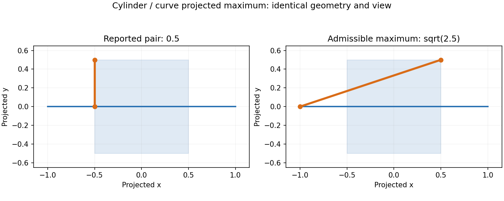

# Projected curve-pair maxima on the main baseline

Issue #3060 reports successful projected maxima below admissible witnesses.
The four cylinder/half-cylinder curve/edge-face queries return 0.5 instead of
sqrt(2.5). Their projected surface is [-0.5,0.5]^2 and query line is
[-1,1] x {0}. Squared distance is convex separately in each coordinate;
opposite x endpoints with |y|=0.5 attain sqrt(2.5).

## Construction and dependencies

This extraction starts at main `7a593124c9`. It carries the existing reviewed
curve-pair construction without the #2840 or #2968 point-query solvers.
The only topology change forwards outer ProjectedMaximize/Single to the
curve-pair Single construction; other requests still ask for All.

`projected_pair` partitions both native domains at knots, evaluates feasible
candidates, and encloses every parameter rectangle. A returned candidate must
contain the global upper bound in its own arithmetic enclosure. Retention slack
never supplies solve accuracy. Work is bounded to 32,768 boxes, depth 128 and
degree 18; cancellation and unresolved proof errors propagate.

The native analytic Line map comes from shared `curve::native_affine` support:
its start/end definition and interval jet preserve the original arithmetic,
including bounded STEP mapping and inside-out direction. No parent point-query
selection or join policy is required. The existing main NURBS interval helpers,
Hermite power coefficients and global accumulator are reused. Ellipse forms
are checked against analytic support by the existing quadric identity machinery.

All is not replaced with Single. One-span affine pairs and identical native
NURBS with certified coordinate monotonicity use finite candidate constructions;
retention and ordered deduplication use the existing accumulator. Other curved
All classes retain their existing path. Uncertainty inside a selected class
refuses rather than falling back.

The enclosure/branch-and-bound construction follows Neumaier, sections 11?12,
[Complete Search in Continuous Global Optimization and Constraint Satisfaction](https://arnold-neumaier.at/glopt/mss/Neu04.pdf).
Interval arithmetic is described in
[Patrikalakis, Maekawa and Cho, section 4.7](https://web.mit.edu/hyperbook/Patrikalakis-Maekawa-Cho/node45.html).

## Historical witnesses and fresh validation boundary

These values are recorded from the earlier reviewed stack. They are not yet a
fresh before/after run of this main-only extraction:

| Case | Earlier best | Corrected value | Proof class |
|---|---:|---:|---|
| gen0844 Single | 0 | 10.979584714079621 | affine endpoints |
| gen1839 All | 4.243690092983992e-12 | 4.408015599603469 | identical rational quadratic, fixed derivative signs |
| gen2050 All | 6.137135877339201e-8 | 40.001231972795864 and 40.00123193297711 | affine corners, both retained |
| gen2187 All | 0.09955759757712836 | 6.310837322899526 | affine corners, only best retained |
| gen2585 All | 0.00012867679784289121 | 0.9962268759220879 and 0.983409688864426 | affine corners, both retained |

The original fixture regressions and all existing pair tests are retained.
Fresh main and extracted-branch replays, affected goldens and normal build gates
are pending. No golden or exclusion is migrated by this source checkpoint.

## Work deliberately kept separate

The original ellipse All case gen0472 remains open under #3081. The earlier
75-case All audit also found 44 other unchanged witnessed failures; those must
be re-established against main before any exclusion migration. This is not a
claim that every All maximum is fixed.

The native cone/sphere/half-torus curve/edge-face corrections belong to #3110:
`analytic_face_{cone_x,sphere_band,sphere_quarter}_{6,7}_15` and
`analytic_face_torus_half_x_{6,7}_15`. Their native endpoint/face residual proof,
ledger, tests and golden changes are deliberately omitted here, not discarded.
The full-torus native accuracy obligation remains with that same work.
Point-face native proposals, residual certificates and vertex-face incumbent
ownership belong to #2968. A maximum on a silhouette curve alone does not prove
a maximum over the whole native face.
