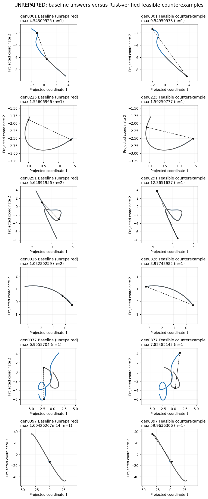
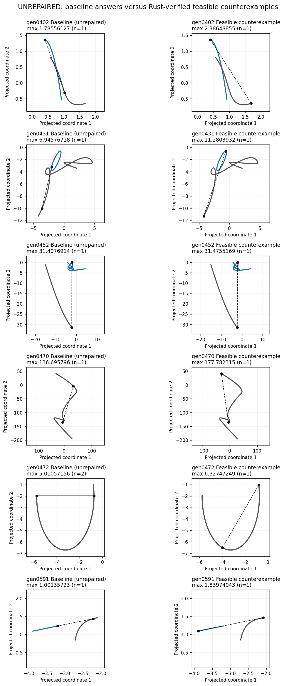
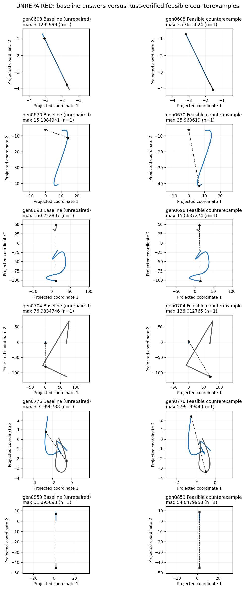
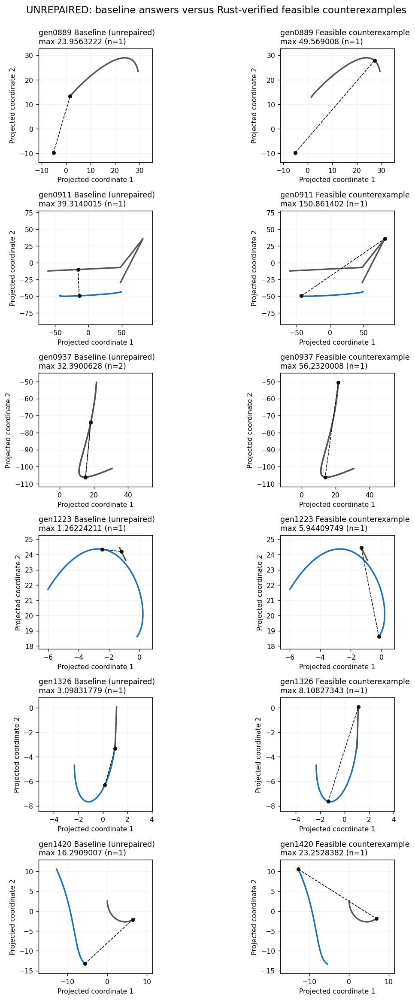
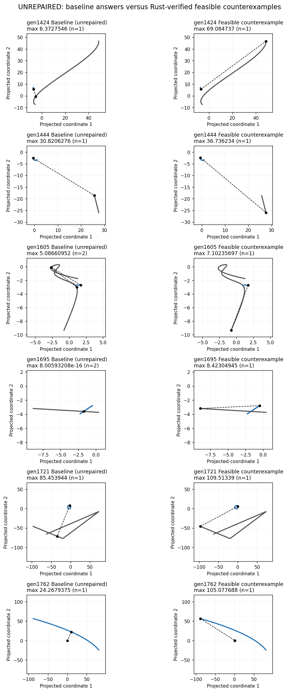
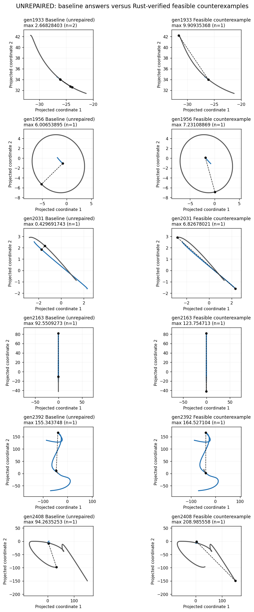
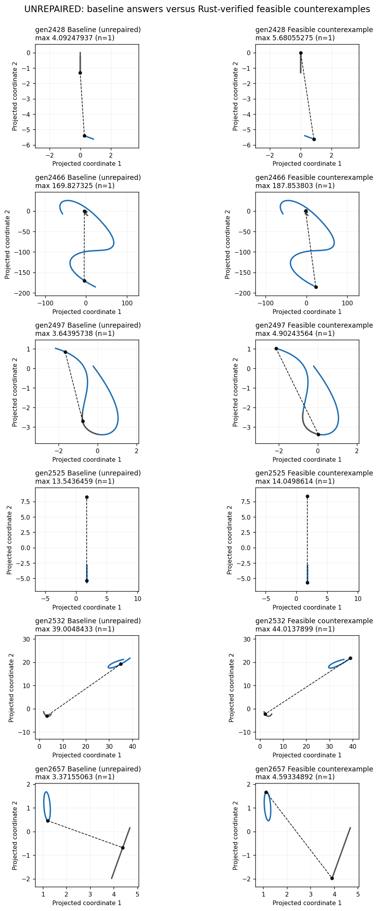
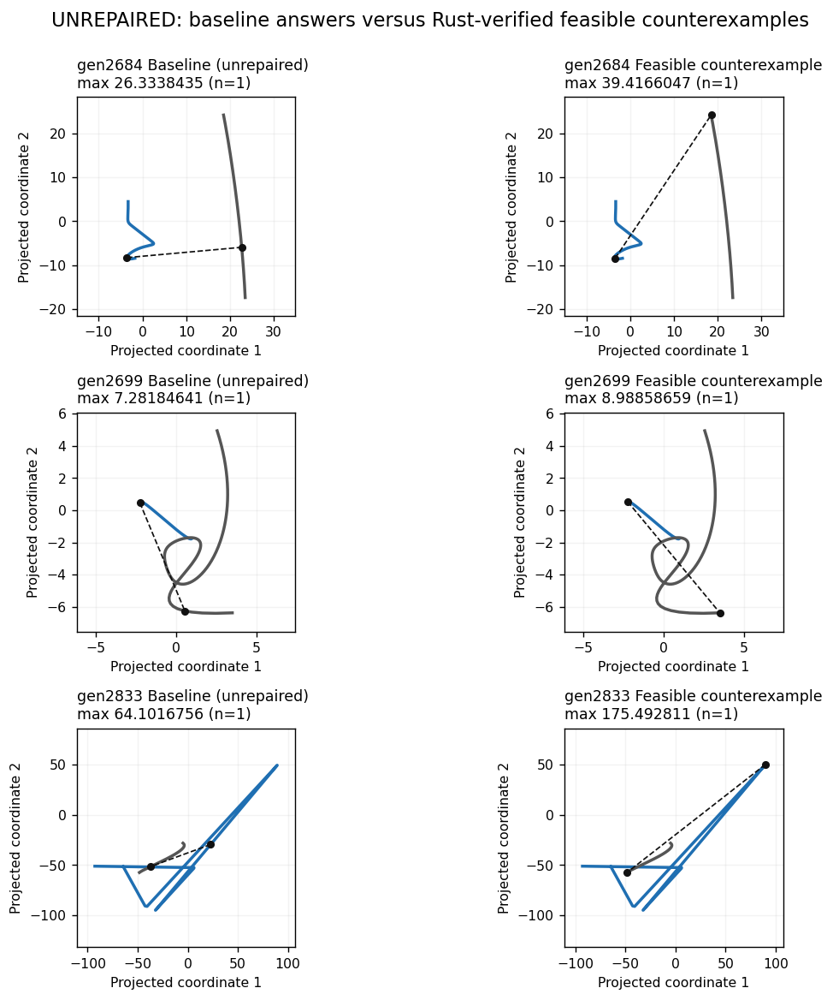

# Unrepaired projected All maxima: actual Rust witness confirmation

This is an exclusion audit, not a fix or a claimed global maximum construction. The 45 rows below retain exactly the same solver outputs before and after 8948e0bc2. For each, the actual public Rust curve constructors and Curve::evaluate_point confirm an admissible pair whose projected distance exceeds the BEST returned scalar by more than the unchanged caller slack. Every requested/natural domain intersection and optional incumbent cutoff passes. There are no evaluator errors.

gen0472 was already excluded. The other 44 are newly documented pre-existing failures under #3060; their wrong golden lines are removed rather than blessed. The five repaired exclusions (gen0844, gen1839, gen2050, gen2187, gen2585) are removed separately, with their correct golden additions pending the final filtered bless. This does not hide a newly introduced failure. The preserved initial independent witness list includes repaired gen1839; it is not in this remaining-failure list.

[Actual Rust results, points, parameters, admissible domains, original scalar checks and target checks](diagnostics/projected_pair_unchanged_all_rust_proof_3060.jsonl). [Exact original inputs and proposed witness records](diagnostics/projected_pair_unchanged_all_witnesses_3060.jsonl). The standalone [Rust evaluator](diagnostics/check_projected_pair_rust_witnesses_3060.rs) mirrors the public golden runner constructors, including raw homogeneous controls, dimensional metadata, analytic definitions and optional transforms. It performs no optimization or golden edits.

Every comparison below is against the best original answer, not merely a lower retained answer. The smallest excess beyond slack is about 0.2% of the witness scale; these are not rounding-boundary allegations. A larger feasible witness disproves the reported maximum but does not identify the exact maximum or establish one identical internal cause for every row.

| Case | Best reported | Rust-evaluated witness | Native parameters | Caller slack |
|---|---|---|---|---|
| gen0001 | 4.5430952499240185 | 9.549509332977966 | (0.49370344949692335, 1.0) | 0.001 |
| gen0225 | 1.556069660856248 | 1.5925077692861305 | (1.0, 0.12110194251055262) | 0.001 |
| gen0291 | 5.648919560277931 | 12.365163747264422 | (0.0, 1.0) | 0.001 |
| gen0326 | 1.03280258777115 | 3.9774398242041924 | (0.7791367645915608, 1.0) | 0.01 |
| gen0377 | 6.955870398075991 | 7.824851426765779 | (4.705082304430622, 0.3537604967753093) | 0.001 |
| gen0397 | 1.6042626665492003e-14 | 59.96363057485847 | (3.024862621636668, 0.028223786984563078) | 0.0001 |
| gen0402 | 1.7855612706803323 | 2.3864885500413147 | (1.0, 0.0) | 0.01 |
| gen0431 | 6.945767176427893 | 11.280393230725531 | (0.24658869787279647, 1.0) | 0.001 |
| gen0452 | 31.40769135420058 | 31.475516879900873 | (-4.007787610394039, 0.12253631376331306) | 1e-06 |
| gen0470 | 136.69579596869153 | 177.78231503834516 | (0.12771286740899088, -4.482612270276597) | 0.001 |
| gen0472 | 5.010571561172592 | 6.327472493603755 | (0.38120962421636895, 1.0) | 1e-05 |
| gen0591 | 1.001357232066695 | 1.8397404346820174 | (0.00033309865880189193, 0.7031356696932195) | 0.01 |
| gen0608 | 3.1292998951391238 | 3.776150239758274 | (0.10674875140217285, 0.0) | 0.01 |
| gen0670 | 15.108494117871489 | 35.960618973052696 | (0.946244061671635, -3.747865288148488) | 0.0001 |
| gen0698 | 150.22289731815547 | 150.63727353714955 | (5.324748035586282, 0.11774800584022657) | 1e-06 |
| gen0704 | 76.98347456276167 | 136.01276532053402 | (0.7886751292304641, 6.935903755366381) | 0.5 |
| gen0776 | 3.7199073790304498 | 5.9919944022174745 | (-3.3261903931642878, 0.319591305178375) | 1e-05 |
| gen0859 | 51.89569298947182 | 54.04799576475025 | (0.7700188968056538, 4.238539201240405) | 0.01 |
| gen0889 | 23.956322206715626 | 49.56900800013303 | (0.16458478853213926, 0.8689873262384588) | 0.01 |
| gen0911 | 39.31400147859675 | 150.86140205362295 | (0.061876863216339166, 4.7459028771751175) | 0.01 |
| gen0937 | 32.39006279585776 | 56.23200081671224 | (-3.528409920404954, -3.060747823300268) | 1e-05 |
| gen1223 | 1.2622421064630283 | 5.944097494451031 | (0.6764761467841738, 0.0) | 1e-06 |
| gen1326 | 3.098317787137711 | 8.108273432699084 | (0.37070955335850714, -3.3939649770228297) | 0.01 |
| gen1420 | 16.29090069339488 | 23.25283820492104 | (0.11654048776633522, 1.0) | 0.0001 |
| gen1424 | 6.372754599619086 | 69.08473697656486 | (0.9488583617948745, 1.0) | 1e-05 |
| gen1444 | 30.82062759207742 | 36.73623396864969 | (0.5954611267297522, 0.32513072790105013) | 1e-05 |
| gen1605 | 5.086609519996921 | 7.102356970521628 | (0.0, 5.879431696278129) | 0.5 |
| gen1695 | 8.005932084973442e-16 | 8.42304945457351 | (0.0, 0.34006401507053496) | 0.5 |
| gen1721 | 85.4539439709601 | 109.5133901970313 | (0.5883737263580163, 0.0) | 1e-06 |
| gen1762 | 24.267937515921847 | 105.07768843661934 | (0.0, 0.8696322921770602) | 1e-05 |
| gen1933 | 2.6682840331465743 | 9.909353678342843 | (1.0, 0.0) | 0.5 |
| gen1956 | 6.006538950318362 | 7.231088693528565 | (0.20919958586119233, 0.2349061757947009) | 1e-06 |
| gen2031 | 0.42969174260923493 | 6.826780214593128 | (0.028838819615146116, 0.0) | 1e-05 |
| gen2163 | 92.5509273062528 | 123.754712918719 | (6.48832998435046, 0.0) | 0.0001 |
| gen2392 | 155.34374777609105 | 164.52710369863053 | (-4.037218223617666, 0.672127498681873) | 0.01 |
| gen2408 | 94.2635253191322 | 208.98555817438634 | (0.7132507301575398, -1.13348143402732) | 1e-06 |
| gen2428 | 4.092479373983543 | 5.680552751978387 | (-1.9631709516389935, 0.0) | 0.01 |
| gen2466 | 169.82732454513135 | 187.85380333158093 | (6.2210284438622505, -3.2768088798482244) | 0.0001 |
| gen2497 | 3.6439573808090895 | 4.902435644979832 | (1.0, 0.3697177557223247) | 0.0001 |
| gen2525 | 13.543645946315504 | 14.049861431862048 | (0.48826061339847426, -0.27121770173253434) | 1e-05 |
| gen2532 | 39.004843268041974 | 44.0137898948527 | (1.0, 0.7923685363078272) | 0.5 |
| gen2657 | 3.371550627708106 | 4.593348923603706 | (0.5245891829331715, -2.794775295653925) | 1e-06 |
| gen2684 | 26.33384354990002 | 39.4166047197288 | (3.774754356540762, 0.6724749256634671) | 0.5 |
| gen2699 | 7.281846410389869 | 8.98858659029796 | (0.07524143690932285, 1.0) | 1e-06 |
| gen2833 | 64.10167555160514 | 175.49281102534619 | (0.24696815876539513, 1.0) | 1e-06 |

## Geometry: baseline answer versus counterexample

These are **unrepaired** cases. The right column shows a verified feasible counterexample, not a new solver output or a certified exact maximum. Each row uses the same definitions, projection, view and magnification. Dashed segments join the measured pair and markers identify its parameters on the curves. Curves are sampled only for rendering.

## Final integration gate

After parent/main integration, regenerate the named inputs and require equality with the frozen records. Repeat the Rust evaluator on the final definitions. Only then run the affected golden gates; an exclusion must not silently attach to a different generated input. The same-view plot source is `diagnostics/plot_projected_pair_unrepaired_3060.py`.
