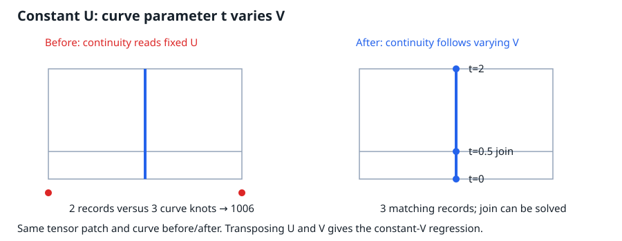

# Iso-curve continuity follows the varying coordinate

Issue: #3113. Unit: `curve.iso_curve`.

A constant-U curve evaluates `S(u0,t)` and its knots already come from V, but its
continuity dispatcher queried U. For a native tensor with two distinct U knots
and three distinct V knots, this returned two continuity entries for three curve
knots. The public projected point solver then returned code1006 before solving
the geometry. Transposing the tensor exposes the same defect for constant V.

## Definition and scope

For a tensor B-spline, fixing u combines the control rows at u0 and leaves a
B-spline in v, with the V knot vector. Fixing v leaves the corresponding U curve.
This is the parametric-line construction in Patrikalakis, Maekawa and Cho,
[Shape Interrogation for Computer Aided Design and Manufacturing, §1.4.4](https://web.mit.edu/hyperbook/Patrikalakis-Maekawa-Cho/node19.html).
Equivalently, `d S(u0,t)/dt = S_v(u0,t)` and `d S(t,v0)/dt = S_u(t,v0)`.

The fix shares one varying-direction selection between `knots` and
`calculate_continuities`; it preserves the evaluator's existing U-versus-other
branch convention. It does not change surface continuity classification, angular
thresholds, the curve evaluator or projected-root accuracy. Surface-level labels
remain inherited metadata, not a new exact-smoothness certificate.

No dedicated isocurve reference document covers this dispatcher; the module's
contract, the unit record, the definition/layer invariants and the tensor-product
construction above determine the coordinate. Fresh issue and open/draft/merged PR
searches found no overlapping claim. #1965 repairs UV iso-line construction and
#944 hardens the reader. The projected defining-join construction in #2840/#2968
and the All enumeration question #3111 remain separate.

## Direct regressions

The native patch has degrees(1,1). Along its fixed coordinate it has knots
`[0,0,1,1]`; along the varying coordinate, `[0,0,.5,2,2]`. Its two fixed-direction
rows have Z=0 and Z=1, and their common XY polyline has a corner at t=.5.
Both fixed directions are tested by transposing the same tensor definition.

- The sharp corner uses XY `(-.25,0),(0,1),(.25,0)`. Its three curve knots must
  have continuity entries `[Discontinuous,C0,Discontinuous]`. Projected distance
  from the origin along Z has exact maximum1 at t=.5: each affine side's norm
  is convex, and the other endpoints have norm.25. Single and All are tested
  with zero retention slack.
- The original shallow corner uses `a=1/1024`, `d=1/524288`, and XY
  `(-a,1-d),(0,1),(a,1-d)`. Its continuity list must also have three entries.
  This test does not prescribe an angular label as an exact smoothness proof;
  the separate defining-join work handles that issue.

Before the fix, all three public tests fail against the existing parent kernel:
sharp metadata is `(CInfinity,[Discontinuous,Discontinuous])`; shallow metadata
has length2; the public projected query returns1006. The regression command is
`cargo test -p solidcore --test iso_curve_continuity` (the initial red used a
standalone test binary linked to the already-built parent kernel, without changing
its Cargo target). No C++ behavior is claimed or needed for this direct proof.

Green, affected goldens, Clippy, wasm and broader integration checks remain pending
at this draft checkpoint. No expected output or tolerance has been changed.
