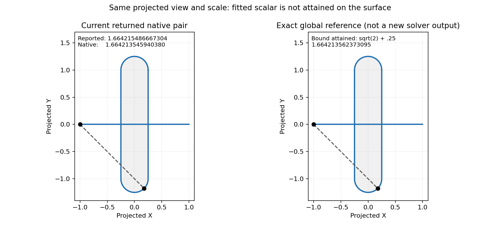

# Native affine curve/face maximum construction

Issue #3109; draft #3110. This is the face-owned pair boundary left after #3077,
not a replacement for its bounded curve/curve construction or #2968's point/face
certificate. No production change is present at this evidence checkpoint.

The two geometric pairs are visually close at this scale, but the reported fitted
scalar lies above the exact global bound. The right panel is an analytic reference,
not an output of an implemented repair.

## Measured defect

Actual public queries at pair checkpoint 69d8abd33 return the full-torus cases
`analytic_face_torus_x_6_15` and `_7_15` with scalar 1.6642154866673036 and native
parameters `(0, .5, .12494065250506982)`. Independent native evaluation gives
1.6642135459403802: an attainment error 1.940726923388425e-6. The half-torus controls
at `(0,0,.12499999813735485)` remeasure as their reported 1.664213562373095.
Original requests and outputs are preserved in
[the audit artifact](diagnostics/torus_pair_native_audit_3109.json); the standalone
[Rust evaluator](diagnostics/torus_pair_native_audit_3109.rs) reconstructs the exact
runner surfaces and checks native-domain membership without padding.

The parent/child checkpoint without #3077 returned 1.25 at `(.5,0,0)` for all four.
That old candidate has the elementary counterexample `(0,0,0)`, whose native
projected distance is sqrt(41)/4. This witness is not the exact maximum.

For the full domain, write projected torus coordinates as
`x=r sin(v), y=(R+r cos(v)) cos(u)`, R=1, r=.25, and line coordinate l in [-1,1].
Then `|x-l| <= 1+r|sin(v)|`, `|y| <= R+r cos(v)`, and the triangle inequality gives
`distance <= ||(1,R)+r(|sin(v)|,cos(v))|| <= sqrt(2)+.25`.
Equality is attained at l=-1, u=0, v=45 degrees. Thus the global bound is
1.6642135623730951; the full-torus reported scalar exceeds it by 1.924294208421884e-6.
The bound applies to both full and half major-angle domains because both contain u=0.

## Root cause and construction

The topology pair path solves against fitted 3D silhouettes, then changes the
solution's parameters and object ownership to the source face while retaining the
fitted scalar. The strict point/face refinement is not applied on this pair path.
A precise maximum of a fitted curve is insufficient evidence about its owner.

[Boyd and Vandenberghe, *Convex Optimization*, sections 3.1 and 3.2.2](https://web.stanford.edu/~boyd/cvxbook/bv_cvxbook.pdf)
establish norm convexity and preservation under affine composition. Applying that
result directly: for fixed surface point S and affine C(t)=(1-t)A+tB, projected
norm `||P(C(t)-S)|| <= (1-t)||P(A-S)||+t||P(B-S)||`, hence no interior t exceeds the
larger endpoint value. Taking the supremum over the face preserves this bound.
The double-cross map P uses the caller's unchanged normal, including its squared
scale. A finite piecewise-affine curve reduces to the union of span endpoints.

Planned implementation reuses the existing native surface residual certificate
for each structurally proved affine span endpoint, with the complete endpoint
**definition enclosure** carried through it. A rounded general endpoint Vec3 is
not silently substituted for that definition. Candidate construction may use
native active-set refinement, but acceptance requires every endpoint/face domain
upper bound to fit the actual returned candidate's own pair enclosure.

Structural selection precedes numerical proof. Selected failures propagate, never
fall back to the fitted scalar. Native requested-domain intersections, knot-side
ownership, discontinuities, non-unit/zero normals, cancellation, work bounds,
external incumbents, face trimming and returned parameter order require tests.
General non-affine curves are outside this initial construction. Existing All
contracts are not silently converted to Single.

## Validation status

Native evaluation and full-query baseline replays are complete. Dedicated full
and half torus kernel regressions are prepared; their targeted red build is pending
shared-cache availability. Production implementation, endpoint-enclosure interface
review, affected-case audit, final before/after rendering and broad gates remain.
