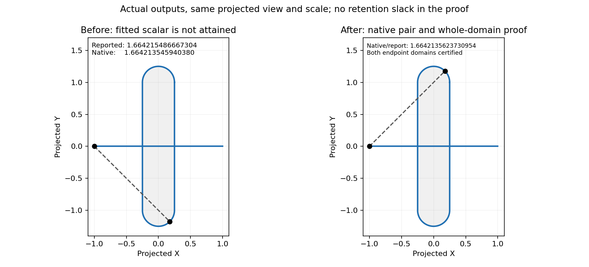

# Native affine curve/face maximum construction

Issue #3109; draft #3110. This is the face-owned pair boundary left after #3077,
not a replacement for its bounded curve/curve construction or #2968's point/face
certificate. The initial evidence checkpoint was 4f883e2dd; the following native construction
is a work-in-progress checkpoint, pending traversal-domain accounting.


The two geometric pairs are visually close at this scale, but the reported fitted
scalar lies above the exact global bound. The right panel is an analytic reference,
not an output of an implemented repair.

## Measured defect

Actual public queries at pair checkpoint 69d8abd33 return the full-torus cases
`analytic_face_torus_x_6_15` and `_7_15` with scalar 1.6642154866673036 and native
parameters `(0, .5, .12494065250506982)`. Independent native evaluation gives
1.6642135459403802: an attainment error 1.940726923388425e-6. The half-torus controls
at `(0,0,.12499999813735485)` remeasure as their reported 1.664213562373095.
Original requests and outputs are preserved in
[the audit artifact](diagnostics/torus_pair_native_audit_3109.json); the standalone
[Rust evaluator](diagnostics/torus_pair_native_audit_3109.rs) reconstructs the exact
runner surfaces and checks native-domain membership without padding.

The parent/child checkpoint without #3077 returned 1.25 at `(.5,0,0)` for all four.
That old candidate has the elementary counterexample `(0,0,0)`, whose native
projected distance is sqrt(41)/4. This witness is not the exact maximum.

For the full domain, write projected torus coordinates as
`x=r sin(v), y=(R+r cos(v)) cos(u)`, R=1, r=.25, and line coordinate l in [-1,1].
Then `|x-l| <= 1+r|sin(v)|`, `|y| <= R+r cos(v)`, and the triangle inequality gives
`distance <= ||(1,R)+r(|sin(v)|,cos(v))|| <= sqrt(2)+.25`.
Equality is attained at l=-1, u=0, v=45 degrees. Thus the global bound is
1.6642135623730951; the full-torus reported scalar exceeds it by 1.924294208421884e-6.
The bound applies to both full and half major-angle domains because both contain u=0.

## Root cause and construction

The topology pair path solves against fitted 3D silhouettes, then changes the
solution's parameters and object ownership to the source face while retaining the
fitted scalar. The strict point/face refinement is not applied on this pair path.
A precise maximum of a fitted curve is insufficient evidence about its owner.

[Boyd and Vandenberghe, *Convex Optimization*, sections 3.1 and 3.2.2](https://web.stanford.edu/~boyd/cvxbook/bv_cvxbook.pdf)
establish norm convexity and preservation under affine composition. Applying that
result directly: for fixed surface point S and affine C(t)=(1-t)A+tB, projected
norm `||P(C(t)-S)|| <= (1-t)||P(A-S)||+t||P(B-S)||`, hence no interior t exceeds the
larger endpoint value. Taking the supremum over the face preserves this bound.
The double-cross map P uses the caller's unchanged normal, including its squared
scale. A finite piecewise-affine curve reduces to the union of span endpoints.

Planned implementation reuses the existing native surface residual certificate
for each structurally proved affine span endpoint, with the complete endpoint
**definition enclosure** carried through it. A rounded general endpoint Vec3 is
not silently substituted for that definition. Candidate construction may use
native active-set refinement, but acceptance requires every endpoint/face domain
upper bound to fit the actual returned candidate's own pair enclosure.

Structural selection precedes numerical proof. Selected failures propagate, never
fall back to the fitted scalar. Native requested-domain intersections, knot-side
ownership, discontinuities, non-unit/zero normals, cancellation, work bounds,
external incumbents, face trimming and returned parameter order require tests.
General non-affine curves are outside this initial construction. Existing All
contracts are not silently converted to Single.

## Validation status

Native evaluation and full-query baseline replays are complete. Dedicated full
and half torus kernel regressions ran on the integrated base: the full-torus test
fails with reported 1.6642154866673036 versus native 1.6642135459403802, while the
half-torus control passes (one pass, one expected failure). Production implementation, endpoint-enclosure interface
review, affected-case audit, final before/after rendering and broad gates remain.


## Native local construction checkpoint

The native endpoint residual construction passes six dedicated tests: the original
full and half torus, reversed operand order, trimmed curve interval, normals scaled
by .001 and 1000, and the zero normal. The seven existing residual tests and twelve
projected-bound tests also pass. The full-torus red regression now succeeds without
using caller slack as accuracy or returning a fitted-silhouette scalar.

This is not the complete repair: topology traversal can have skipped or discarded
domains before the local face solve. A previous candidate's attainment enclosure
does not prove coverage of that history. The next checkpoint records original
domain groups before pruning and independently certifies them against the final
retained pair. Unknown mixed domains must refuse. This draft is not ready until
that traversal proof, cross-owner tests and the affected-case audit are complete.


## Traversal-domain ledger (implementation review)

The local construction alone is insufficient: an earlier fitted scalar can prune a
winning native face, and a retained point only proves attainment, not coverage of
previously discarded domains. The ledger records original operand groups before
pruning and checks their full Cartesian product at completion.

- **Capture:** `Ledger::record_trees` reads complete original tree object lists,
  native edge intervals, face domains and supplied curve intervals before either
  global branch or topology object pruning. Direct `LocalSolver::solve_it` records
  its complete local pair. References retain the original definitions; no fitted
  silhouette enters the ledger. Scoped tree solvers move the same ledger back.
- **Membership:** a retained solution must belong to one recorded original pair,
  with both owners matching and every curve parameter in its requested and natural
  domains. Native face-point feasibility also requires the exact rectangle proof.
  A valid native scalar at an out-of-trim point is not an admissible candidate.
- **Coverage:** affine curve/face groups use endpoint convexity and the shared
  homogeneous face residual. Curve/edge groups reuse the complete curve-pair
  construction, reconstructing its returned point enclosure with the identical
  bounded requested intervals. Point pairs use direct enclosures. Unsupported
  mixed domains refuse; no unvisited domain is inferred from an earlier answer.
- **Selection:** a feasible alternative is retained when scalar ordering discards
  the candidate whose own enclosure covers the domains. The certificate always
  belongs to the returned pair. The external incumbent cutoff is outward rounded
  and is checked separately after coverage; caller slack never stops the solve.
- **Work:** at most 4,096 recorded operands and 16,384 domain-pair checks. Original
  groups avoid Cartesian allocation; empty groups are discarded. The existing
  curve and surface proof budgets and cancellation remain in force.
- **Entry ownership:** `solve_trees`, `solve_two_trees`, the shape/B-rep wrappers,
  and the `GlobalSolve::solve_branch` trait entry own full capture/finalization.
  A raw generic free-function traversal or untracked `local_solve_branch` partial
  call cannot enforce finalization and explicitly refuses an activated native
  pair query. A partial branch return is never presented as a global certificate.

The first ledger cycle passed 15 focused native tests, all 60 topology-solver
unit tests and 33 projected-pair tests. These include direct/tree parity,
vertex/edge/face history, an unattained legacy scalar that would prune the winning
face, different face owners, an out-of-trim retained native point, empty groups,
cone sqrt(3), and both sphere controls at 1.5. The subsequent focused cycle
passed all 23 tests, adding trait/raw/partial entry guards, external-incumbent
empty/accepted/ambiguous controls, cancellation, the 128/129-span budget boundary,
and unchanged single-tree/cull behavior for an unrelated minimum query. The
strict library/tests lint check also passes. The separate fresh-request lifecycle
below preserves branch accumulation while preventing a new request from inheriting
old domains or an active certificate.
Affected-unit output/refusal accounting and final broad gates remain pending.


## Fresh-request lifecycle

`GlobalSolve::begin_solve` is a default no-op hook called once at the start of
`solve_it`, before validation, answer-array replacement or traversal. The topology
solver clears its pair ledger there even if the new operation is not eligible.
Explicit branch calls and tracked tree phases do not invoke the hook, preserving
intentional accumulation across their original domains. Supplied answers without
recorded provenance still refuse when the native certificate is activated.

All 28 focused native/domain tests and all 15 generic global-solver tests pass.
The five new controls cover a fresh empty answer array with changed curve trim and
projection normal, an early error on a noneligible request, supplied-answer
provenance, cancellation followed by retry, and explicit branch accumulation.
The final strict library/tests lint rerun also passes. The affected-unit
output/refusal audit, final native output artifacts and broad gates remain pending.


## Frozen affected-output audit

The before checkpoint is `cf11091a9`, the current pair-query parent with its
reviewed wrapper/caller corrections and native cone/sphere/half-torus goldens.
The standalone `affine_face_output_audit_3110.rs` links the checkpoint's existing
`goldens` library, enumerates the unit's real case list, then replays the frozen
JSON inputs without applying known-failure exclusions. No Cargo rebuild or golden
blessing is part of that step. Its baseline contains 2,575 cases: 1,975 fixtures
and 600 generated vertex-tree controls. Fourteen fixtures exercise the selected
native affine curve/edge-face Single projected maximum class: four cylinders,
two cones, four spheres and four tori. The two known-wrong full-torus outputs are
included rather than excluded from the audit.

The frozen input SHA-256 is
`eb9347c55dd6d8b1c503f09db342adc0608829057dda36639c3da402bcb29398`;
the structured before-output SHA-256 is
`dcc2cd45d4071d9b0fd3efc200717c96c4ecf9cb8cdb96f812865932246a6a42`.
The after executable must consume those exact inputs. A separate final-generator
freeze must match them, or fixture/generator changes must be accounted for before
comparing solver behavior.

For every case, compare success/error/deferred/rejected state and the complete raw
output, independently of its golden exclusion. List every changed row and every
new refusal; an unchanged status alone does not validate a changed answer. A new
refusal requires its concrete cause and scope, never a replacement golden that
hides it. Successful focal rows must satisfy all of these obligations:

1. Decode the original entry's parameter order and verify the curve/edge parameter
   against its requested native interval and UV against the actual face domain.
   The static adapter collapses some object handles to the same display id, so
   raw display ids alone do not establish ownership; dedicated owner/history
   regressions check the real handles.
2. Recreate the exact native constructors used by the adapter and evaluate both
   returned points. Record reported scalar, native metric, difference and an
   independently evaluated definition-point enclosure. The reported scalar must
   lie in that returned pair's own enclosure; caller retention is not an error
   allowance.
3. Apply the native homogeneous residual certificate to both defining line
   endpoints over the complete native face domain, with the returned pair's own
   upper endpoint as threshold. Convexity then covers the entire affine segment.
   Record both endpoint proof results and an intentionally too-small threshold
   control. A closed-form ideal bound is additional geometric evidence, not a
   substitute for the native defining-net certificate.
4. Classify a fitted scalar outside the native point enclosure separately from a
   feasible point that fails the whole-domain bound. Preserve before evidence even
   when both defects occur in the same full-torus record.

The 600 generated p2 tree cases do not contain native curve/face maxima. The 28
focused native/domain tests therefore form a separate required history/lifecycle
cohort: direct/tree parity, vertex/edge/face accumulation, scalar-pruning trap,
different owners, trims, unknown history refusal, bounded work, external targets,
raw partial-entry refusal, fresh request reuse and intentional branch accumulation.
Their pass counts must not be described as before/after golden coverage. Final
validation also runs the complete affected topology units and generic solver
checks after the final parent merge; only confirmed repaired records may graduate.

Propagation waits for the final parent gates. Relative to this branch's original
`5211a7ad2` base, `cf11091a9` overlaps production changes in `curve/curve/p1.rs`:
retain the parent's exact wrapper and centered affine certificates together with
this change's endpoint-enclosure API and bounded endpoint reduction. The ledger,
native face construction and fresh-request hook do not overlap that checkpoint's
production changes. Merge the final parent stack once, do not rebase, and rerun the
frozen output comparison and focused lifecycle checks on the merged head.


### Executable native audit protocol

`run_affine_face_audit_3110.py` uses existing rlibs only. It runs its standalone
Rust compiler and replays under `nice -n 10`, and requires every scratch file,
executable and log to be inside a designated artifact/storage directory. The
baseline validator now checks the two pinned hashes above before trusting case
counts or writing its manifest. The final fixture/generator freeze must match the
original bytes, preserving signed zero and other representation details.

Run three labeled replays: the historical `cf11091a9` build, the immediate parent,
and the final #3110 build. The historical build must reproduce its pinned outputs;
the immediate-parent comparison separates inherited proposal changes from this
PR's native pair changes. Supply exact rlib filenames from each build rather than
choosing the newest cache file by timestamp. The script records their content
hashes; its operator-supplied revision label does **not** independently prove rlib
origin. Associate those hashes with the exact-head build log before presenting the
results as final validation.

With `REPO`, `STORAGE`, `ARTIFACTS`, `DEPS`, and the three `*_RLIB` variables set to
the reviewed build and designated artifact storage, the commands are:

```sh
python "$REPO/plan/findings/diagnostics/freeze_affine_face_audit_3110.py" "$ARTIFACTS"
python "$REPO/plan/findings/diagnostics/run_affine_face_audit_3110.py" \
  --repo "$REPO" --storage-root "$STORAGE" --artifact-dir "$ARTIFACTS" \
  --deps "$DEPS" --goldens-rlib "$GOLDENS_RLIB" \
  --solidcore-rlib "$SOLIDCORE_RLIB" --serde-json-rlib "$SERDE_JSON_RLIB" \
  --revision "$BUILT_HEAD" --proof-revision "$PAIR_HEAD" --label "$RUN_LABEL"
```

For the historical replay add `--case-root "$ARTIFACTS/input-root"
--expect-baseline`. For the final replay add
`--reference-outputs "$ARTIFACTS/$PARENT_LABEL/outputs.jsonl"
--expect-certified`. Use a new label on every attempt; the tool will not overwrite
the pinned before directory or an existing attempt. The point/residual audit uses
a mechanically import-adapted copy of the explicitly identified proof source,
recording both source hashes. This permits the same independently reviewed native
certificate to examine historical outputs without pretending the historical
solver implemented it.

The native audit recreates the adapter's exact line and analytic surface
constructors, then checks each actual returned endpoint and UV. Curve controls,
normal and requested interval are constants in the adapter, not fixture JSON
fields: the driver pins the full adapter source hash
`ab07e2085d02e1025ea981d9456b54fd819e0feb42b32b0471752f7eeb83dcc8`,
saves that source and its explicit geometry contract, and refuses source drift.
The native helper verifies that contract plus each input's entry, operation,
request and inclusion flag; each surface is reconstructed from its actual input. Its point
arithmetic follows the defining endpoint's division by its stored unit weight,
the default native surface knot side, and the same outward double-cross norm.
Both endpoint residuals must fit that retained point's own upper enclosure. The
negative control is one representable value below the rigorous witness enclosure's
lower endpoint, rather than below an unqualified rounded scalar. A failed global
certificate is reported as unproved, not automatically as a counterexample; a
scalar outside its own native enclosure is a distinct attainment failure.

The driver writes all changed outputs, every refusal, native obligations and
source/library hashes before applying its final gates. `--expect-certified`
requires all fourteen native rows to satisfy every obligation and no new refusal
against either historical or immediate-parent output. Failure requires
investigation, not tolerance changes, golden replacement or new exclusions.
The Linux historical/immediate-parent/final replay remains pending. The independent
Windows final replay below has executed the native helper; its evidence does not
substitute for the pending historical output comparison.


The merged production checkpoint `17353d3ac` passed all 28 native/history tests,
all 15 generic global-solver tests and strict library/tests Clippy after the
reviewed parent native-proposal repair was integrated. These are kernel test
results, not a claim that the prepared standalone native audit has run. The
immediate-parent evidence/golden-only follow-up does not change kernel sources;
its source identity is checked separately when propagated.

### Final native construction audit (Windows, `c341e5309`)

The fresh host build's Cargo artifact record identifies the rebuilt kernel rlib
with SHA256 `2f600bf05200db5743ad00f2497918208ef4cdc49733f38529a4e43edef2eaaa`.
The actual public runner froze all 2,575 inputs; their byte hash equals the pinned
historical input hash above. All fourteen native curve/edge-face maximum records
then passed independent checks of requested/native domain membership, reported
scalar inclusion in the returned point's own enclosure, native scalar identity,
and both affine endpoint residual certificates over the complete face. The
one-representable-value-below-witness-lower-bound controls all refused. No caller
retention slack enters these construction checks.

Exact inputs, output arrays, native points and individual proof results are in
[`affine_face_native_final_3110.json`](diagnostics/affine_face_native_final_3110.json).
The final full- and half-torus outputs report `1.6642135623730954`, exactly equal
to their evaluated native metric. Their rigorous native point enclosures, rather
than an unpadded ideal-geometry scalar, supply the full-domain proof threshold.



The full Windows golden comparison is **not green**: 2,575 cases, four changed,
zero added/removed/broken, and the two existing full-torus exclusions. The four
changes are `analytic_face_sphere_band_{6,7}_{14,3}`, outside the new projected
maximum operation 15. Operation 14 retains scalar zero but chooses the other
periodic seam parameter; operation 3 chooses the symmetric opposite endpoint
candidate, with a one-ULP scalar difference. Both operation-3 endpoint answers
are independently disproved by the native admissible pair
`t=0.6250000000000001`, `UV=(0,1)`: the curve point is
`(0.2500000000000002,0,0)`, the face point is
`(0.2500000000000002,0,-0.5669872981077808)`, and their distance
`0.5669872981077808` is below the reported `0.9142135623730951`.
This ordinary-minimum defect is outside the projected-maximum construction.
It is tracked separately in [#3119](https://github.com/tangency-labs/solidcore/issues/3119),
with the independently rerun public reproduction and confirmed native witness.
A fresh Windows immediate-parent replay is required to determine attribution;
these outputs have not been blessed. The
native fourteen-record audit includes both currently excluded full-torus cases,
so their proof coverage does not depend on the golden exclusions.

The historical raw-output comparison and final Linux native replay remain
pending; matching input bytes alone is not a before/after output comparison.
The separate 28 native/history and 15 generic solver tests passed at the
production-identical `17353d3ac` checkpoint. The later parent provenance merge
changes documentation only.
