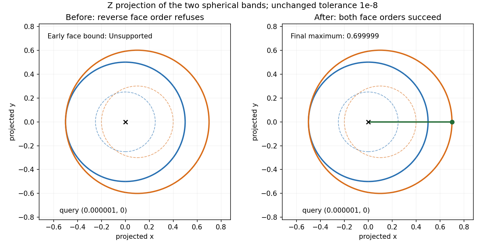
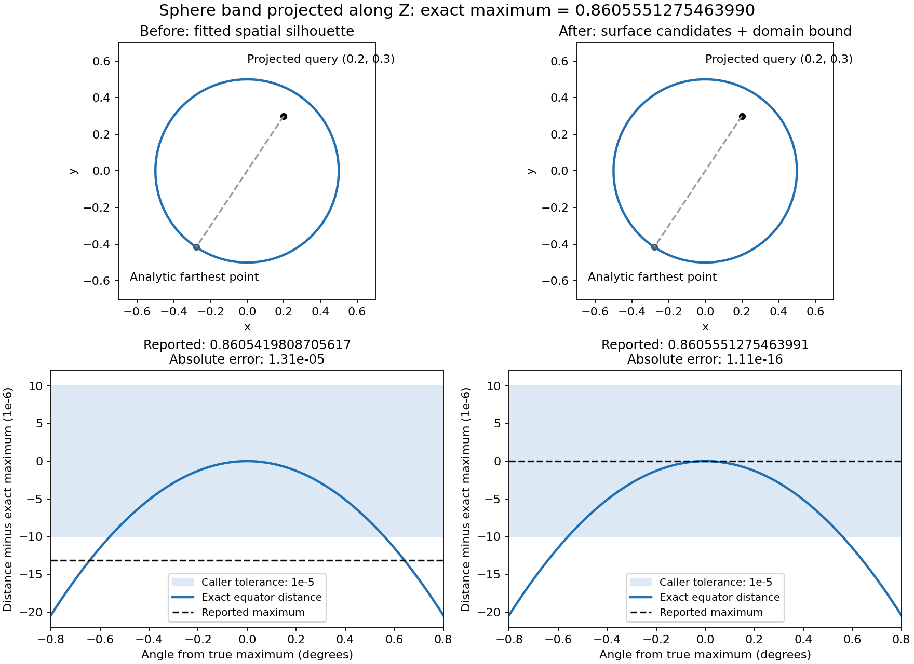
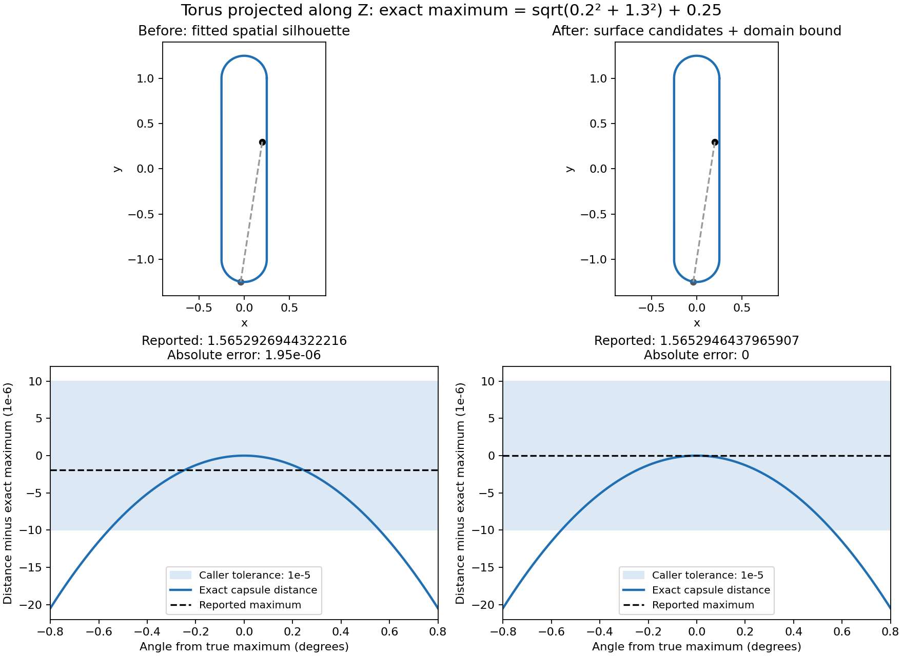
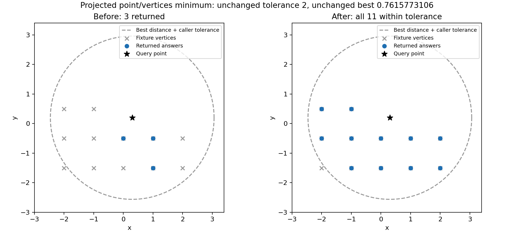

# Projected point/face maximum: whole-domain certificate

**Current acceptance:** the integration correction at the end of this record uses
native UV proposals and the returned point's own arithmetic enclosure. The earlier
mean-value/tolerance account below is a historical checkpoint, not today's rule.
Caller tolerance controls retention; the unchanged homogeneous Bernstein residual
proves the whole-face maximum against the selected native point enclosure.

The reported operation is a single projected point/face maximum. Its candidate
curves now evaluate `S(uv(t))`; an independent fitted spatial curve is not measured.
This removes the original extra fit error but is not, by itself, a certificate.
The verified rectangular boundary curves are also candidate curves, so a
boundary maximum does not depend on a silhouette reaching it or on the global
tree visiting edges first.

## Construction

For `Q(x) = N cross x cross N`, bound `f(u,v) = |Q(S(u,v)-P)|^2` on every
nonempty knot rectangle of the face domain. Existing outward-rounded NURBS
partials supply intervals for `S`, `S_u`, and `S_v`. Intersect the direct squared
norm enclosure with the mean-value enclosure

`f(c) + 2 Q(S-P).Q(S_u) (U-c_u) + 2 Q(S-P).Q(S_v) (V-c_v)`.

The centre evaluation is also an interval evaluation. The rectangle is convex,
so the mean-value formula encloses every value without assuming a stationary
point was found. Knot rectangles are checked separately. Subdivision is
iterative and deterministic, with cancellation, a 16,384-box budget and a
48-bisection path limit. A failed denominator enclosure is subdivided; a box
that remains unresolved is never accepted.

Every box must prove its distance upper bound at most the reported scalar plus
the caller's tolerance, with that threshold rounded inward. This accounts for
missed branches without certifying or replacing the tracer. The method follows
the mean-value inclusion principle of interval analysis; see equation (27) in
[Neumaier, Complete Search in Continuous Global Optimization and Constraint Satisfaction](https://arnold-neumaier.at/glopt/mss/Neu04.pdf),
section 11, and
[Patrikalakis, Maekawa and Cho, interval arithmetic](https://web.mit.edu/hyperbook/Patrikalakis-Maekawa-Cho/node45.html).

## Definition and feasibility

Plain NURBS definitions and the existing checked analytic exactness classes are
eligible. Procedural blend/sweep definitions and unsupported surface classes
refuse; their displayed net cannot substitute for their definition.

A newly returned face candidate must be a single point within the UV rectangle.
The stored trim boundary must consist of one connected four-edge loop whose
edges are full, clamped, degree-one, two-control-point UV segments or analytic
lines joining the four exact rectangle corners. Analytic lines are checked from
their defining point/vector/scale/parameter interval with the existing exact
binary64 product predicate; neither their stored net nor rounded endpoint samples
prove that identity. The tolerance-based rectangular flag is never
used as proof. The metric at the returned UV is enclosed independently, and the
entire enclosure must agree with the reported scalar within the tolerance.
A previous answer on another object is retained as the caller's already
established feasible bound; this local certificate proves that this face cannot
improve it by more than the tolerance.

Global B-rep/shape point queries check each newly selected face candidate before
it can affect subsequent tree pruning, then defer whole-face upper bounds until
the final feasible candidate is available. Local point/face calls retain their
immediate whole-face check. A zero vertex distance does not finish a projected
maximum query.

The two-face regression uses sphere bands of radii 0.5 and 0.6, centered at
(0,0,-1) and (0.1,0,-1), with longitude [0,360], latitude [-60,60], Z projection
and query (0.000001,0,2). The exact maximum is 0.699999. Before this review fix,
one face insertion order succeeds and the reverse returns an unproved-bound
refusal at the first face. Both orders now return the maximum within 1e-8.

A companion single-band query at (0.25,0,2) has coincident projected seam vertices
but maximum 0.75, ensuring the vertex shortcut cannot skip the face.

Candidate-check failure restores the solver state from before candidate generation and returns
`Unsupported`, rather than publishing an unproved candidate. The certificate
uses no enlarged tolerance or sampled accuracy floor. A final global bound failure
also returns `Unsupported`; it never publishes a partially certified answer.

## Scope

This change is deliberately restricted to `PointFace`/`VertexFace`,
`ProjectedMaximize`, `Single`. Curve/face and face/face queries, other operations,
and requests enumerating all extrema retain the parent candidate implementation.
The shared projected minimum/maximum topology-box culling now encloses the same
double-cross metric, including non-unit normals. The former projected sphere
test used an unscaled plane distance and could discard the face after seeing a
vertex value scaled by `|N|^2`; the public traversal test exposed this at normal
length 1000. Outward-rounded box bounds replace that mismatched comparison.
The pruning comparison keeps the caller's tolerance around the current best,
so requests for all answers do not discard an answer within that tolerance.
The regression at half the tolerance fails without this margin; an answer two
tolerances away is still culled for both projected minimum and maximum.
Earlier
child-branch pair-query measurements are investigation results, not evidence
that this certificate covers those operations.

Focused validation covers local and public
B-rep traversal for the analytic fixtures. The sphere result is
`0.860555127546399068` against analytic `0.860555127546398957`; the original
inaccurate scalar is refused by the independent whole-domain bound.
The full-suite and golden results are recorded in the PR description.

The upper panels show the same analytic projection and maximizing point; the
lower panels magnify the exact distance function near its maximum and overlay
the measured scalar. The drawing is explanatory evidence, not the certificate.
The original scalar is recorded in issue #2967; the new scalar is from the
regression output. The plotting source is
`diagnostics/projected_maximum_comparison_2967.py`.

## Golden audit

The three affected units were run into a separate candidate directory before
changing expected records. `curve.curve_p1` has no changed records. There are
12 changed box-pruning records in `intersect.topology_solver_p1`, and 25 changed
plus one restored record in `intersect.topology_solver_p2`. No case broke.
Only these audited records are updated; other issue-linked exclusions remain.

The restored `analytic_face_sphere_band_5_15` is removed from `known_failing.json`.
Its old scalar `0.8605419808705617` becomes `0.8605551275463991`, with the analytic
reference `0.8605551275463990`. For `analytic_face_torus_x_5_15`, the scalar changes
from `1.5652926944322216` to `1.5652946437965907`; the latter is the closed-form
capsule distance `sqrt(0.2^2 + 1.3^2) + 0.25`. The UV changes from
`(0.5, 0.9735618580045653)` to `(0.5, 0.9737927804326563)`. Both new records have
success status and one solution; the tests independently check the surface
value, UV feasibility and whole-domain bound.

The torus's old scalar was already within the requested tolerance, but measuring
the surface definition removes its extra fit error and shifts the maximizing UV.

The box cases were independently reconstructed with 80-digit decimal arithmetic
from the binary64 inputs. Project each corner of the box difference by the
double-cross map, enclose each component, then bound its norm and compare with
`sqrt(best) +/- tolerance`. All changed decisions agree. A zero normal gives
zero distance everywhere, so it cannot improve an incumbent maximum of 2;
tiny normals retain their squared scale.

| Case | Changed output indices: old -> new |
|---|---|
| `gen0197` | 6: 1 -> 0 |
| `gen0551` | 2: 0 -> 1; 3: 1 -> 0 |
| `gen1019` | 3: 1 -> 0 |
| `gen1335` | 7: 1 -> 0 |
| `gen1343` | 3: 1 -> 0 |
| `gen1363` | 0: 0 -> 1; 9: 1 -> 0 |
| `gen2213` | 0, 2, 6: 1 -> 0 |
| `gen2643` | 1, 3: 1 -> 0 |
| `zerovec_may_tiny_14` | 1: 0 -> 1 |
| `zerovec_may_tiny_15` | 1, 2: 1 -> 0 |
| `zerovec_may_zero0_15` | 0, 1, 2: 1 -> 0 |
| `zerovec_may_zero_15` | 0, 1, 2: 1 -> 0 |

The other 24 changed records are `subdivided_{entry}_14_1_{sizes}_{tol}_{mode}`,
with each row below covering modes `1` and `3`. The old tree pruning omitted
answers within tolerance. An independent exhaustive enumeration of the fixture
vertices (and the bounded line's endpoints and closest parameter for entry 1)
reproduces the complete new answer sets. Every returned scalar matches its
projected Euclidean distance, and every returned line parameter is in `[0,1]`.
The query normal is Z. No tolerance or acceptance floor was changed.

| Entry | Vertex counts | Tolerance | Old -> new solution count, each mode |
|---|---|---:|---:|
| 0: point/vertices | 12, 11 | 2 | 3 -> 11 |
| 0 | 12, 11 | 50 | 3 -> 12 |
| 0 | 40, 30 | 2 | 6 -> 36 |
| 0 | 40, 30 | 50 | 6 -> 40 |
| 1: line/vertices | 12, 11 | 2 | 12 -> 21 |
| 1 | 12, 11 | 50 | 12 -> 26 |
| 1 | 40, 30 | 2 | 40 -> 72 |
| 1 | 40, 30 | 50 | 40 -> 88 |
| 2: vertices/vertices | 12, 11 | 2 | 12 -> 80 |
| 2 | 12, 11 | 50 | 12 -> 132 |
| 2 | 40, 30 | 2 | 60 -> 584 |
| 2 | 40, 30 | 50 | 60 -> 1200 |

The minimum distances are unchanged: point/vertices `0.7615773105863908` (12
vertices) or `0.4242640687119285` (40); line/vertices `0.5`; vertices/vertices
`0.13975424859373686`. The changed digests reflect the restored answer sets.

This representative `subdivided_0_14_1_12_11_2_1` view uses the fixture's actual
vertices and query. The old returned vertex IDs are `7, 8, 3`; the new set is
IDs `1` through `11`. Vertex `0` remains outside the tolerance circle.

## Integration correction: native UV proposals, independent global proof

At `32c78bb2a`, integrating the defining-wrapper boundary checks exposed seven
previously successful entry-5 projected maximum fixtures as error 1021:
`analytic_face_{cyl_x,halfcyl_x,cone_x,sphere_band,sphere_quarter,torus_x,torus_half_x}_5_15`.
The hosted kernel run also failed six existing silhouette tests. The temporary
nonlinear `CrvOnSurf` candidate solver reached an artificial cache boundary and
correctly refused a join whose defining regularity it could not prove. That
stronger curve-extremum obligation was unnecessary for constructing a feasible
point to be checked by the independent whole-face certificate.

The repair is `c5896c6cc`, integrated with the current child/main as `4cb14dcff`
(main `7a593124c9`). It changes the certified Single point/face branch before any
curve solve: UV silhouette and exact-trim curves supply hints, while native knot
rectangles supply further proposals. No failed curve solve is caught or retried,
and no generic wrapper boundary predicate is weakened. All and other operation
classes retain their existing path.

The deterministic construction:

- Checks the existing native definition/exactness class, rectangular trim and
  finite domain/metric. Active knot cells are counted before cut-vector allocation;
  the supported domain remains at most 4096 cells, as in the residual proof.
- Keeps all four domain corners. At most 4096 total UV seeds are spread across
  the full native cell index range and the full trace-hint index range. When hints
  exist, part of the budget is reserved for them; each selected hint contributes
  at most 17 parameter points, including its endpoints and midpoint. Dense trace
  approximation knots do not increase this work budget.
- Refines each proposal on the native surface with the existing bounded 48-step
  active-set Newton construction before scalar selection. Undefined/non-improving
  Newton steps stop refinement; a seed is never evidence that all maxima were found.
- Re-evaluates every proposed scalar on the native surface and checks it against
  that actual point's own interval enclosure, using the native default knot side.
  Existing naming, retention ordering, candidate checks and rollback remain.
- Refuses if a generated native proposal cannot be evaluated or enclosed. The
  current controls cover pole and knot cases, but this conservative behavior is
  not a claim that every otherwise certifiable surface will produce a candidate.
- Requires the unchanged whole-face residual certificate, immediately for a local
  solve or against the final selected incumbent for deferred B-rep faces. A bounded
  proposal set that misses the maximum still refuses; no sample spacing or caller
  tolerance enters acceptance.

This separates the role of local feasible-point construction from global proof,
as described in Neumaier, [Complete Search in Continuous Global Optimization,
section 13](https://arnold-neumaier.at/glopt/mss/Neu04.pdf). The preserved residual
uses the Bernstein convex-hull enclosure; see Dang and Testylier,
[section 3.1, Lemma 1](https://www-verimag.imag.fr/~tdang/Papers/bernstein-rap.pdf).
These references motivate the separation; the implemented residual and directed
arithmetic, rather than sampled values, prove this kernel's returned result.
The residual module is byte-identical to the pre-correction source at
`32c78bb2a`, Git blob `9210112674430a035465ba9962adcd852aadbf63`.

### Direct controls and checkpoint

The seven fixture constructors, query vertex `(0.2,0.3,2)`, Z normal, and
VertexFace dispatch are reproduced in the native test. Their projected closed
forms are:

| Geometry | Closed-form maximum |
|---|---|
| Full/half X cylinder | `sqrt(.7^2 + .8^2)` |
| X cone, heights .5 to 1.5 | `sqrt(.3^2 + (.3 + 1.5*tan(30deg))^2)` |
| Full-longitude sphere band | `.5 + sqrt(.2^2 + .3^2)` |
| Half-longitude sphere quarter | `sqrt(.7^2 + .3^2)` |
| Full/half X torus | `.25 + sqrt(.2^2 + 1.3^2)` |

These analytic values explain the geometry; each returned native point is also
checked against its own enclosure and the actual native whole-domain residual,
without replacing the stored rational definition by an ideal quadric.

Additional controls preserve the contract:

- A 512-cell affine tensor still certifies its exact corner maximum within the
  candidate's own enclosure; the fixed seed budget does not impose a new 455-cell
  domain restriction.
- The exact degree-six scalar surface
  `x(u)=120*u^2*(1-u)^2*(u-.5)^2` has zero stationary values at every supplied
  proposal but a feasible witness `x(.25)=135/512`. The unchanged global proof
  rejects every inadequate proposal.
- Native full-sphere pole proposals are valid, but the collapsed topological trim
  is still refused by the unchanged exact-rectangle feasibility requirement.
- The cached-fit control deliberately displaces fitted geometry in coordinates
  that affect the metric. Native UV evaluation, and the final returned point,
  remain the source of the measurement.

The integrated checkpoint passes all **48** focused topology tests:
`cargo test -p solidcore --lib intersect::topology_solver`. This includes all
seven fixture inputs, all six formerly failing tests, the negative certificates,
and the 512-cell control. The final end-to-end poisoned-cache control also passes:
the real B-rep trim is prepared first, the cache supplies a fitted line displaced
by 10 in X and Z, and the production solve returns native UV `(1,1)` with value
`sqrt(2)`. Measuring the fitted line under the requested Z projection would exceed
10. `cargo clippy -p solidcore --lib --tests -- -D warnings` and formatting
checks on the changed Rust files also pass. Actual full affected-unit golden
capture remains a separate integration gate; no golden has been automatically
blessed by this construction change. Existing figures depict the same
sphere/torus geometries; no new render is claimed here.
