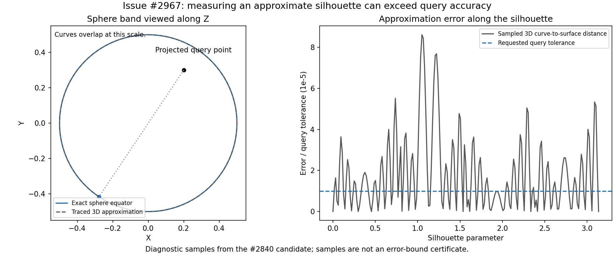

# Silhouette accuracy: first reproduction and representation experiment

Issue #2967; claim #2968. No production implementation changes yet.

The historical failing query belongs to #2840's projected-curve candidate, not
unmodified main. This distinction matters: the latest main's stored golden for
`analytic_face_sphere_band_5_15` is success with zero solutions. An empty success
does not certify the maximum or demonstrate that main returns the same bad scalar.

## Geometry and executable diagnostic

The sphere is centered at `(0, 0, -1)`, radius `0.5`, longitude `[0, 360]`
degrees and latitude `[-60, 60]` degrees. The point is `(0.2, 0.3, 2)` and the
projection normal is unit Z. The silhouette is the equator. Its exact projected
maximum is `0.5 + sqrt(0.2^2 + 0.3^2) = 0.860555127546399`.

`crates/solidcore/examples/silhouette_accuracy.rs` builds this surface and traces
the silhouette using the face caller's `1e-4` approximation tolerance and
20-degree angle tolerance. It queries both the fitted 3D curve and an existing
`CrvOnSurf` made from the returned UV trace and original surface. It also emits
4,001 diagnostic samples. These samples are not a proof of a global bound.

Executed against the previously validated #2840 candidate library:

| Representation | Projected maximum | Curve parameter |
|---|---:|---:|
| Fitted 3D curve | 0.8605419808705617 | 2.0651143077201275 |
| UV trace evaluated on the sphere | 0.8605551275463991 | 2.0647615968273123 |

The first reproduces the recorded failing scalar. The second agrees with the
analytic maximum to floating-point precision, without changing query tolerance.
This is a representation experiment, not a complete production repair.

The same diagnostic was compiled and executed on current main `b43a3ec3a`:
both representations return zero candidates, while all sampled values below
are identical. The filtered golden run passes its stored empty success
(`cases=1 changed=0 added=0 removed=0 broken=0`, exit 0). Both the diagnostic
and baseline commands complete with exit 0. Thus the approximation error is
present independently, but repairing this complete query depends on #2840's
candidate-finding changes. #2968 stacks that dependency by merging its existing
branch, rather than reimplementing or independently owning the same solver work.

The sampled 3D-curve maximum is `0.8605419689531334`; the sampled on-surface
maximum is `0.8605550981685833`. The largest sampled curve-to-surface distance
is `8.695878052481907e-5`. Sampling the fitted curve more densely would still
measure that representation, rather than the original surface.

The left curves overlap at this scale. The right plot shows sampled positional
deviation; it is not the query's optimization error or a certified bound.

## Research and next construction checks

Patrikalakis, Maekawa and Cho explain [distance stationarity on the original
surface](https://web.mit.edu/hyperbook/Patrikalakis-Maekawa-Cho/node136.html)
and [interval enclosures for geometric computation](https://web.mit.edu/hyperbook/Patrikalakis-Maekawa-Cho/node45.html).
These support checking the defining geometry and bounding errors rather than
grading a fitted curve solely by samples. The repository's
`docs/definitions-and-certificates.md` requires the same distinction.

For the existing double-cross projection `M = |N|^2 I - N N^T`, its Euclidean
operator norm is `|N|^2`. Consequently a proved positional error epsilon can
contribute up to `|N|^2 * epsilon` to the projected distance error, by the reverse
triangle inequality. This is a derived budget constraint, not a measured bound
for the current tracer.

`CrvOnSurf` removes the fitted 3D curve's positional deviation by evaluating
`S(uv(t))`. It does not by itself prove that the UV trace is the exact silhouette,
that trim endpoints are correct, or that the optimizer found every required
candidate. Next checks must cover those errors, nonunit normals, other surfaces,
and the surrounding public topology query. No arbitrary tolerance multiplier,
native mismatch parking or golden blessing is proposed by this experiment.

## Follow-up: lifting does not certify the UV trace

A second diagnostic tilts the view 45 degrees in the x-z plane. With a unit
normal, the analytic maximum is `2.502498439450079`; the fitted-curve solve
returns `2.502491230322871` and the lifted solve `2.502498439368356`.
The latter is much closer, but still differs by about `8.17e-11`.

Scaling the same normal to length 1000 preserves the silhouette locus and scales
the double-cross metric by one million. The analytic maximum becomes
`2502498.439450079`; the lifted solve returns `2502498.439368355`, a gap of about
`8.17e-5`, exceeding the unchanged `1e-5` query tolerance. These experiments used
the validated #2840 library. The example now accepts tilt and normal length as
arguments so the checks are reproducible (`-- 45 1` and `-- 45 1000`).

The WIP production change removes the independent 3D fitting error for all
callers of `face_silhouettes`, including cache hits. It is not a complete repair
of #2967. `compute_span_deviation_base` tests finitely many span points against
locally corrected points, and supplies no global UV-trace enclosure. The next
construction must control that remaining error in the actual query metric,
including the projection scale, and verify trimmed endpoints and enumeration.

## Projection metric correction and executed regression

The next implementation requests tracing tolerance
`query_tolerance / max(1, |N|^2)`. The squared-normal factor converts the
projection metric to geometric distance. The maximum with one prevents a
contracting projection from loosening the geometric tolerance: the tracer also
uses that tolerance to discard short geometric segments. Nonfinite or
underflowed positive tolerance conversions return an input error.

An isolated diagnostic using the geometric budget `1e-5 / |N|^2` for the
45-degree, length-1000 normal returned `2502498.4394500777`, compared with the
analytic `2502498.4394500786`: error about `9.3e-10`. The committed diagnostic
reproduces the budget comparison with `-- 45 1000 metric`; the default remains
the original `legacy` tracing tolerance to preserve the failing reproduction.

At production head `14404b56f`, the prepared-face tests passed: two tests,
four configurations (untilted/unit, tilted/0.001, tilted/unit, tilted/1000),
zero failures. Each checks the returned scalar against the closed form at the
original query tolerance, and against the surface evaluated at the returned
UV parameters with a separate floating-point rounding allowance. The latter
allowance does not loosen the query tolerance. This is evidence for these
cases, not a global enclosure proof for the sampled tracer.

The earlier lift-only head `da344d338` completed both affected-unit golden runs:

| Unit | Cases | Changed from main goldens | Broken |
|---|---:|---:|---:|
| intersect.topology_solver_p1 | 3592 | 24 | 0 |
| intersect.topology_solver_p2 | 2575 | 65 | 0 |

Rust-only output snapshots against the validated #2840 executable isolate the
follow-up: p1 has zero changed outputs across all 3592 common cases; p2 has 45
changed outputs across all 2575 common cases, with no changed statuses or
solution counts. Some differences are rounding or different equal-valued
representatives. Sphere and torus point maxima move to their closed-form
values. This comparison does not certify the global optimality of every local
curve/face or face/face record. No golden was blessed. Final metric-head
goldens, full tests, lint and wasm checks remain to be recorded.

The reconstruction audit in
`diagnostics/silhouette_measurement_audit_2967.py` rebuilds the fixture surfaces
and evaluates each changed record at its returned UV coordinates (and the line
parameter for curve/face records). For the lift-only comparison, 16 of 45 parent
records differ from that reconstructed projected distance by more than `1e-5`;
the largest discrepancy is `3.866563226329056e-5`. All 45 lifted records agree
with the reconstructed magnitude exactly in the executed floating-point
evaluations. Signed results are checked by magnitude here: this audit does not
certify direction, global optimality, completeness or trim membership.

Workspace/all-target strict Clippy on production head `14404b56f` passed.
