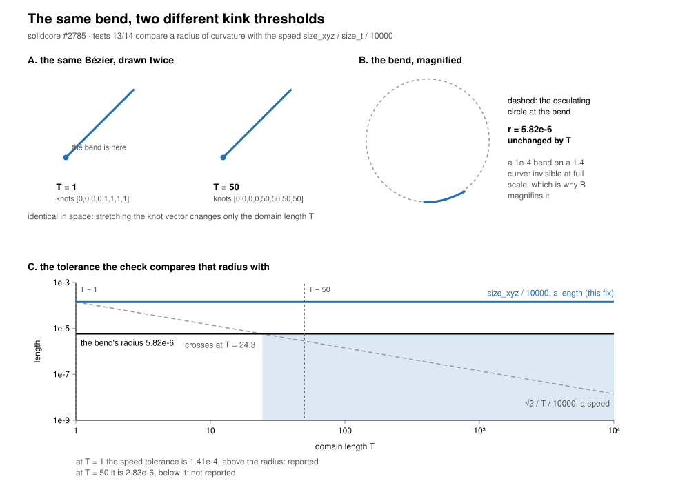

# `SmBSplineCurve::AssertValid` tests 13/14 compare a radius of curvature with a speed

Unit: `nurbs.b_spline_curve_p3` (`crates/solidcore/src/nurbs/b_spline_curve/p3.rs`).
Issue: tangency-labs/solidcore#2785. Fix: this PR.



*Figure. Left: the curve of #2785 magnified, with the osculating circle at its bend. Right:
the tolerance the check compares that radius against. The dashed line is the old speed
`sqrt(2) / T / 10000`, which falls below the bend's radius at `T = 24.3`; the solid blue line
is the length `size_xyz / 10000` this fix uses. From `T = 24.3` on the bend was silently
accepted, although nothing about the curve had changed.*

## The defect

`BSplineCurve::assert_valid` builds one tolerance and uses it for two different kinds of
quantity:

```rust
let size_t = domain.length();
let tol = if bounded { (size_xyz / size_t) / 10000.0 } else { 1e-03 };
...
let (mut radius_sized, mut radius_tol, mut radius_sep) = (sized, tol, min_sep);
```

`size_xyz / size_t` is a length per parameter — the curve's average speed. That is the right
unit for tests 11/12, which compare `|C'|`, a speed, and for the `speed_clear` bound below
them. A radius of curvature is a **length**, so tests 13/14 (2D and 3D) compared a length with
a speed. The mapped UV-trim branch (`radius_tol = (mapped_size / size_t) / 10000.0`) had the
same shape.

The consequence is that the verdict depends on the parametrisation: stretching the knot vector
multiplies `size_t` and divides the tolerance, so the same curve with the same bend is reported
or not depending on its domain. `zero_speed_radius_stretch` (WR-668) was affected too: it
divides `radius_tol` by the radius' growth rate to get a stretch in *parameter* units, which
needs `radius_tol` to be a length.

## Measured

The curve is the cubic Bézier `(0,0) (h,0) (h,h) (1,1)` with `h = 1e-4`, on the knot vector
`[0,0,0,0,T,T,T,T]`. The curve in space is identical for every `T`; only the parametrisation
differs. Its smallest radius of curvature is `5.815568702310391e-6` throughout (the check's own
search returns `5.8155015634573e-6`, #2637).

| `T` | old tolerance `sqrt(2)/T/10000` | new tolerance `sqrt(2)/10000` | old verdict | new verdict |
|---|---|---|---|---|
| 1 | 1.414213562373095e-4 | 1.414213562373095e-4 | reported | reported |
| 10 | 1.4142135623730951e-5 | 1.414213562373095e-4 | reported | reported |
| 20 | 7.0710678118654756e-6 | 1.414213562373095e-4 | reported | reported |
| 50 | 2.828e-6 | 1.414213562373095e-4 | **not reported** | reported |
| 1e2 | 1.414e-6 | 1.414213562373095e-4 | **not reported** | reported |
| 1e3 | 1.414e-7 | 1.414213562373095e-4 | **not reported** | reported |
| 1e4 | 1.414e-8 | 1.414213562373095e-4 | **not reported** | reported |

The old tolerance crosses the true radius at `T = 24.3177`, which is the `T` between 20 and 50
where the reports stop.

## The fix

`radius_tol` is a length at part scale: `size_xyz / 10000.0` (and `mapped_size / 10000.0` for a
mapped UV trim). This is the same 1/10000 fraction of the curve's own extent that the speed
tolerance is of its average speed, and it is the only scale in the function that does not
involve `size_t`, so the verdict is invariant by construction. `tol` stays a speed for tests
11/12 and for `speed_clear`.

No flag: the change is on the path `Kernel::fixes.bspline_check_min_radius` (WR-382, #475)
already gates. With that flag off — which is `UpstreamFixes::default()`, and so the difftest —
`min_radius` stays `BIG_DOUBLE` and tests 13/14 never fire, so the difftest cannot see this
change. `issue_2785_radius_tolerance_is_a_length_not_a_speed` pins that too.

## What moves

One case in the corpus: `crates/solidcore/tests/issue_2343_curved_setback.rs`,
`countersink_asked_corner_is_certified_with_its_nets`. A corner trim's radius is
`1.5145154e-4` against the new tolerance `1.6900205e-4` (it passed the old `1.008e-4` by a
factor 1.5). Measured for that trim: `size_xyz` 1.5229, `size_t` 1.6770, mapped size 1.6900, so
the old tolerance was `mapped_size / size_t / 10000` and the two nearly cancelled.

Its radius profile along the curve is a spike at the curve's own start, not a bend:

```
1.515e-4  8.533e-1  1.150e0  1.578e0  2.214e0  3.220e0  5.025e0  9.178e0
2.739e1   3.745e1  1.290e1  8.107e0  6.147e0  5.069e0  4.392e0  3.955e0
3.643e0   3.434e0  3.304e0  3.239e0  3.233e0
```

The first span is short (the first two control points are `3e-5` apart), which is the WR-668
zero-speed-end shape. Note that the *derivative* loop skips a solution on a natural boundary end
("they are not a problem") and the radius loop does not; WR-668 then added a conditional waiver
for a zero-speed tangent end at a vertex. Whether a radius minimum at a curve's own end should
be skipped outright, waived as WR-668 does, or reported, is a separate question from the units,
and is left out of this fix.

**Any dimensionally correct fix flips this case.** The curve's radius is `8.9e-5` of the trim's
own box, so a tolerance of `size/10000` reports it and a tolerance of `size/20000` does not; the
corpus happens to accept it because the trim's domain length nearly equals its mapped size. The
choice of fraction is therefore a design question, not a substitution — as #2785 says.

## What this does to SolidCraft's reports

The check is the one that refuses a body SolidCraft has just built ("SMLib's check refuses the
result"). A report survives the fix iff `size_t > radius / old_tolerance`; the ratio is given
per issue so triage can decide without re-running:

| SolidCraft issue | test | radius | old tolerance | survives iff `size_t` > |
|---|---|---|---|---|
| #12059 | 13 | 9.3833822e-8 | 1.4354766e-4 | 6.54e-4 |
| #12090 | 14 | 2.0557583e-3 | 9.403931e-3 | 0.2186 |
| #12319 | 13 | 2.2940238e-5 | 5.0182638e-5 | 0.4571 |
| #11582 | 13 | 2.6946122e-6 | 2.6884914e-3 | 1.00e-3 |
| #11754 | 13 | 2.6946122e-6 / 1.3805233e-6 | 2.6884914e-3 / 4.0427811e-3 | 1.00e-3 / 3.41e-4 |

None of these is closed by this fix alone. What it changes is that the verdict no longer depends
on the domain, so a report that survives is a real near-cusp in the geometry and can be fixed at
the construction that made it, instead of appearing or vanishing with the parametrisation.
