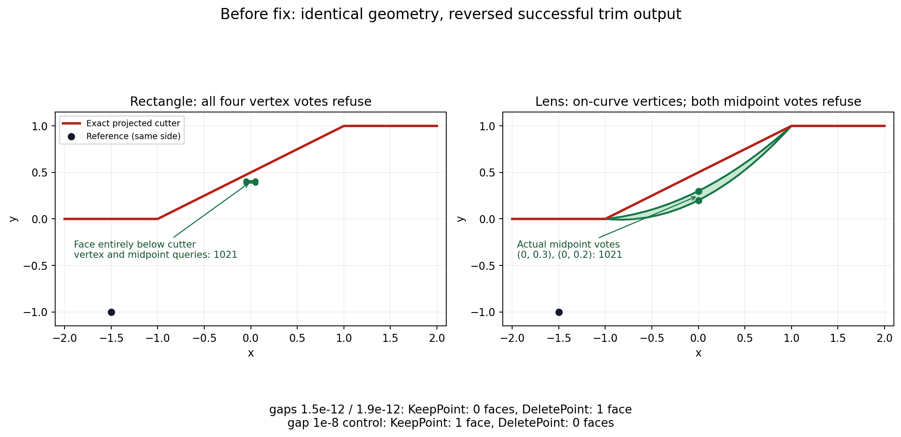

# Projected face votes must preserve certificate refusals

Issue: #3107. Construction: `topology::brep::p10::faces_to_delete`.

The existing raw-face fixtures have one face wholly below the diagonal cutter
segment from (-1,0,0) to (1,1,0). The reference point (-1.5,-1,0) is also on its
right side. Thus KeepPoint retains the face and DeletePoint removes it, or the
operation refuses when it cannot certify a required projection.

The rectangle has x in [-.05,.05], y in [.39,.41]; its distance below the
line y=(x+1)/2 is at least .065. The lens's two quadratic boundary curves have
control points below that line except for their endpoints on it. Bernstein
convexity proves their interiors lie below it. These are geometric checks,
independent of a golden's previous output.



The same view applies after the caller change: neither the cutter nor the face
is changed. The narrow-gap operation returns its certificate refusal rather
than deleting a face from an uncertified vote.

## Measured failure

At knot gaps 1.5e-12 and 1.9e-12, the rectangle's vertex and midpoint side
queries return NotWithinTolerance. The lens's endpoint queries return ordinary
on-curve ambiguity, while its midpoint queries return NotWithinTolerance.
Nevertheless both whole-face operations returned success with KeepPoint deleting
the face and DeletePoint retaining it. The four gap-1e-8 controls return the
geometrically correct KeepPoint/ DeletePoint face counts 1 / 0.

The vertex/midpoint errors and final trim outputs were replayed dynamically;
the precise final ray witness has not been instrumented. The source independently
shows all three vote sites used `ignored`, which erased certificate failures
before the ray ambiguity rule could choose the opposite reference side.

## Construction change

All three vote sites preserve the typed NotWithinTolerance error, including its
original payload. Other statuses retain the existing policy: ordinary on-curve
ambiguity remains an absent vote; cancellation, preparation and unported errors
still propagate. The reference vote already propagates errors directly.
No geometry, knot, solver tolerance or global error policy changes.

`projected_side_classification` replays the eight narrow-gap combinations and
four wider-gap controls through the public ProjectAndTrim API. The empty imprint
subset isolates classification: on a refused vote the original face remains.
This does not promise rollback of earlier imprint edits for a nonempty subset.

## Validation

The public regression failed against the parent construction before this caller
change: a narrow-gap operation returned success where the test required refusal.
The linked parent included the final-selection and directed-span minimum fixes;
its library SHA256 was
`b9697942d8f25fc6e4cf1d6f0b4d7203b9b926266573d6290cdb3ae859502ab9`.

Commands for the final source:

```sh
cargo test -p solidcore --test projected_side_classification
cargo test -p solidcore --lib projected_vote_preserves_refusal_and_control_signals
```

The public regression passes on the caller fix merged with parent `d3e2cfdc8`: all eight narrow-gap operations refuse, retain their original face in this classification-only setup, and all four wide-gap controls preserve the correct face count. Independent Linux validation at `ad59d6c20` passed the same classification matrix,
32 projected-query tests and eight caller-keyed operation tests. Scoped goldens:
`curve.curve_p1` 3102 unchanged; `curve.crv_on_surf` 2407 unchanged;
`topology.brep_p1` 2636 unchanged; `topology.brep_p10` 1436 cases with exactly
the eight narrow-gap changes below and zero broken. The four ordinary Defeature
cases are unchanged. The policy-unit test passed (one executed test), and
`cargo clippy -p solidcore --lib --tests -- -D warnings` passed. Formatting and
diff checks passed. The eight golden records below were copied from the actual
Linux runner output, asserting each complete old JSONL line before replacement;
no digest or numeric output was synthesized.

## Intended golden change

Exactly these eight checked-in golden cases change from the older successful
classification (KeepPoint: one face; DeletePoint: zero faces) to operation status
1021, retaining the original face. The intermediate strict parent before this
caller fix instead produced the reversed successful 0 / 1 counts shown above;
those wrong intermediate outputs were never blessed.

The runner stores operation status inside its encoded integer result, so its
top-level `error` field remains null. The public test directly checks the typed
operation error and proves classification-only refusal leaves the face present.

| fixture family | gaps | modes |
|---|---|---|
| `raw_vote_vertex` | `1.5e-12`, `1.9e-12` | `trim0`, `trim1` |
| `raw_vote_midpoint` | `1.5e-12`, `1.9e-12` | `trim0`, `trim1` |

The four gap-1e-8 controls must keep their successful face counts 1 / 0.
The ordinary `project_t0_Defeature_inset_cube`,
`project_t1_Defeature_inset_cube`, `project_t0_Defeature_brep1`, and
`project_tols_inset_cube` are independently handled by the parent's representable
minimum certificate; they must not be swept into this refusal justification.

